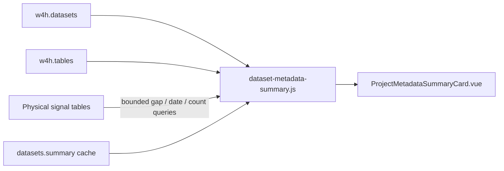

**Status:** Accepted  
**Date:** 2026-09-15  
**Relates to:** ADR-003 (table model), ADR-008 (GeoMTS), ADR-012 (project–dataset linking), ADR-019 (wear-compliance analytics cache), MVP §6.1 (D-02)  
**References:**
- [whats-new.md](../whats-new.md) — Project dataset overview (user-facing summary)
- [ADR-019](ADR-019-mets-wear-compliance-analytics.md) — wear CLI, `datasets.summary.wear_compliance` cache (writer not yet wired)
- [analytics-contributions.md](analytics-contributions.md) — WP4 wear cache write-back (future)

> **Note on scope:** The August 2026 draft of this ADR described a vendor-agnostic **basic dataset stats card** on the **Analytics** tab (`basic_stats` in `datasets.summary`). That card was not implemented. This ADR now records the **metadata summary** shipped on the project **Datasets** tab instead — overlapping subject count and date range goals via Scope/Subjects, but structured as import/registry metadata rather than an analytics dashboard card.

---

## Context

Researchers selecting a dataset in a project workspace need a structured answer to: *what is this dataset, how was it collected, and is it fit for analysis?* Before this work, project overview showed ad hoc stat tiles without a stable category model or field definitions.

MVP **D-02** (device type, sampling rate, subject count, date range) and **A-01** (summary dashboard) both need a researcher-facing surface. Wear compliance cohort metrics (ADR-019) belong in metadata context but must not re-run heart-rate scans on every project load — they project from cached per-subject rows when present.

Stakeholders asked for categories aligned to research questions (device, cadence, provenance, compliance, semantics), explicit **Unavailable** semantics for fields importers have not persisted, and info-icon tooltips defining every field.

---

## Decision

### 1. Surface and storage model

- Render **Metadata summary** on the project **Datasets** tab when one dataset is selected (`ProjectDatasetMasterDetail.vue` → `ProjectMetadataSummaryCard.vue`).
- **Compute on read** from `w4h.datasets`, `w4h.tables`, bounded physical-table reads (observed cadence, collection dates, enrolled count), and optional projection from `datasets.summary` (observations, wear compliance). **No new DB columns** for metadata v1.
- Attach `metadata_summary` on project dataset rows via `attachMetadataSummaries()` after registry hydration (`w4h-api/routes/projects.js`).



### 2. Seven researcher-facing categories

Replace the earlier **Provenance / Structural / Contextual** grouping with:

| Section | Research question |
|---------|-------------------|
| **Scope** | How much data is in this dataset and over what calendar span? |
| **Subjects** | Who is enrolled and what cohort demographics are known? |
| **Device** | What hardware and signals produced this data? |
| **Cadence** | At what interval was each signal captured or reported? |
| **Provenance** | How did this dataset enter W4H? |
| **Wear Compliance** | How well did participants follow the wear protocol? |
| **Semantic** | What do the variables mean (units, ontology)? |

Each section has a one-sentence category intro and per-field Bootstrap tooltips (`metadataFieldHelp.js`, `MetadataFieldLabel.vue`, `MetadataTile.vue`).

### 3. API contract (`metadata_summary`)

Builder: [`w4h-api/lib/dataset-metadata-summary.js`](../../w4h-api/lib/dataset-metadata-summary.js) — `buildMetadataSummary()`.

Top-level keys:

```json
{
  "scope": { ... },
  "subjects": { ... },
  "device": { ... },
  "cadence": { "signals": [ ... ] },
  "provenance": { ... },
  "compliance": { ... },
  "semantic": { "signals": [ ... ] }
}
```

Removed keys: `structural`, `contextual`, `temporal` (dataset-level dates live under **scope**; per-signal timing under **cadence**).

#### Scope

| Field | Source |
|-------|--------|
| `table_count` | `w4h.datasets.table_count` |
| `observations` | Cached `datasets.summary.observations` (approx flag supported) |
| `date_start` / `date_end` | Catalog dates, else merged from physical subjects table (`start_date`/`end_date`) and MIN/MAX on time-mapped signals |
| `study_length_days` | Inclusive day count when both dates present |

UI shows collection start/end as **month + year only**; study length uses full dates internally.

#### Subjects

| Field | Source |
|-------|--------|
| `enrolled_participants` | `COUNT(DISTINCT id)` on physical enrollment/subjects table; fallback `datasets.subject_count` |
| `participant_age` | `null` until demographics persisted |

#### Device

| Field | Source today |
|-------|--------------|
| `vendor` | Unique `source_name` from signals or `device_type` |
| `signal_types` | `mapping_json.signal_type` / table name per measurement signal |
| `model`, `sensor_specifications`, `firmware_os`, `anatomical_placement` | `null` → Unavailable until importer persists |

#### Cadence (per signal)

| Field | Source |
|-------|--------|
| `native_sensor_rate` | Registry / future importer field — `null` → Unavailable (not hard-coded missing) |
| `declared_interval` | `mapping_json.sampling_interval` when set |
| `observed_cadence` | Bounded timestamp-gap query (see §4) |
| `timezone` | `null` until persisted |

Native, declared, and observed cadence are **separate labeled fields** — never merged into one “sampling rate” column.

#### Provenance

| Field | Source today |
|-------|--------------|
| `origin`, `description` | Catalog |
| `ingestion_source` | Contribution run / audit when available |
| `sources[]` | Per-signal `source_name` / `source_url` (e.g. Fitbit API docs) |
| `package_vendor`, `package_format`, `package_version` | Importer cache when persisted |
| `api_payload_scheme`, `api_payload_version`, `data_state` | Reserved — Unavailable |

Provenance **Description** is not duplicated as a separate tile in the UI (catalog description remains on the dataset row elsewhere).

#### Wear Compliance (`compliance.wear_cohort`)

Aggregates cached per-subject wear rows — **does not** re-scan HR tables on metadata read. Source envelope (future writer; metadata v1 **reads only**):

```json
{
  "wear_compliance": {
    "protocol": {
      "daily_band_wear_percentage": 60,
      "overall_band_wear_percentage": 60,
      "daily_band_wear_hours": [["08:00", "20:00"]]
    },
    "subjects": [
      {
        "subject_id": "1",
        "start_date": "2018-06-01",
        "end_date": "2018-11-30",
        "overall_compliance_percentage": 75.0,
        "is_overall_compliant": true,
        "days_with_data": 90,
        "compliant_days": 68
      }
    ],
    "daily": [
      {
        "subject_id": "1",
        "date": "2018-06-01",
        "compliance_hours": 9.9,
        "compliance_percentage": 82.5,
        "is_daily_compliant": true
      }
    ]
  }
}
```

Field names align with `w4h-fitbit-wear-compliance` CSV output (`report.py` / `ComplianceAnalyzer`). The CLI currently writes files, not this jsonb — see ADR-019 WP4.

Display shape from `aggregateWearCohort()`:

```json
{
  "wear_cohort": {
    "subjects_compliant": 3,
    "subjects_total": 5,
    "compliance_pct": 60.0,
    "median_daily_wear_pct": 72.5,
    "median_days_worn": 6.0,
    "protocol": { ... }
  }
}
```

| Tile | Computation |
|------|-------------|
| Wear-compliant subjects | `count(subjects where is_overall_compliant)` of `subjects.length` |
| Cohort compliance rate | `(subjects_compliant / subjects_total) × 100` when total > 0 |
| Median daily wear | Median of all `daily[].compliance_percentage` across subjects/days |
| Median days wear | Median of per-subject `days_with_data`; fallback count of `daily[]` rows per subject when `days_with_data` absent |

**UI behavior:** all four tiles are **always visible**. Each tile shows **Unavailable** independently when its source data is missing. A muted helper line under the section suggests running `w4h-fitbit-wear-compliance` on the Analytics tab when no cohort cache exists. Per-subject drill-down stays on Analytics / notebook / CLI CSV — not in metadata v1.

`daily[]` is optional at rest but required for **median daily wear**; do not substitute subject-level overall %.

#### Semantic (per signal)

From `mapping_json.values[]`: variable name, unit, type, description, ontology code (Unavailable until persisted). UI shows full signal and variable descriptions (no line clamp); variable tiles are full row width.

### 4. Observed cadence (bounded compute)

For each time-mapped measurement signal, run a **bounded** gap query on the physical table:

1. Build timestamp expression from `mapping_json.time` (date+time combine, same idea as `sql-contribution-engine.js`).
2. Per subject: `gap_minutes = (ts - LAG(ts)) / 60`; drop non-positive gaps; bucket to nearest minute.
3. **Mode** = most frequent gap (+ count and share of gaps at mode) — reflects typical on-body reporting.
4. **max_gap_minutes** = largest sampled gap — labeled “largest gap”, not cadence (non-wear / sync / charging hint).
5. Cap gaps analyzed (e.g. 5,000 intervals per signal); set `approx: true` when capped.
6. Skip enrollment tables and signals without time mapping.

API shape per signal:

```json
{
  "signal": "heart_rate",
  "observed_cadence": {
    "mode_minutes": 1,
    "mode_count": 4820,
    "mode_pct": 96.4,
    "max_gap_minutes": 11,
    "gaps_sampled": 5000,
    "approx": true
  }
}
```

**Why mode, not median:** long gaps (device off-body) skew medians; mode reflects typical worn cadence while max gap carries the coverage hint separately.

### 5. Unavailable semantics

- `null`, empty string, or empty array → tile value **Unavailable** (muted styling).
- Tooltip appends: *“Not provided by the importer or not computed yet.”*
- Fields reserved for future importer persistence remain in the schema as `null` — not special-cased as permanently missing (e.g. native sensor rate).

### 6. Field definitions (single source)

Researcher-facing labels and definitions live in [`w4h-app/src/utils/metadataFieldHelp.js`](../../w4h-app/src/utils/metadataFieldHelp.js). Edit copy there only; UI reads via `fieldHelp(fieldKey)`.

### 7. Validation

- Unit/smoke: [`w4h-api/scripts/smoke-metadata-summary.mjs`](../../w4h-api/scripts/smoke-metadata-summary.mjs) — `aggregateWearCohort()`, Fitbit-shaped and ICDE-shaped `buildMetadataSummary()` fixtures.
- Manual: project → Datasets → select one dataset → verify seven sections, cadence rows, and wear tiles (Unavailable until cache written).

---

## Consequences

**Positive:**
- Stable, vendor-agnostic metadata model on the primary dataset selection surface.
- Expensive metrics (observations, wear cohort) read from cache; cadence uses bounded SQL, not full-table scans on list endpoints.
- Tooltips and category intros make Unavailable fields interpretable for researchers.

**Negative / risks:**
- Observed cadence recomputes on project load (not cached in `datasets.summary` v1) — may need caching if many large signals are linked.
- Wear compliance tiles stay Unavailable until ADR-019 WP4 writes `wear_compliance` into `datasets.summary`.
- Many provenance and device slots remain Unavailable for sample importers until manifest persistence work lands.

---

## Out of scope (future work)

- Persist manifest fields (vendor package identity, firmware, timezone, ontology, native sensor rate, data state).
- Cache observed cadence under `datasets.summary`.
- **Write** per-subject wear rows via extended `POST /datasets/:id/summary/refresh` or contribution write-back.
- Participant age from demographics tables.
- Analytics-tab **basic_stats** card from the August 2026 draft (separate track if still needed).
- Admin Datasets edit / dataset details modal parity with metadata summary.

---

## Alternatives not chosen

- **Three buckets (Provenance / Structural / Contextual)** — rejected; researchers think in device/cadence/compliance/semantic terms.
- **Exact `COUNT(*)` on every metadata read** — rejected; observations and row totals use cache or bounded estimators.
- **Re-run ComplianceAnalyzer on metadata read** — rejected; project from cached per-subject rows only.
- **Single combined “sampling rate” field** — rejected; native, declared, and observed must stay distinct.
- **Hide wear section behind one Unavailable block** — rejected; four tiles always render with per-tile Unavailable.

---

## Changelog

| Date | Change |
|------|--------|
| 2026-08-18 | Initial draft — basic dataset stats card on Analytics tab (`basic_stats` cache). |
| 2026-09-15 | **Accepted** — rewritten to document shipped **metadata summary** on project Datasets tab (seven categories, compute-on-read, wear cohort aggregation). Basic stats Analytics card deferred. Wear tile set: compliant subjects, cohort rate, median daily wear %, median days wear. |
