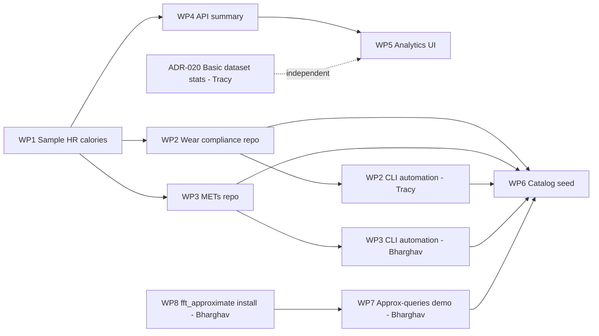

**Status:** Active handoff  
**ADR:** [ADR-019 — METs and wear-compliance analytics](ADR-019-mets-wear-compliance-analytics.md)  
**MVP:** §6.2 (D-14), §10 (A-01a, A-04, A-04a–c), milestone **M3**  
**Target:** September 2026 (M3)

**August update:** WP1–WP3 (extended Fitbit sample, wear-compliance notebook, METs notebook) were smoke-tested end to end during 0.3.0 Peña Roja — data import + both notebooks run manually against a test dataset using a personal **API key** ([ADR-007](ADR-007-authentication-model.md)), via the `w4h-docker` Jupyter Lab service. See [august-2026-release-plan.md](august-2026-release-plan.md#m3-notebooks-august-smoke-test-ahead-of-productization). WP4–WP6 (API cohort summary, Analytics tab UI, catalog seed) are unaffected — still **September (M3)**.

This page is the **operator checklist for RAs**. Product requirements live in [MVP](mvp.md); architecture in ADR-019.

---

## Goal

Ship **device wear compliance** and **METs** analysis for Fitbit-style datasets:

1. **Contributions** — two catalog notebooks RAs can run locally or in Docker Jupyter
2. **In-app** — basic cohort stats on the project **Analytics** tab (Users + Admins)
3. **Sample data** — extend the public Fitbit sample so demos and sandbox have HR + calories
4. **Automation** — CLI entry point on each analytical notebook repo (`kinds: notebook, cli`), parity with [`w4h-sample-fitbit-csv-importer`](https://github.com/USC-InfoLab/w4h-sample-fitbit-csv-importer)'s `import`/`sync` pattern, so a Team admin can run these on cron, not only interactively
5. **Approximate queries demo** — new notebook (`w4h-demo-approximate-queries`) showing `fft_approximate` range-aggregate queries against the sample dataset

**Adjacent, separate track:** [ADR-020](ADR-020-basic-dataset-stats-dashboard.md) — a vendor-agnostic basic dataset stats card (subject count, date range, device types, size) for **any** dataset, not gated on Fitbit-shaped signals. Assigned here (Tracy) because it shares the Analytics tab surface, but has no dependency on WP1–WP4 below.

---

## What already exists (do not reinvent)

| Asset | Location | Reuse |
|-------|----------|--------|
| Wear compliance logic | [`w4h-notebooks/compliance_analyzer.py`](../../w4h-notebooks/compliance_analyzer.py) | Port `ComplianceAnalyzer` class |
| Legacy notebook | [`w4h-notebooks/band_wear_compliance.ipynb`](../../w4h-notebooks/band_wear_compliance.ipynb) | Reference UX; fix stale cells |
| Fitbit sample + importer | [`w4h-sample-fitbit-csv`](../../w4h-sample-fitbit-csv), [`w4h-sample-fitbit-csv-importer`](../../w4h-sample-fitbit-csv-importer) | Extend manifest; mirror repo layout |
| Contributions pattern | [ADR-018](ADR-018-contributions-catalog.md), [`w4h-load-json`](../../w4h-load-json) | Notebook + `.env` + API ingest |
| Dataset summary cache | `w4h.datasets.summary` jsonb ([MVP A-01](mvp.md)) | Add `wear_compliance`, `mets_summary` keys |

**Not wear compliance:** [HIPAA Compliance](../guide/hipaa-compliance.md), admin Usage KPIs.

**Not metabolic METs:** [`fft_approximate`](../../fft_approximate) (Postgres FFT extension).

---

## Gap summary

| Gap | Owner workstream |
|-----|------------------|
| No `heart_rate` / `calories` in Fitbit sample | WP1 |
| No catalog repo for wear compliance | WP2 |
| No MET derivation code | WP3 |
| Analytics tab is placeholder | WP5 |
| No API cohort aggregates | WP4 |
| Catalog rows missing | WP6 |
| No CLI automation on wear-compliance / METs repos (notebook-only today) | WP2, WP3 |
| No demo of `fft_approximate` against ingested data | WP7 |
| `fft_approximate` install path undocumented for `w4h-docker` | WP8 |
| No vendor-agnostic basic dataset stats card (Analytics tab empty for non-Fitbit datasets) | ADR-020 |

---

## Work packages (assign to RAs)

### WP1 — Extend Fitbit sample (prerequisite)

**Repos:** `w4h-sample-fitbit-csv`, `w4h-sample-fitbit-csv-importer`

| Task | Acceptance criteria |
|------|---------------------|
| Add `data/fitbit_heart_rate.csv` | Synthetic rows for existing subject ids; columns documented in manifest |
| Add `data/fitbit_calories.csv` | Same; include optional `mets` column on subset for WP3 validation |
| Update `manifest.yaml` | `heart_rate` + `calories` signals with GeoMTS mapping (subject, time, values) |
| Update importer | `_dedupe_columns_for_signal` for new slugs; `import_all` loads 4 signals |
| Tests | `test_manifest.py` asserts 4 signals; CSV files exist |

**Reference manifest signals:** existing `subjects`, `weight` in [`w4h-sample-fitbit-csv/manifest.yaml`](../../w4h-sample-fitbit-csv/manifest.yaml).

---

### WP2 — `w4h-fitbit-wear-compliance` (new repo)

**Port from:** `w4h-notebooks/compliance_analyzer.py`

| Task | Acceptance criteria |
|------|---------------------|
| Package layout | `pyproject.toml`, `w4h_fitbit_wear_compliance/`, `tests/`, `.env.example` |
| README | Protocol windows, HR-as-wear-proxy assumption, required signals (`heart_rate`, `subjects`), db-token read steps |
| Notebook | Config via env; per-subject daily + overall compliance table; CSV export |
| **CLI automation** (`w4h-fitbit-wear-compliance report ...`) | `[project.scripts]` entry point, parity with importer `import`/`sync`; cron-friendly; `W4H_API_KEY` from env, never hardcoded — **owner: Tracy** |
| Unit tests | Fixtures from WP1 sample CSVs; known compliant / non-compliant subjects |
| No direct Postgres credentials in git | API key + db-token only ([ADR-007](../dev/ADR-007-authentication-model.md)) |

**Expected catalog row:** slug `w4h-fitbit-wear-compliance`, kinds `notebook` + `cli`, language `python`.

---

### WP3 — `w4h-compute-mets` (new repo)

**New code** (formula documented in README):

```
METs ≈ calories / (weight_kg × 0.25)
```

Document: interval (e.g. per Fitbit calories row), missing weight → last-known or default, synthetic validation rows from WP1.

| Task | Acceptance criteria |
|------|---------------------|
| Module + notebook | Join calories + weight; output MET series per subject |
| **CLI automation** (`w4h-compute-mets compute ...`) | `[project.scripts]` entry point, parity with importer `import`/`sync`; cron-friendly; `W4H_API_KEY` from env — **owner: Bharghav** |
| Optional write-back | Append `mets_computed` signal via `POST /datasets/:id/import/csv-batch` (document in README); CLI exposes `--write-back` flag |
| Unit tests | Match synthetic `mets` column within tolerance on fixture rows |
| README | Formula, assumptions, limitations (not medical advice) |

**Expected catalog row:** slug `w4h-compute-mets`, kinds `notebook` + `cli`, language `python`.

---

### WP4 — API cohort summary (`w4h-api`)

| Task | Acceptance criteria |
|------|---------------------|
| `lib/dataset-cohort-summary.js` (or similar) | Bounded queries on mapped HR/calories tables; wear + MET aggregates |
| Extend `hydrateDatasetSummaries` / refresh | Merge `wear_compliance`, `mets_summary` into `datasets.summary` |
| `POST /datasets/:id/summary/refresh` | Team admin+; returns updated summary; audited |
| No list-endpoint full scans | Use limits / sampling; cache results |

**Summary JSON shape (draft):**

```json
{
  "wear_compliance": {
    "subjects_total": 5,
    "subjects_compliant": 3,
    "median_daily_wear_pct": 72.5,
    "protocol": { "daily_threshold_pct": 60, "windows": ["08:00-20:00"] }
  },
  "mets_summary": {
    "signal": "mets_computed",
    "subjects_with_data": 4,
    "cohort_mean_mets": 1.8,
    "cohort_met_hours_per_day": 12.3
  }
}
```

---

### WP5 — Analytics tab UI (`w4h-app`)

| Task | Acceptance criteria |
|------|---------------------|
| Replace placeholder in [`ProjectHub.vue`](../../w4h-app/src/components/project/ProjectHub.vue) Analytics section | Cohort stat cards when linked dataset has summary |
| Subject filter (A-04b) | Dropdown or pick-list when multiple subjects in summary |
| Contributions link | Admins see link to wear + METs catalog entries |
| Viewer parity | Same stats visible to Users ([A-07](mvp.md)) |

Reuse patterns from [`ProjectDatasetMasterDetail.vue`](../../w4h-app/src/components/project/ProjectDatasetMasterDetail.vue) for summary parsing.

---

### WP6 — Catalog + docs

| Task | Acceptance criteria |
|------|---------------------|
| Seed `w4h.contributions` in [`w4h-api/data/schema.sql`](../../w4h-api/data/schema.sql) | Three new rows when repos are public (wear compliance, METs, approximate-queries demo) |
| Update [Contributions guide](../guide/sample-packages.md) | List new tools under planned first-party |
| Super admin smoke test | Browse `/contributions`; README renders from public GitHub |

---

### WP7 — `w4h-demo-approximate-queries` (new repo)

**Owner: Bharghav.** Demonstrates the [`fft_approximate`](../../fft_approximate) Postgres extension against the (extended) Fitbit sample dataset.

| Task | Acceptance criteria |
|------|---------------------|
| Package layout | `pyproject.toml`, `notebook/`, `tests/`, `.env.example` (same shape as the other Contributions) |
| README | Extension prerequisite (install on your Postgres before running), what "approximate" means and its error bounds, not a replacement for exact aggregates |
| Notebook | Approximate range-aggregate query on `heart_rate` (or `calories`) vs. exact query, side by side, timing/accuracy comparison |
| Notebook-only | Kind is `notebook` only — no CLI; this is illustrative, not an operational tool |

**Expected catalog row:** slug `w4h-demo-approximate-queries`, kind `notebook`, language `python`.

---

### WP8 — Docker: Jupyter Lab verification + `fft_approximate` install path

**Owner: Bharghav.** Extends the August smoke test ([august-2026-release-plan.md](august-2026-release-plan.md#m3-notebooks-august-smoke-test-ahead-of-productization)) from ad hoc to documented.

| Task | Acceptance criteria |
|------|---------------------|
| Verify `w4h-docker` `notebooks` Jupyter Lab runs WP2 + WP3 (and WP7) notebooks | Same token/URL flow as the Fitbit importer; note any gaps in [guide/docker-deployment.md](../guide/docker-deployment.md) |
| Document `fft_approximate` install path for Docker users | Since Postgres is external to `w4h-docker` ([ADR-015](ADR-015-docker-deployment-packaging.md)), document the extension install step against that external Postgres before WP7's notebook can run |
| No bundled Postgres change | Do not add a Postgres service to `w4h-docker`'s Compose — stays external per current architecture |

---

## Phasing

| Phase | When | Deliverables |
|-------|------|--------------|
| **P0** | First (done) | WP1 + WP2 + WP6 (sample + wear repo + catalog draft) — smoke-tested August 2026 |
| **P0.5** | August 2026 | WP2/WP3 CLI automation, WP7 (approximate-queries demo), WP8 (docker verification + `fft_approximate` install), ADR-020 (basic dataset stats) — see [Assignments](#assignments-august-2026) |
| **P1** | Same sprint | WP3 (METs repo) — notebook smoke-tested August; CLI in P0.5 |
| **P2** | M3 (September) | WP4 + WP5 (API + UI cohort cards) |
| **P3** | Later M3 | A-02 charts, A-06 export (separate RA track) |

---

## Dependencies



---

## Assignments (August 2026)

Hours are RA effort budget for this cycle, not full-time; ETAs in [Timeline](#timeline-august-2026) assume part-time sessions.

| RA | Hours | Tasks |
|----|-------|-------|
| **Tracy** | 10h | WP2 CLI automation for `w4h-fitbit-wear-compliance` (`report`/`sync`); [ADR-020](ADR-020-basic-dataset-stats-dashboard.md) in-app basic dataset stats card on the Analytics tab |
| **Bharghav** | 20h | WP8 (Jupyter Lab verification in `w4h-docker` + `fft_approximate` install path); WP3 `w4h-compute-mets` notebook + CLI automation; WP7 `w4h-demo-approximate-queries` notebook |

---

## Timeline (August 2026)

ETAs calibrated against actual commit cadence on this project (`git log`, all repos): during the active pre-0.3.0 push (2026-08-11 → 2026-08-17) the team shipped roughly **1–3 substantive commits per repo per active day**. RA hours are part-time (assume ~5h focused sessions, 1–2 sessions/week), so each row below is sized to one session.

| Deliverable | Owner | Hours | ETA | Depends on |
|---|---|---|---|---|
| WP8a — Jupyter Lab verified for wear-compliance + METs notebooks in `w4h-docker` | Bharghav | 5h | Thu 2026-08-20 | WP1 (done), WP2/WP3 notebooks (smoke-tested) |
| WP2 CLI automation (`w4h-fitbit-wear-compliance report`/`sync`) | Tracy | 5h | Fri 2026-08-21 | WP2 notebook (exists) |
| WP8b — `fft_approximate` install path documented for `w4h-docker` | Bharghav | 5h | Mon 2026-08-24 | none |
| WP3 `w4h-compute-mets` notebook hardening + CLI automation | Bharghav | 5h | Thu 2026-08-27 | WP1 (done) |
| ADR-020 basic dataset stats card on Analytics tab | Tracy | 5h | Fri 2026-08-28 | none (independent of WP4) |
| WP7 `w4h-demo-approximate-queries` notebook | Bharghav | 5h | Tue 2026-09-01 | WP8b |

**Total:** Tracy 10h over ~2 weeks; Bharghav 20h over ~2 weeks. Lands just ahead of the M3 / September window ([mvp.md §17](mvp.md#17-delivery-timeline)) without pulling WP4/WP5 forward.

---

## Out of scope for RAs (unless explicitly assigned)

- HIPAA audit / Usage dashboard metrics
- Spark batch (M6)
- In-app time-series charts (A-02)
- Storing notebook outputs in platform DB (ADR-018)

---

## Verification checklist (PI / lead)

- [x] Import extended Fitbit sample into a test dataset; four signals in catalog — smoke-tested August 2026, via `w4h-docker` Jupyter Lab + API key
- [x] Run wear-compliance notebook → per-subject report CSV — smoke-tested August 2026, same run
- [x] Run METs notebook → derived series; optional write-back — smoke-tested August 2026, same run
- [ ] Run `w4h-fitbit-wear-compliance` via its CLI (not just the notebook) — Tracy, WP2
- [ ] Run `w4h-compute-mets` via its CLI (not just the notebook) — Bharghav, WP3
- [ ] Run `w4h-demo-approximate-queries` against the sample dataset in `w4h-docker` Jupyter Lab — Bharghav, WP7/WP8
- [ ] Basic dataset stats card renders on Analytics tab for a non-Fitbit-shaped dataset — Tracy, ADR-020
- [ ] Analytics tab shows wear + MET cohort cards after summary refresh
- [ ] Contributions catalog lists all three tools with working README links
