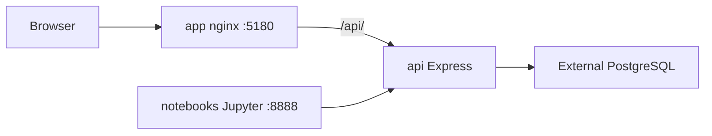

**Status:** Active  
**Release:** **0.3.0** — **🧗 Peña Roja** (August 2026)  
**User-facing notes:** [What's New](../whats-new) · [Release archive](../releases/archive)

This page is the **operator checklist** for August. Product requirements and milestone tracking remain in [MVP](mvp.md).

---

## Naming conventions

W4H uses **two parallel naming layers** — do not conflate them.

| Layer | Pattern | August 2026 example |
|-------|---------|---------------------|
| **Semver** | `MAJOR.MINOR.PATCH` on `w4h-app` + `w4h-api` `package.json` | `0.3.0` |
| **Release codename** | Short phrase + optional emoji in `releaseName`; About modal + What's New | `🧗 Peña Roja` |
| **Git tag** | `v` + semver on each repo that ships | `v0.3.0` |
| **Monthly archive** | `releases/YYYY-MM.md` → `/docs/2026-08` | Move `whats-new.md` at start of September |
| **MVP milestones** | `M1`…`M9` in [mvp.md](mvp.md) §17 — delivery phases, not monthly releases | M3 = basic cohort dashboards + wear/MET contributions (September) |

### Codename pattern (established)

| Month | Codename | Semver era |
|-------|----------|------------|
| July 2026 | Venga! | `0.2.x` |
| **August 2026** | **Peña Roja** | **`0.3.0`** |
| September 2026+ | TBD when bumping minor | `0.4.0` |

**Convention:** one memorable word or short phrase (often Spanish or outdoor/climbing themed); optional leading emoji (🧗 climb, etc.). Update `releaseName` in **both** `w4h-app` and `w4h-api` when the codename changes.

### Docker / registry naming (Dep-04, milestone M5)

| Artifact | Suggested name |
|----------|----------------|
| Registry | `ghcr.io/usc-infolab/` ([ADR-015](ADR-015-docker-deployment-packaging.md)) |
| Images | `w4h-app`, `w4h-api`, `w4h-notebooks` |
| Tags | `0.3.0`, optional `0.3.0-pena-roja`, `latest` on default branch only after GA |
| Compose repo | `w4h-docker`; pin image tags in compose for releases |

August ships **build-from-source** via `w4h-docker`; registry tags target **October (M5)** unless pulled forward.

### Contribution repo naming ([ADR-016](ADR-016-paired-sample-importer-repos.md))

- Sample data: `w4h-sample-<vendor>-<format>`
- Importer: `w4h-sample-<vendor>-<format>-importer`
- Single-purpose notebooks: `w4h-load-<format>`
- Wear / MET analytics (M3): `w4h-fitbit-wear-compliance`, `w4h-compute-mets` ([ADR-019](ADR-019-mets-wear-compliance-analytics.md))
- Approximate-query demo (M3): `w4h-demo-approximate-queries` ([ADR-019](ADR-019-mets-wear-compliance-analytics.md))

---

## Scope decision (August 2026)

| Track | August | Notes |
|-------|--------|-------|
| **Monthly release 0.3.0 Peña Roja** | **Ship** | Platform, Contributions, AI chat, dataset overview, Docker prototype |
| **M3 analytics (A-01a, A-04, A-04a–c, A-07)** | **Defer to September** — except a slice pulled into August (below) | 0% in MVP; RA handoff: [analytics-contributions.md](analytics-contributions.md) · [ADR-019](ADR-019-mets-wear-compliance-analytics.md) |
| **Notebook CLI automation + basic dataset stats (ADR-019 automation, ADR-020)** | **Ship in August** (continues past the 0.3.0 cut) | Tracy (10h) + Bharghav (20h); timeline: [analytics-contributions.md § Timeline](analytics-contributions.md#timeline-august-2026) |
| **M5 Docker registry (Dep-04)** | **Defer to October** | Prototype + build-from-source docs suffice |
| **M9 community launch** | March 2027 | Full governance + tutorials |

---

## Docker test deployment

**Yes — local prototype; not a hosted test environment.**

[`w4h-docker`](https://github.com/USC-InfoLab/w4h-docker) ships standalone Compose per [ADR-015](ADR-015-docker-deployment-packaging.md). Setup: [Docker Deployment](../guide/docker-deployment).

| Service | Role |
|---------|------|
| `app` | Vue UI + nginx (only public port) |
| `api` | Express API, auth, docs import, audit |
| `notebooks` | Convenience Jupyter + Fitbit CSV importer contribution |

**Included:** working Compose, Dockerfiles, entrypoint, user guide (status: **Prototype**).

**Not included:** bundled Postgres, cloud/staging URL, published registry images (Dep-04), CI workflows. Legacy `uscimsc/w4h:icde-demo` is **not** this stack.

### M3 notebooks — August smoke test (ahead of productization)

**Status:** Ad hoc verification during Peña Roja, not the M3 deliverable — API/UI productization is still deferred (see scope table above).

RAs ran the [ADR-019](ADR-019-mets-wear-compliance-analytics.md) notebooks end to end in August using a personal **API key** ([ADR-007](ADR-007-authentication-model.md)) against a test dataset:

1. **Data import** — Fitbit CSV importer notebook, per [Docker Deployment](../guide/docker-deployment.md) §6.
2. **Sample data** — the extended Fitbit sample (`heart_rate` + `calories`, WP1 in [analytics-contributions.md](analytics-contributions.md)) supplied the rows.
3. **Wear compliance + METs notebooks** — `w4h-fitbit-wear-compliance` and `w4h-compute-mets` (WP2/WP3), run against the imported sample.
4. **Jupyter Lab in `w4h-docker`** — same `notebooks` service / token flow as the importer; confirms the Docker prototype can run all three notebooks, not only the shipped importer.

**Not covered by this smoke test:** API cohort summary (WP4), Analytics tab cards (WP5), catalog seeding (WP6) — those stay **M3 / September**.

### Free deployment?

Self-host for free — no W4H-managed free tier. Researchers provide Docker and **external PostgreSQL**. Build images locally until Dep-04 lands.

---

## Repositories — public visibility

Verified **2026-08-17**:

### Already public
- `w4h-sample-fitbit-csv`, `w4h-sample-fitbit-csv-importer`, `w4h-load-json`, `fft_approximate`, `w4h-datasets` (legacy)

### Must go public for 0.3.0 (private today)

| Repo | Why |
|------|-----|
| **`w4h-docs`** | Help, FAQ, Issues, release notes |
| **`w4h-app`** | About modal → GitHub Issues |
| **`w4h-api`** | About modal → Issues; self-host backend |
| **`w4h-docker`** | Clone + build instructions |

### Defer to M9
- `w4h-utils`, `w4h-notebooks` (legacy index; [ADR-018](ADR-018-contributions-catalog.md))

[ADR-018](ADR-018-contributions-catalog.md): contribution READMEs are fetched from **public** GitHub; first-party contribution repos are already public.

---

## Release checklist

1. **Public repos** — flip four core repos; secret-scan before making public
2. **Tag `v0.3.0`** — `w4h-app`, `w4h-api`, `w4h-docs`, `w4h-docker`
3. **Pilot deploy** — set `APP_URL`; Super admin **Refresh Help**
4. **Verify Contributions** — README rendering for all seeded rows in `w4h.contributions`
5. **Close in-progress August features** — AI chat modes, Contributions polish, dataset share/discoverable, samples sandbox D-30
6. **Docker smoke test** — compose up → DB wizard → Super admin → API key → Fitbit importer notebook → wear-compliance + METs notebooks (ADR-019, see [M3 notebooks smoke test](#m3-notebooks-august-smoke-test-ahead-of-productization))

### In progress (impl 🚧 in MVP)

| Area | Key reqs |
|------|----------|
| PHI-safe AI chat | AI-01, AI-03, AI-04, AI-02c |
| Contributions catalog | D-14, D-25, D-26, D-27 |
| Dataset catalog/sharing | D-07, D-23, D-24, S-01–S-07 |
| Per-team roles | R-03, R-08, R-09, T-07–T-14 |
| Project dataset overview | A-01 |
| Notebook CLI automation + basic dataset stats (Tracy/Bharghav, Aug) | D-14, A-01, A-04 — [ADR-019](ADR-019-mets-wear-compliance-analytics.md), [ADR-020](ADR-020-basic-dataset-stats-dashboard.md) |
| Samples sandbox | D-28; D-30 still Todo |

### Not August (carry-over)

Ingestion UI (D-09–D-11), platform access requests (T-16–T-18), HIPAA hardening (H-03–H-09), API key TTL (D-17, D-20), REDCap (M7).

---

## Timeline

| Track | Window | MVP | August status |
|-------|--------|-----|----------------|
| Peña Roja release (0.3.0) | Aug 2026 | Monthly release | Ship — docs, Contributions, AI, Docker prototype |
| Docker prototype (`w4h-docker`) | Aug 2026 | Dep-01 (prototype); M5 Oct | Active — build from source |
| M1 / M2 carryover | May–Aug 2026 | M1, M2 | In progress — sharing, roles, ingest gaps remain |
| M3 analytics (A-01a, A-04, A-04a–c) | Sep 2026 | M3 | **Defer** — [analytics-contributions.md](analytics-contributions.md) for RA tasks |
| M5 Docker registry (Dep-04) | Oct 2026 | M5 | **Defer** — GHCR images after August |
| M9 community launch | Mar 2027 | M9 | Planned — full public release + governance |

Interactive program Gantt (same Mermaid syntax as [MVP §17](mvp.md#17-delivery-timeline)): open **MVP → Delivery Timeline** in Help. Cursor’s Markdown preview does not render `gantt` blocks reliably; the table above is the canonical view for this page.

---

## Priority order

1. Make core four repos **public**
2. Tag and deploy **v0.3.0**; refresh Help
3. Close highest-visibility **🚧** items (sharing, Contributions, AI)
4. Docker smoke test; document **prototype / build from source**
5. Record **M3 deferral** in [mvp.md](mvp.md) §17 — done; September target + [analytics-contributions.md](analytics-contributions.md) for RAs
