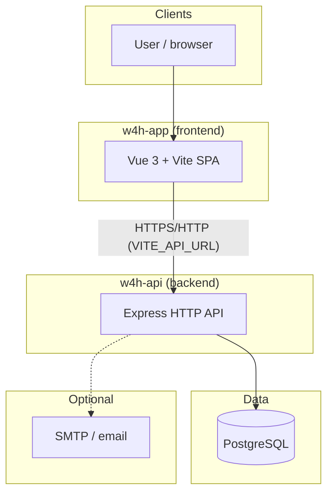
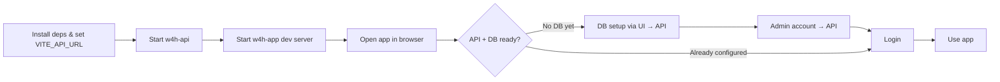

## System architecture



**Summary:** The browser loads the SPA. The SPA talks only to the API (via `VITE_API_URL`). The API owns database access and optional outbound email.

**Core team (USC-InfoLab / w4h-toolkit):** how we coordinate new repos, cross-repo PRs, catalog, releases, and GitHub org admin — [Core team workflow](core-team-workflow.md). External module authors use [Contribute a module](../guide/contribute-a-module.md) instead.

---

## First-time setup workflow

Until the API and database are configured, the UI may guide you through database connection and admin creation (handled by **w4h-api** endpoints, not by direct DB access from the browser):



---

## Run the whole stack locally (from zero)

**Prerequisites:** Node.js 22+ (the Docker image uses 22); a running **PostgreSQL 15+ server** (Postgres.app, or `brew install postgresql@16 && brew services start postgresql@16`; pgAdmin is only a client and does not start a server); **Python 3.10+** as `python3` for contributions (macOS's bundled `python3` is 3.9, which is too old); git; optionally Docker Desktop and `gh`.

1. **Clone** every repo into one parent folder: `git clone git@github.com:USC-InfoLab/<repo>.git`. The API finds contributions at `../<slug>` and docs at `../w4h-docs`, so the sibling layout matters.
2. **Create a Postgres login role** that can create databases (not a superuser):
   ```sql
    CREATE ROLE w4h_dev LOGIN PASSWORD 'choose-one' CREATEDB;
   ```
3. **Start the API:** `cd w4h-api && cp .env.example .env && npm install && npm start` (port 2026). In `.env` set `APP_URL=http://localhost:5173` so invitation links work. Leave `DB_USER`, `DB_PASSWORD` and `TOKEN_SECRET` empty to let the first-run wizard fill them. If you pre-fill `DB_`* yourself, also set `TOKEN_SECRET` (`node -e "console.log(require('crypto').randomBytes(64).toString('hex'))"`): the wizard only generates it during its database step.
4. **Start the app:** `cd w4h-app && cp .env.example .env && npm install && npm run dev`, then open `http://localhost:5173`.
5. **First-run wizard:** connect the database (host `localhost`, port `5432`, database `w4h-db`, your role), then create the **Super admin** (password at least 12 characters). Copy the `w4h_sk_...` key shown once on the next screen. You land on Platform Admin (`/admin/home`).
6. The schema (`data/schema.sql`) is re-applied idempotently on every API start, and Help is imported from `DOCS_REPO_PATH`. To redo the wizard, unset `DB_DATABASE` in `w4h-api/.env` and restart; drop the database in pgAdmin for a truly clean start.

**Shortcut for role testing:** `cd w4h-api && node bin/w4h seed-docs && npm run start:sample` creates a separate `w4h-sample` database with Super admin `superadmin@example.com`, Admin `admin@example.com` (owner of project **Wearable Pilot**) and User `user@example.com`, all with password `DocsOnly!2026`. It never touches `DB_DATABASE`. Switch back with `npm start`.

Default ports: API `2026`, Vite dev server `5173`, Docker app `127.0.0.1:5180`, Docker Jupyter `127.0.0.1:8888`.

## Get a personal API key

- A key is shown **once**: after creating the initial Super admin, and after accepting an invitation. Copy it then.
- Help pages say "Profile → API keys", but no screen for it is mounted on `w4h-app` `main`. The Generate/Rotate UI exists in `src/components/project/ProjectUserPanel.vue`, which nothing renders. To get a new key, rotate through the API (this invalidates the old key):
  ```bash
  TOKEN=$(curl -s http://localhost:2026/users/login -H 'Content-Type: application/json' \
    -d '{"email":"you@example.com","password":"..."}' | python3 -c 'import sys,json;print(json.load(sys.stdin)["token"])')
  curl -s -X POST http://localhost:2026/users/me/api-key -H "Authorization: Bearer $TOKEN" \
    -H 'Content-Type: application/json' -d '{"password":"..."}'      # response has api_key
  ```
- In-app **Run** does not need you to copy a key: the runner uses (or issues) your key server-side.
- Use it as `Authorization: Bearer w4h_sk_...` or the `x-w4h-api-key` header; store it as `W4H_API_KEY` in a contribution repo's `.env`. Never commit it.

## Test personas, invites and the onboarding path

- **Super admin cannot also be a team or project member** (`"Super admins are not added as team members..."`, `"Platform admin accounts are not project members."`). Use separate emails for Admin and User, e.g. `you+admin@gmail.com` and `you+user@gmail.com`.
- **No SMTP needed locally:** inviting still creates the invitation and the UI shows the link with "SMTP is not configured; share the invitation link...". Open it in a private window (it expires after `INVITE_TTL_HOURS`, default 72). Login codes and the **Request access** flow do need SMTP.
- **Typical end-to-end check:** Super admin invites an Admin → Admin accepts in a private window and creates a team (current `w4h-app` `main` prompts "Create your team" on first sign-in; older checkouts lack that screen, so the Super admin creates the team at `/admin/teams/add` and picks it when inviting) → creates a project → adds two empty catalog datasets and links them → **Run import...** with the Fitbit importer on one and the ICDE importer on the other → invites a User as `editor` → confirms the User can see data but has no **Run import...** button. Then Analytics → **Run analysis...** → Compute METs (SQL).
- **Expected sample sizes:** Fitbit loads 5 subjects, 70 weight rows, 165,588 heart-rate rows and 1,215,360 calories rows (takes a while). ICDE loads 3 subjects across 7 signal types; its importer reports 1,728 GPS rows as vendor-spec misfits (deliberate; rows are still imported).
- **Check what ingest registered:** `SELECT name, physical_schema, physical_table, mapping_json->>'sampling_interval' FROM w4h.tables WHERE dataset_id = '<id>';`

## Troubleshooting

| Symptom | Cause and fix |
|---|---|
| `connection refused` on 5432 | No Postgres server is running. Start Postgres.app or `brew services start postgresql@16` |
| `User '...' does not have CREATEDB privilege` | `ALTER ROLE w4h_dev CREATEDB;` |
| `secretOrPrivateKey must have a value` when creating the admin | `TOKEN_SECRET` is empty. Set it, restart the API. The admin row was probably created already, so log in instead of re-running "Create" |
| `Postgres.app rejected "trust" authentication` | Postgres.app → Preferences → permissions → allow `node`, restart the server |
| Login fails but the request shows HTTP 200 | `POST /users/login` returns 200 with `{ "error": { "message": ... } }` on bad credentials. Check the body |
| Setup wizard reappears | `DB_DATABASE` missing from `.env`; in Docker, the API read settings too early: restart the `api` container |
| **Run import...** missing | You are a User (only team admins/project owners see it); the contribution is not `published` + `runnable` on this database; the dataset is read-only or archived |
| Run fails: `run.sh not found` or "Could not prepare ...'s repository" | Sibling clone missing and the runner could not clone it (network, `repo_url`). Clone it next to `w4h-api` or set `CONTRIBUTION_RUNNER_REPO_ROOT` |
| Run fails during `pip install` (Python version) | The API process found Python < 3.10. Install 3.10+, delete `<contribution>/.venv`, restart `npm start` from a shell where `python3 --version` is 3.10+ |
| Run log shows 403 | Your user lacks ingest rights on that dataset's team, or the dataset is a read-only sample |
| `SQL contribution checkout missing` | Clone `w4h-sql-compute-mets` next to `w4h-api` |
| METs job complains about the interval | Dataset was ingested without `sampling_interval`; re-ingest or pass `interval_minutes` |
| Dataset still shows "Needs ingest" after a successful run | Check `w4h.tables.physical_schema` / `physical_table` (see the ADR-022 changelog) |
| Help pages empty | Wrong `DOCS_REPO_PATH`; Platform Admin → Settings → Documentation Management → **Refresh Docs** |
| Docs screenshots hit the wrong app | Use `http://127.0.0.1:5173`, not `localhost`, when something else binds `[::1]:5173` |

## Testing and validation

No repo has CI. Local checks are the only gate.

| Repo | Checks |
|---|---|
| `w4h-api` | `npm test` is a stub. Real: `node --test lib/sql-ident.test.js`; `node scripts/smoke-test-csv-batch-insert.mjs` (creates and drops its own scratch dataset); curl the changed endpoints with a JWT or API key |
| `w4h-app` | `npm run build`; `npm run lint` (runs `eslint --fix`, so it edits files); Playwright e2e when needed |
| `w4h-docs` | `node scripts/generate-docs-index.mjs` after adding or renaming pages; Playwright captures against `w4h-sample` |
| `w4h-docker` | `docker compose build && docker compose up -d`; app at `http://127.0.0.1:5180` |
| Python contributions | `pytest tests/ -q -m "not integration"`; integration tests need a running API, `W4H_API_KEY`, `W4H_DATASET_ID`; then `./run.sh import` against your own team's dataset |
| `fft_approximate` | `make installcheck` against a real server |

## Git and branches

| Repo | Default branch |
|---|---|
| `w4h-api` | `master` |
| `w4h-docker` | `docker-deployment-prototype` |
| `w4h-demo-approximate-queries` | `master` |
| All others | `main` |

- Never commit `.env` files, keys or real participant data.
- Local clones may lag GitHub. Run `git fetch` and compare with `origin/<default>` before stating what is "on main".
- One logical feature across repos means one PR per repo, linked in each description; regenerate `API_INDEX.md` / `UI_INDEX.md` / `DOCS_INDEX.md` when structure changes.
- Platform releases bump semver on `w4h-app` and `w4h-api` together. Contribution repos tag `vMAJOR.MINOR.PATCH` (bump `pyproject.toml` too) so the catalog can pin a release instead of `main`.

## Where to look first

| Question | Look at |
|---|---|
| Which endpoint, what auth | `w4h-api/API_INDEX.md`, then `w4h-api/routes/*.js` |
| Which screen or component | `w4h-app/UI_INDEX.md`, then `w4h-app/src/router/index.js` |
| Which doc page | `w4h-docs/DOCS_INDEX.md` |
| Who may do X | ADR-004, then the handler's membership checks (and `assertCanIngestDataset` for writes) |
| Is X built | The `mvp.md` row, then confirm in code |
| What tables and columns exist | `w4h-api/data/schema.sql` (+ `data/projects_acl.sql`) |
| What is in the catalog, what is runnable | `INSERT INTO w4h.contributions` and the `runnable` update in `w4h-api/data/schema.sql` |
| What a contribution needs | Its `README.md`, `manifest.yaml`, `contribution.yaml`, `run.sh` |

Docs have drifted from code before (the API-key screen, `architecture.md` schema names), so confirm in code before relying on prose.

## Glossary

| Term | Meaning |
|---|---|
| GeoMTS | Geospatial Multivariate Time Series: each signal table's roles (`subject`, `time`, optional `geo`, `values[]`) live in `w4h.tables.mapping_json` (ADR-003, ADR-008) |
| ADR | Architecture Decision Record, `dev/ADR-NNN-*.md`. Accepted ADRs are not edited; a new ADR supersedes them |
| MVP rows | Requirement IDs in `dev/mvp.md`: `R-` roles, `T-` teams, `U-` users, `P-` projects, `D-` datasets/ingest, `S-` sharing, `H-` HIPAA/audit, `A-` analytics, `M-` models, `AI-` assistant, `Doc-` docs, `UX-` feedback. `M1`–`M9` (no dash) are delivery milestones |
| PI | Principal Investigator: the lead researcher, usually the team **Admin** |
| PHI | Protected Health Information. Never put subject IDs, raw rows, emails or GPS in logs, prompts, screenshots or commits |
| HIPAA / IRB | US health-privacy law / the ethics board approving a study. Drive the audit log (ADR-011) and the AI chat's PHI filter (`w4h-api/lib/ai/phi.js`) |
| ACL | Access control: platform role → team role → project role → optional per-resource rules (ADR-004) |
| METs | Metabolic equivalents, an activity-intensity measure derived from calories and weight |
| W4H Samples | Read-only sandbox datasets seeded by Super admin (`w4h.datasets.read_only`). Never re-ingest into them |
| Flexible vs TRE mode | Flexible (today): researchers use personal API keys from their own machines. TRE (post-MVP): compute stays in a managed enclave (ADR-006) |
| Project DB token | Short-lived token from the project workspace (**Issue project token**, about 2 days) for scripts; accepted by some project routes |
| Sibling checkout | A repo cloned next to `w4h-api`, which the runner and SQL engine read at `../<slug>` |

---

## w4h-app Setup

This template should help get you started developing with Vue 3 in Vite.

### Recommended IDE Setup

[VS Code](https://code.visualstudio.com/) + [Vue (Official)](https://marketplace.visualstudio.com/items?itemName=Vue.volar) (and disable Vetur).

### Recommended Browser Setup

- Chromium-based browsers (Chrome, Edge, Brave, etc.):
  - [Vue.js devtools](https://chromewebstore.google.com/detail/vuejs-devtools/nhdogjmejiglipccpnnnanhbledajbpd)
  - [Turn on Custom Object Formatter in Chrome DevTools](http://bit.ly/object-formatters)
- Firefox:
  - [Vue.js devtools](https://addons.mozilla.org/en-US/firefox/addon/vue-js-devtools/)
  - [Turn on Custom Object Formatter in Firefox DevTools](https://fxdx.dev/firefox-devtools-custom-object-formatters/)

### Customize configuration

See [Vite Configuration Reference](https://vite.dev/config/).

### Project Setup

```sh
npm install
```

### Compile and Hot-Reload for Development

```sh
npm run dev
```

### Compile and Minify for Production

```sh
npm run build
```

### Run End-to-End Tests with [Playwright](https://playwright.dev)

```sh
# Install browsers for the first run
npx playwright install

# When testing on CI, must build the project first
npm run build

# Runs the end-to-end tests
npm run test:e2e
# Runs the tests only on Chromium
npm run test:e2e -- --project=chromium
# Runs the tests of a specific file
npm run test:e2e -- tests/example.spec.ts
# Runs the tests in debug mode
npm run test:e2e -- --debug
```

### Lint with [ESLint](https://eslint.org/)

```sh
npm run lint
```

## Local docs screenshots

Do not capture the UI while signed in as yourself, and do not seed fake users
into your working database. `seed-docs` creates a separate `w4h-sample`
Postgres database; serve it with `npm run start:sample`. Details:
[docs-fixtures.md](docs-fixtures.md).

## Test a new contribution module

Required tests live **in the module**, not here. **First-party:** CLI tests in the repo, then [Core team workflow § Test Run import… in the app](core-team-workflow.md#test-run-import-in-the-app-core-team-checklist). **External authors:** [Contribute a module](../guide/contribute-a-module.md).
