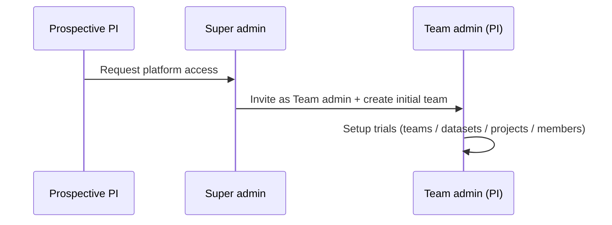
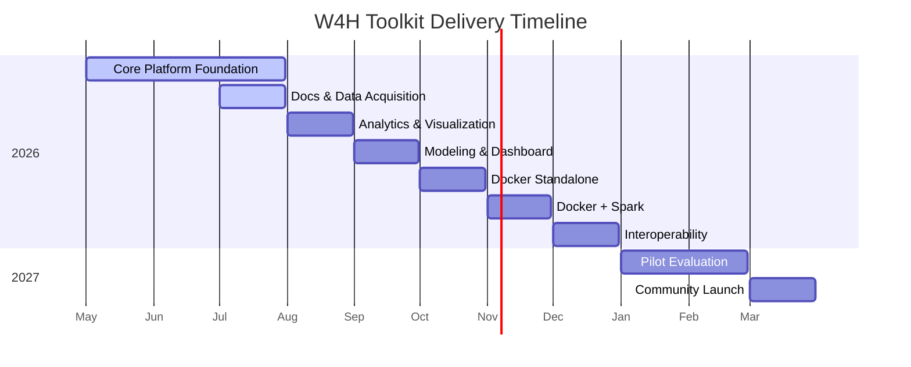
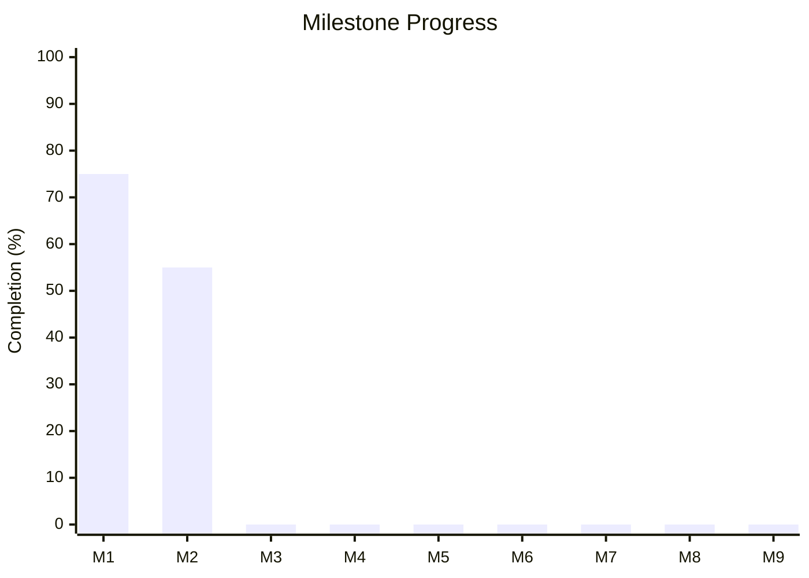

**Protocol Version:** 1

**Date Updated:** July 22, 2026

**Title:** W4H Toolkit — Validating and Promoting the W4H Toolkit

**Principal PI:** Cyrus Shahabi, shahabi@usc.edu

**Co-Investigator:** Luciano Nocera, nocera@usc.edu

**Funding:** SC CTSI Pilot Funding Program

**Document Status:** Draft v0.16

> **Changelog (v0.15 → v0.16):** **ADR-014 Accepted** — **PHI-safe AI chat** (Claude): Cursor-like multi-chat; **team-scoped API keys** (team pays) + optional Super admin **platform key**; context chips; default **PHI-safe (strict)** egress filter with team setting. Expanded MVP §13.1 (AI-01a…, AI-13…AI-16). CTSI pilot: assistant supports knowledge-transfer / usability without central LLM budget.
>
> **Changelog (v0.14 → v0.15):** Documentation Quality assessments split into **platform Help** vs **project pages**. Account menu: **About** + **Report an issue** (email to `HELP_EMAIL`). Docs mention GitHub Issues for technical contributors (no PHI). UI adoption events (`user.login`, `session.start`, `page.view`) feed `/admin/usage`; unique users expanded (UI vs API). Admin home remains a thin snapshot.
>
> **Changelog (v0.13 → v0.14):** Aligned **Usage** operator surface with CTSI protocol Study Assessments and Measures. Renamed route/menu `/admin/api-usage` → `/admin/usage` (label **Usage**). Expanded D-18/D-19*; ledger purpose is platform study metrics (adoption, latency/reliability, workflow outcomes, knowledge transfer, usability aggregates) — still distinct from HIPAA `audit_log` and anonymous telemetry. Added study-assessment → surface map; M8 export of descriptive usage metrics.
>
> **Changelog (v0.12 → v0.13):** **PI / trial onboarding model:** Super admin bootstraps **platform access** (Team admin account + first team) — they do **not** approve or manage individual trials. After onboard, the Team admin (PI) self-serves trial setup (teams/projects/datasets/members). Draft **T-15–T-18** / **U-17**; revises who may create teams (T-01). **UI:** Super admin always stays in Platform Admin (no app-shell toggle); Team admin **Add Team** self-service.
>
> **Changelog (v0.11 → v0.12):** **Discoverable** datasets (`discoverable`, default **on**): other teams may see name, description, and owning team in the catalog without access to link or query until an explicit share. Catalog filters: **Mine** / **Others** / **Shared**. Clarifies discoverability ≠ share (D-07, S-07 updated).
>
> **Changelog (v0.10 → v0.11):** **Per-team roles** on `team_members` (`team_admin` | `member`) so the same account can be Team admin on one team and a regular member on another (dual-hat). Effective Team admin is membership-scoped, not a single global `users.role`. Clarified that **PI → student ingest without full Team admin** is a finer-grained **ACL/capability** (not solved by per-team roles alone) — tracked as Draft D-22.
>
> **Changelog (v0.9 → v0.10):** Documented **home surfaces** for operators: Super admin Platform Admin home (`/admin/home`) with KPIs, platform-health checks, and usage/audit deep links to validate the deployment; Team admin home (normal app shell — not Platform Admin) with team-scoped **IRB access reports** (H-09). Super admin **attention strip**: invites pending, datasets without team, teams without Team admin, last successful backup / reminder, link to HIPAA checklist. Clarified ledger split: HIPAA `audit_log` vs API usage (D-19) vs optional product telemetry. Project users / project `owner`s do not browse the raw audit log (H-11); owners may generate project-scoped IRB reports from the workspace. **Impl:** Super admin home + `GET /config/admin-home` + stub `/admin/audit-log` and `/admin/api-usage` shipped as 🚧 In progress.
>
> **Changelog (v0.8 → v0.9):** Invite flow aligned with U-14/U-15: time-limited activation link (no password in email); resend/revoke; `invited` user status; quick-start updated. Hard user delete replaced by discontinue/resume (ADR-010, U-01/U-05/U-08–U-12). **Platform Admin UI is Super admin only**; Team admins manage their team from the normal app shell (not “W4H Toolkit Admin”).
> **Changelog (v0.7 → v0.8):** Re-audited **Impl Status** against `w4h-api` / `w4h-app` (teams/projects/datasets catalog, platform docs, roles). Corrected overstated M1/M2 progress. Gaps remain: user discontinue/resume, dataset share CRUD, GeoMTS/ingestion, project-scoped docs, HIPAA audit viewer.
>
> **Changelog (v0.6 → v0.7):** MVP doc editor is a **Markdown editor with preview** (not rich-text WYSIWYG). Project page edit rights follow project membership and may be refined via project ACL `resource_type=doc`. Corrected Doc-* implementation statuses to match existing platform docs work. Removed misplaced “project UI editor for admins” row that collided with Doc-08.
>
> **Changelog (v0.5 → v0.6):** Clarified **project documentation pages** as distinct from platform docs: separate DB table, project-scoped hierarchy (same patterns as platform docs), member edit access, and owner/Super-admin import/export for team versioning. Retires the “link platform doc slug to project” model for project pages.
>
> **Changelog (v0.4 → v0.5):** Renamed document to *MVP*. Unified two-column status tracking (`Req Status` / `Impl Status`) across all sections. Added status and progress tracking to milestone table. Sections previously lacking status columns (Teams, Sharing, REDCap, Analytics, ML, Docs, AI, Deployment) now fully tracked. Redefined **M1** as *Core Platform Foundation* (requirements, architecture, auth, users, teams, projects, datasets, RBAC, core schema) — in progress.
>
> **Changelog (v0.3 → v0.4):** Aligned role vocabulary with ADR-004 (**Super admin** · **Team admin** · **Project user**; "Group Admin" retired as an alias). Documented shared-dataset vs project visibility (ADR-012). Clarified push-share UX and multi-dataset project linking. Project membership simplified to `owner` / `editor` / `viewer` (dropped project `admin`).
>
> **Changelog (v0.2 → v0.3):** Added user discontinue/resume lifecycle (replaces hard "remove"); added personal API key timeout and revocation-on-discontinuation; scoped audit log *viewing* access to Super admin / Team admin; added grant-writing device & trial-design AI capabilities; moved basic email invitation (Google SMTP) into MVP scope and out of "Out of Scope."

---

## Status Key

### Required Status
| Value | Meaning |
|-------|---------|
| `✅ Stable` | Requirement is agreed and unlikely to change |
| `⚠️ Draft` | Placeholder; not yet agreed |
| `❌ Deprecated` | Removed from scope |

### Implementation Status
| Value | Meaning |
|-------|---------|
| `✅ Done` | Fully implemented and verified |
| `🔁 In review` | Implemented; pending verification or rework |
| `🚧 In progress` | Actively being built |
| `🚩 Todo` | No implementation yet |

---

## 1. Overview

The W4H Toolkit is a research-grade, open-source wearable health data platform for clinical research teams. It enables researchers to ingest, store, analyze, visualize, and model wearable data — standardized using the **GeoMTS (Geospatial Multivariate Time Series)** abstraction — within a secure, multi-tenant, HIPAA-compliant environment.

The MVP establishes the core platform architecture: multi-tenant team isolation, dataset sharing across teams, HIPAA-compliant data pipelines, REDCap data import, project-scoped analytics, AI-assisted research tools, and a comprehensive documentation system.

Role and sharing semantics follow [ADR-004](ADR-004-acl-roles.md), [ADR-002](ADR-002-cross-trial-sharing.md), and [ADR-012](ADR-012-project-dataset-linking.md).

---

## 2. Roles & Access Model

Access is layered: **platform role** → **team membership role** → **project membership role** → optional **resource ACL** (e.g. docs). See [ADR-004](ADR-004-acl-roles.md).

| # | Requirement | Req Status | Impl Status |
|---|-------------|------------|-------------|
| R-01 | Platform role **Super admin** is account-wide (`users.role`). Non–Super-admin accounts are standard users whose team/project authority comes from memberships (ADR-004). | `✅ Stable` | `🔁 In review` |
| R-02 | Project membership roles are `owner`, `editor`, and `viewer`; project `admin` is retired. | `✅ Stable` | `✅ Done` |
| R-03 | A user may belong to multiple teams, each with its own **team membership role**. | `✅ Stable` | `🚧 In progress` |
| R-04 | Every project belongs to exactly one owning team. | `✅ Stable` | `🔁 In review` |
| R-05 | Sharing a dataset never shares a project (ADR-012). | `✅ Stable` | `🚧 In progress` |
| R-06 | All users (except Super admin), projects, and datasets must belong to a team. | `✅ Stable` | `🚧 In progress` |
| R-07 | Users are never hard-deleted; lifecycle uses `active` / `discontinued`. | `✅ Stable` | `✅ Done` |
| R-08 | **Team membership roles** on `team_members.role`: `team_admin` \| `member`. The same user may be `team_admin` on team A and `member` on team B (dual-hat). | `✅ Stable` | `🚧 In progress` |
| R-09 | Effective Team admin for team T = Super admin **or** membership on T with role `team_admin`. Global `users.role = team_admin` is legacy and migrates onto `team_members`. | `✅ Stable` | `🚧 In progress` |

Project membership roles are **not** a fourth platform tier. Team membership roles are **not** a fourth platform tier either — they scope Team admin vs member **per team**.

### 2.1 Key Rules

- A user **can belong to multiple teams** with **different roles per team** (e.g. Team admin on their home trial, `member` on a collaborator team).
- **Team admins** (per team) manage that team's users, projects, and datasets — including inviting, discontinuing, and resuming members — within that team only.
- **All projects belong to one owning team.** There are no dual-owned or platform-level "Super admin" projects.
- **Sharing a dataset does not share a project.** A Team A project that links Team B's shared dataset is visible to Team A only (ADR-012). Team B sees the share agreement, not Team A's project.
- New deployments **must** assign all non–Super-admin users, projects, and datasets to a team at setup time. Unscoped records are not permitted.
- Users are **never hard-deleted** from the platform. A user account has a `status` of `active` or `discontinued`; discontinuing a user is reversible (see §4).
- **Ingest without full Team admin** (PI delegates wearable ETL to a student) is **not** covered by per-team roles alone — that is a finer-grained ACL/capability (see D-22).
---

## 3. Multi-Tenancy (Research Teams)

### 3.0 Platform access vs trial setup (onboarding)

Super admin **does not** manage or approve individual trials — they have no trial-domain knowledge. Separation of duties:

| Stage | Who | What |
|---|---|---|
| 1. Request access | Prospective PI (guest) | Submits a **platform access** request (identity + affiliation + brief purpose) |
| 2. Bootstrap | Super admin | Creates the **Team admin** account (invite) and an **initial team**; does **not** configure projects, datasets, or IRB for the trial |
| 3. Trial setup | Team admin (PI) | Creates further teams if needed, datasets, projects, members, shares — full self-service |

### 3.1 Team Management

| # | Requirement | Who | Req Status | Impl Status |
|---|-------------|-----|------------|-------------|
| T-01 | Create a research team (name, slug). **Bootstrap:** Super admin may create the PI’s initial team at onboarding. **Self-service:** Team admin may create additional teams for their trials after they have been onboarded (T-15). | Super admin; Team admin (after onboard) | `⚠️ Draft` | `🚧 In progress` |
| T-02 | List all teams with member count and project count. | Super admin | `✅ Stable` | `🔁 In review` |
| T-03 | Edit any team's name and metadata. | Super admin | `✅ Stable` | `✅ Done` |
| T-04 | Deactivate any team (soft-delete; preserves data). | Super admin | `✅ Stable` | `✅ Done` |
| T-05 | View, edit, and manage their own team's details, metadata, and membership. | Team admin (scoped to own team) | `✅ Stable` | `✅ Done` |
| T-06 | Each team has a unique URL-friendly `slug`. | System | `✅ Stable` | `✅ Done` |
| T-15 | After platform onboarding, Team admin can create additional teams (new trials / study tenancies) without Super admin involvement. Super admin does **not** approve each new team/trial. | Team admin | `⚠️ Draft` | `🚧 In progress` |
| T-16 | Prospective users can submit a **platform access request** (name, email, affiliation, short purpose). This is **not** a per-trial approval queue. | Guest / System | `⚠️ Draft` | `🚩 Todo` |
| T-17 | Super admin can list pending access requests and **fulfill** one by inviting the requester as Team admin and creating their **initial team** (guided or one-step). | Super admin | `⚠️ Draft` | `🚩 Todo` |
| T-18 | Super admin attention / home surfaces pending **access requests** (not trial setup tasks). | Super admin | `⚠️ Draft` | `🚩 Todo` |

### 3.2 User–Team Association

| # | Requirement | Who | Req Status | Impl Status |
|---|-------------|-----|------------|-------------|
| T-07 | Assign a user to one or more teams at creation, with a **team membership role** per team (`team_admin` \| `member`). | Super admin / Team admin (own team only) | `✅ Stable` | `🚧 In progress` |
| T-08 | Remove a user from a team (membership link only — does **not** discontinue the user's account or their membership in other teams). | Super admin / Team admin (own team only) | `✅ Stable` | `🚧 In progress` |
| T-09 | Users with no team assignment are Super admins. | System | `✅ Stable` | `🔁 In review` |
| T-10 | Team admin can view, invite, edit, discontinue, and resume members of their team (scoped by that team's membership). | Team admin | `✅ Stable` | `🔁 In review` |
| T-11 | Users can see teammates across all their teams; Super admin sees all users globally. | System | `✅ Stable` | `✅ Done` |
| T-12 | Discontinuing a user does not remove their team or project memberships; resuming restores their prior access immediately. | System | `✅ Stable` | `🚩 Todo` |
| T-13 | Change a member's **team membership role** on a team without changing their roles on other teams (dual-hat). | Super admin / Team admin (own team) | `✅ Stable` | `🚧 In progress` |
| T-14 | Add an existing user to a team with an explicit team membership role (no duplicate account). | Super admin / Team admin (own team) | `✅ Stable` | `🚧 In progress` |

---

## 4. User Management

### 4.1 Core Lifecycle

| # | Requirement | Req Status | Impl Status |
|---|-------------|------------|-------------|
| U-01 | Create, edit, discontinue, and resume users. Users are never hard-deleted. | `✅ Stable` | `✅ Done` |
| U-02 | Assign platform role `super_admin` (account-wide). Non–Super-admin authority is via **team membership roles** and **project membership roles** (ADR-004). Legacy `users.role` values `team_admin` / `project_user` / `admin` / `researcher` / `clinician` migrate accordingly. | `✅ Stable` | `🔁 In review` |
| U-03 | Users have multi-valued team membership (`team_members`) including per-team role. | `✅ Stable` | `🚧 In progress` |
| U-04 | Team admin can invite/add members to their team (with team membership role). | `✅ Stable` | `🚧 In progress` |
| U-05 | Team admin can discontinue and resume Project users in their team. | `✅ Stable` | `✅ Done` |
| U-06 | `team_id` (primary) embedded in JWT at login for request scoping. | `✅ Stable` | `✅ Done` |
| U-07 | User profile displays their team(s) and project memberships. | `✅ Stable` | `🚩 Todo` |
| U-08 | Users have a `status` field: `active` or `discontinued`. | `✅ Stable` | `✅ Done` |
| U-09 | Discontinuing a user preserves their full historical record (audit trail, prior contributions, team/project links) — only their ability to authenticate and access data is suspended. | `✅ Stable` | `✅ Done` |
| U-10 | Discontinuing a user immediately invalidates all of that user's active web-app sessions/JWTs and all of their personal API keys (see D-20). | `✅ Stable` | `✅ Done` |
| U-11 | Resuming a discontinued user restores web-app login ability; the user must issue new API key(s) post-resume (old keys remain revoked). | `✅ Stable` | `✅ Done` |
| U-12 | `/admin/users` list and `/admin/users/:id` detail show current status (`active` / `discontinued`) with a toggle action, scoped per role. | `✅ Stable` | `✅ Done` |

### 4.2 Email Invitations

| # | Requirement | Req Status | Impl Status |
|---|-------------|------------|-------------|
| U-13 | Super admin / Team admin can invite a new user by email via **Google SMTP**. | `✅ Stable` | `✅ Done` |
| U-14 | Invitation email contains a time-limited signed link for password set and account activation. | `✅ Stable` | `✅ Done` |
| U-15 | Expired or unused invitations can be revoked or resent by the inviting admin. | `✅ Stable` | `✅ Done` |
| U-16 | Invite flow is intentionally basic for MVP: single SMTP provider (Google), plain-text/simple HTML template, no custom branding. | `✅ Stable` | `✅ Done` |
| U-17 | Platform access request (T-16) is distinct from Team admin **inviting** members to an existing team (U-13). Fulfilling an access request uses the invite flow with team membership role `team_admin` and an initial team (T-17). | `⚠️ Draft` | `🚩 Todo` |

---

## 5. Project Management

| # | Requirement | Req Status | Impl Status |
|---|-------------|------------|-------------|
| P-01 | Create, list, view, edit, archive projects. | `✅ Stable` | `✅ Done` |
| P-02 | Project member roles: `owner`, `editor`, `viewer` (retire project `admin`). | `✅ Stable` | `✅ Done` |
| P-03 | At least one `owner` enforced per project. | `✅ Stable` | `✅ Done` |
| P-04 | Projects have a `team_id` (owning team). | `✅ Stable` | `✅ Done` |
| P-05 | Team admin can create projects within their team and link multiple owned or inbound-shared datasets (D-06, ADR-012). | `✅ Stable` | `✅ Done` |
| P-06 | Users see only projects in their team(s) or where explicitly added as members (same team only in MVP). | `✅ Stable` | `✅ Done` |
| P-07 | Super admin sees all projects across all teams. | `✅ Stable` | `✅ Done` |
| P-08 | Project list and detail views display the owning team name. | `✅ Stable` | `✅ Done` |
| P-09 | Project documentation pages stored in a dedicated project-scoped table (see §12.2). | `✅ Stable` | `✅ Done` |
| P-10 | IRB protocol metadata stored per project (protocol ID, expiry date). | `✅ Stable` | `✅ Done` |

---

## 6. Dataset Management & GeoMTS Abstraction

All datasets in the W4H Toolkit are represented using the **GeoMTS (Geospatial Multivariate Time Series)** abstraction, which treats wearable data as geotagged, multi-sensor time series collections. This enables unified querying, analysis, and modeling across heterogeneous device types (Fitbit, Apple Watch, ActiGraph, etc.).

### 6.1 Dataset Core

| # | Requirement | Req Status | Impl Status |
|---|-------------|------------|-------------|
| D-01 | Datasets have a `team_id` (owning team). | `✅ Stable` | `✅ Done` |
| D-02 | Datasets have rich metadata: name, description, device type, sampling rate, subject count, date range, GeoMTS schema, IRB reference. | `✅ Stable` | `🚧 In progress` |
| D-03 | All datasets conform to the GeoMTS abstraction layer. | `✅ Stable` | `🚩 Todo` |
| D-04 | Original data is always preserved. Derived or modified data is stored separately (additive model). | `✅ Stable` | `🚩 Todo` |
| D-05 | Each dataset version (original, derived) is tracked with provenance metadata. | `✅ Stable` | `🚩 Todo` |
| D-06 | Datasets can be linked to one or more projects with per-link access type (`read` / `read_write`). Linkable set = project team’s owned datasets ∪ inbound shares ∪ datasets the actor admins on their other teams (linking those auto-creates a team share). | `✅ Stable` | `🚧 In progress` |
| D-07 | Team catalog shows: (1) **Mine** — owned datasets; (2) **Shared** — inbound shares (linkable); (3) **Others** — peer datasets marked **Discoverable** (name, description, owning team only — **not** linkable until shared). Non-discoverable peer datasets stay hidden. | `✅ Stable` | `🚧 In progress` |
| D-08 | Super admin sees all datasets across all teams. | `✅ Stable` | `✅ Done` |
| D-23 | **Discoverable** flag on each dataset: when on, other teams can see the dataset’s name, description, and owning team in **Others**. Does **not** grant link, query, or project access (share still required). Default **on** at create; Team admin / Super admin can change anytime. | `✅ Stable` | `🚧 In progress` |
| D-24 | Datasets list supports filters **All** / **Mine** / **Others** / **Shared** (D-07). | `✅ Stable` | `🚧 In progress` |

### 6.2 Data Ingestion

| # | Requirement | Req Status | Impl Status |
|---|-------------|------------|-------------|
| D-09 | Import datasets via **CSV**. | `✅ Stable` | `🚩 Todo` |
| D-10 | Import datasets via **JSON**. | `✅ Stable` | `🚩 Todo` |
| D-11 | Import datasets via **REDCap** (see §9). | `✅ Stable` | `🚩 Todo` |
| D-12 | **Super admin** or **Team admin** (team membership role on the owning team) can create datasets and ingest data via the privileged path (catalog + signal-table DDL via `w4h_platform`). | `✅ Stable` | `🚩 Todo` |
| D-13 | **Team members** who are not Team admin ingest data via **API key** only (no direct DB / DDL) when so authorized (project membership + key scope). | `✅ Stable` | `🚧 In progress` |
| D-14 | Data ingestion notebooks available per dataset for script-based ETL pipelines. | `✅ Stable` | `🔁 In review` |
| D-15 | Ingestion logs stored with timestamp, user, row count, and status. | `✅ Stable` | `🚩 Todo` |
| D-22 | **Ingest delegation (ACL/capability):** a Team admin may grant a team `member` permission to create/ingest datasets for that team **without** elevating them to `team_admin` (e.g. PI delegates wearable ETL to a student). This is finer-grained than per-team RBAC; exact grant model TBD (team capability flag vs resource ACL). | `⚠️ Draft` | `🚩 Todo` |

### 6.3 API Key Data Access

| # | Requirement | Req Status | Impl Status |
|---|-------------|------------|-------------|
| D-16 | Project users authenticate against the data API using a **personal**, individually-issued API key. | `✅ Stable` | `🚧 In progress` |
| D-17 | API keys are scoped to a user's project memberships and their allowed datasets. | `✅ Stable` | `🚩 Todo` |
| D-18 | API key analytics: log every API access event to `usage_events` (user, timestamp, duration; `metadata` includes status, path/method, and when available dataset, query type, row count). | `✅ Stable` | `🚧 In progress` |
| D-19 | **Usage** dashboard at `/admin/usage` (menu: **Usage**) visible to Super admin (platform-wide) and Team admin (team-scoped). Sections: **Adoption / key hygiene**; **System performance** (latency p50/p95, error rate); **Workflow outcomes** when richer event types exist; **Knowledge transfer** milestones; optional **Usability** summary. Not a HIPAA audit viewer. | `✅ Stable` | `🚧 In progress` |
| D-19a | Super admin home (`/admin/home`) surfaces a **thin usage snapshot** (API calls, active keys / 24h–7d) with deep link to `/admin/usage`. Full study metrics live on the Usage page — not on home. | `✅ Stable` | `✅ Done` |
| D-19b | Richer `usage_events` beyond `api.request` (e.g. `dataset.import`, `query.run` with success/fail, duration, format/row counts) feed Data Integration and Workflow Performance assessments. Depends on D-15 ingest logging. | `⚠️ Draft` | `🚩 Todo` |
| D-19c | Knowledge-transfer metrics on `/admin/usage`: time from invite → first API key → first successful data action; % of invited users completing a representative task within N days (supports M8 / protocol Knowledge Transfer). | `⚠️ Draft` | `🚩 Todo` |
| D-19d | Usability aggregates on `/admin/usage` from `survey_responses` (e.g. SUS / satisfaction summary) or deep link; raw survey entry elsewhere. CSV/export for SC-CTSI descriptive reporting. | `⚠️ Draft` | `🚩 Todo` |
| D-19e | UI adoption events in `usage_events`: `user.login` (password / email-code), `session.start`, `page.view` (JWT). Usage page reports unique UI users, logins, page views separately from unique API users — so dashboard use is visible without collapsing into admin home KPIs. | `✅ Stable` | `🚧 In progress` |
| D-20 | API keys have a configurable timeout/expiration (TTL). | `✅ Stable` | `🚩 Todo` |
| D-21 | When a user is `discontinued`, all personal API keys are immediately invalidated. | `✅ Stable` | `✅ Done` |

---

## 7. Dataset Sharing (Cross-Team)

Sharing is **dataset-scoped**, not project-scoped. See [ADR-002](ADR-002-cross-trial-sharing.md) and [ADR-012](ADR-012-project-dataset-linking.md).

**Push-share UX (MVP default):** Team admin A opens an **owned** dataset → Share → Team B (or a Team B project). Team admin B then sees it as *"Shared by [Team A]"* and may **link** it to a Team B project. A's modeling project that also uses that dataset remains **visible only to Team A**.

**Discoverable ≠ share:** Turning **Discoverable** on only lists metadata for other teams (**Others** filter). Access to link or query still requires an explicit share (S-01).

| # | Requirement | Who | Req Status | Impl Status |
|---|-------------|-----|------------|-------------|
| S-01 | Share a dataset owned by your team with one or more other teams (push share). | Team admin, Super admin | `✅ Stable` | `🚧 In progress` |
| S-02 | Share is **team-wide** (recipient team can link from any of their projects). Project-scoped share is deferred. | Team admin | `✅ Stable` | `🚧 In progress` |
| S-03 | Default share access type is `read`; `read_write` is explicitly granted. | Team admin | `✅ Stable` | `🚧 In progress` |
| S-04 | Revoke a dataset share at any time. | Team admin (own datasets), Super admin | `✅ Stable` | `🚧 In progress` |
| S-05 | Shared datasets show owner team name in the UI: *"Shared by [Team Name]"*. | System | `✅ Stable` | `🚧 In progress` |
| S-06 | Super admin can view all active share agreements across all teams. | Super admin | `✅ Stable` | `🚧 In progress` |
| S-07 | Recipient catalog: **Mine** ∪ **Shared** (linkable) ∪ **Others** (discoverable metadata only). Never expose non-discoverable peer catalogs or peer project links. | System | `✅ Stable` | `🚧 In progress` |
| S-08 | Linking a shared dataset into a project does not grant the source team visibility into that project. | System | `✅ Stable` | `✅ Done` |
| S-09 | Optional: recipient may request share; owner Team admin or Super admin approves (pull path). | Team admin, Super admin | `⚠️ Draft` | `🚩 Todo` |
| S-10 | Discoverable listing does not auto-create a share and does not appear in the project linkable set until shared. | System | `✅ Stable` | `🚧 In progress` |

---

## 8. HIPAA Compliance

The platform must comply with HIPAA Security Rule requirements for handling Protected Health Information (PHI).

| # | Requirement | Req Status | Impl Status |
|---|-------------|------------|-------------|
| H-01 | Append-only audit log for all PHI access and mutations (`w4h.audit_log`). | `✅ Stable` | `🚧 In progress` |
| H-02 | Audit log records: timestamp, user, action, resource type, resource ID, IP address, user agent. | `✅ Stable` | `🔁 In review` |
| H-03 | Audit log records must be retained for a minimum of **6 years**. No deletions permitted. | `✅ Stable` | `🚩 Todo` |
| H-04 | All PHI-modifying API endpoints must write to the audit log. | `✅ Stable` | `🚩 Todo` |
| H-05 | Data at rest encrypted (PostgreSQL-level or filesystem-level encryption). | `✅ Stable` | `🚩 Todo` |
| H-06 | Data in transit encrypted via TLS/HTTPS. | `✅ Stable` | `🚩 Todo` |
| H-07 | Role-based access enforcement on all data endpoints (least-privilege), including immediate revocation for `discontinued` users. | `✅ Stable` | `🚧 In progress` |
| H-08 | Automated HIPAA compliance checks as part of CI/CD pipeline. | `✅ Stable` | `🚩 Todo` |
| H-09 | Ability to generate an access audit report per dataset or project for IRB review (filtered summary from `audit_log`; not a dump of unrelated teams). | `✅ Stable` | `🚩 Todo` |
| H-09a | **Team admin home** (normal app shell) provides entry points to generate / download **IRB access reports** for the team's datasets and projects. | `✅ Stable` | `🚩 Todo` |
| H-09b | **Project `owner`** may generate an IRB access report for **their project only** from the project workspace. They cannot browse the raw platform audit log. | `✅ Stable` | `🚩 Todo` |
| H-10 | Support de-identification pipelines before data is shared across teams. | `⚠️ Draft` | `🚩 Todo` |
| H-11 | Audit log viewing access is role-scoped: Super admin sees all; Team admin sees own team only; Project users cannot browse raw audit log. | `✅ Stable` | `🚧 In progress` |
| H-12 | Super admin Platform Admin home (`/admin/home`) shows a **compliance / ops snapshot** (audit write health, recent privileged events, failed logins) with deep links to `/admin/audit-log` — not a full log table on the home page. | `✅ Stable` | `✅ Done` |
| H-12a | Super admin home **attention strip** flags: invites pending; datasets without an owning team; teams without a Team admin; last successful backup / backup-reminder ops note; plus a link to the in-app **HIPAA compliance checklist** doc. | `✅ Stable` | `✅ Done` |

**Ledger split (do not conflate on home pages):**

| Ledger | Store | Purpose | Who |
|--------|-------|---------|-----|
| HIPAA audit | `w4h.audit_log` | PHI access, ACL, auth, privileged admin actions (ADR-011) | Super admin (all); Team admin (own team); IRB reports for Team admin / project owner |
| Platform usage | `usage_events` + key analytics (D-18 / D-19*) | CTSI study assessments: adoption, latency/reliability, workflow/ingest outcomes, knowledge transfer; optional usability aggregates — **not** PHI compliance | Super admin; Team admin (own team) via `/admin/usage` |
| Product telemetry | external / opt-in | Product improvement | Settings toggle only — never a compliance or study-assessment surface |

### Study assessments → platform surfaces (CTSI protocol)

Maps protocol **Study Assessments and Measures** to where operators observe descriptive metrics. Analyses remain primarily descriptive (protocol §XIII).

| Protocol domain | Platform surface | MVP reqs |
|-----------------|------------------|----------|
| System performance (latency, speed) | `/admin/usage` — duration percentiles, error rate | D-18, D-19 |
| Data integration (ingest success, formats) | `/admin/usage` + ingest logs when available | D-15, D-19b |
| Workflow performance (task completion / time) | `/admin/usage` — event completion and duration | D-19b |
| Modeling performance | Model-run tracking (later); PHI aspects in audit | M-04; M-08 |
| Usability (SUS / satisfaction) | Survey entry elsewhere; summary on `/admin/usage` | D-19d |
| Usability (unprompted feedback) | Account menu **Report an issue** → email to `HELP_EMAIL` | UX-01 |
| Knowledge transfer (assistant-assisted tasks) | Optional **PHI-safe AI chat** (ADR-014); task time in M8 | AI-01…; D-19c |
| Documentation quality — platform Help | Doc-assisted onboarding tasks; platform doc completeness surveys | Doc-01…Doc-07; Doc-17 |
| Documentation quality — project pages | % projects with pages; task success finding trial materials in project docs | Doc-08…Doc-16; Doc-18 |
| Compliance (HIPAA / FHIR) | `/admin/audit-log`, H-* — **not** Usage | H-01… |
| Knowledge transfer (time-to-task) | `/admin/usage` onboarding milestones | D-19c |
| Wearable value quantification | Pilot analysis / notebooks — not admin Usage KPIs | M8 analysis |
| Community engagement / outreach | GitHub Issues / stars (external); workshops | M9; FAQ |

**Protocol note (Documentation Quality):** Amend the study assessment table to list **platform documentation** and **project documentation** as two outcome lines under the same domain (not a new Aim).

---

## 9. REDCap Integration

REDCap is the most widely used data capture platform in academic clinical trials. W4H must interoperate with it.

| # | Requirement | Req Status | Impl Status |
|---|-------------|------------|-------------|
| R-01 | Connect to a REDCap instance via REDCap API (token-based). | `✅ Stable` | `🚩 Todo` |
| R-02 | Import a REDCap project's records into a W4H dataset. | `✅ Stable` | `🚩 Todo` |
| R-03 | Map REDCap field names to GeoMTS schema fields during import. | `✅ Stable` | `🚩 Todo` |
| R-04 | Schedule recurring REDCap syncs (incremental import of new/updated records). | `✅ Stable` | `🚩 Todo` |
| R-05 | Log REDCap import events in the audit log. | `✅ Stable` | `🚩 Todo` |
| R-06 | Validate imported REDCap data against the dataset's GeoMTS schema. | `✅ Stable` | `🚩 Todo` |
| R-07 | Surface import errors and validation warnings in the admin UI. | `✅ Stable` | `🚩 Todo` |

---

## 10. Analytics Dashboards

Basic analytics dashboards allow researchers to understand the data available in their projects without writing code.

| # | Requirement | Req Status | Impl Status |
|---|-------------|------------|-------------|
| A-01 | Per-project summary dashboard: subject count, date range, device types, dataset sizes. | `✅ Stable` | `🚧 In progress` |
| A-02 | Signal-level visualization: time series plots for individual subjects or group averages. | `✅ Stable` | `🚩 Todo` |
| A-03 | Comparative analytics: compare selected subjects against a control group. | `✅ Stable` | `🚩 Todo` |
| A-04 | Compliance and wear-time metrics per subject and per dataset. | `✅ Stable` | `🚩 Todo` |
| A-05 | Outlier detection visualization for health metrics. | `✅ Stable` | `🚩 Todo` |
| A-06 | Export dashboard views as PDF or PNG for reporting. | `✅ Stable` | `🚩 Todo` |
| A-07 | Dashboard is accessible to all project members (Viewer and above). | `✅ Stable` | `🚩 Todo` |

---

## 11. ML Model Capabilities

The W4H Toolkit supports applying, retraining, and extending pre-built ML models on a team's own data. Built-in models include GeoMTS-based frameworks (BysGNN, NeuroGNN, WaveGNN, Motif analysis).

| # | Capability | Requirement | Req Status | Impl Status |
|---|-----------|-------------|------------|-------------|
| M-01 | **Apply model** | Run a pre-trained model against a project's dataset and view predictions/outputs. | `✅ Stable` | `🚩 Todo` |
| M-02 | **Apply model** | Model outputs stored as a derived dataset (additive; original preserved). | `✅ Stable` | `🚩 Todo` |
| M-03 | **Retrain model** | Fine-tune an existing model with a team's own labeled data. | `✅ Stable` | `🚩 Todo` |
| M-04 | **Retrain model** | Track retraining runs: parameters, dataset version, performance metrics. | `✅ Stable` | `🚩 Todo` |
| M-05 | **Extend model** | Define a new model variant based on an existing architecture with custom hyperparameters. | `✅ Stable` | `🚩 Todo` |
| M-06 | **Extend model** | Share a trained model with another team (with permission). | `⚠️ Draft` | `🚩 Todo` |
| M-07 | **All** | Model execution runs in a notebook environment (Jupyter/VS Code). | `✅ Stable` | `🔁 In review` |
| M-08 | **All** | Model runs logged in the audit trail with user, model version, and dataset reference. | `✅ Stable` | `🚩 Todo` |

---

## 12. Documentation System

### 12.1 Platform Documentation (External Repository)

Platform Help docs are global (not project-owned). Managed by Super admin; synced with `w4h-docs`.

**Editor (MVP):** Platform and project page editing use a **Markdown editor with preview** (source + rendered preview). True rich-text WYSIWYG is out of scope for MVP.

| # | Requirement | Req Status | Impl Status |
|---|-------------|------------|-------------|
| Doc-01 | Documentation is maintained as Markdown files in an external git repository (`w4h-docs`). | `✅ Stable` | `✅ Done` |
| Doc-02 | Admin UI provides a path to **pull and update docs** from the external repository / source path. | `✅ Stable` | `✅ Done` |
| Doc-03 | Admin UI provides a path to **export** docs (Markdown zip) for publish / round-trip with the repository. | `✅ Stable` | `✅ Done` |
| Doc-04 | Docs rendered in the app are fetched from the database (previously synced from the repo). | `✅ Stable` | `✅ Done` |
| Doc-05 | Markdown editor with preview for editing platform documentation pages within the admin UI. | `✅ Stable` | `✅ Done` |
| Doc-06 | Documentation supports embedded code examples, GeoMTS schema snippets, and mermaid diagrams. | `✅ Stable` | `✅ Done` |
| Doc-07 | Platform docs support import from path and export to zip for source-controlled management with an external repository. | `✅ Stable` | `✅ Done` |

### 12.2 Project Documentation Pages (Project-Scoped)

Project pages are **not** platform docs. They use a **separate database table** (not `w4h.docs`, and not a join that only links platform slugs). Each page belongs to exactly one project and never appears in the global Help / platform docs tree.

Hierarchy and authoring match platform docs **within the project**: page types/groupings, sort order, sidebar navigation, Markdown body, TOC, and the same Markdown editor with preview — scoped so one project’s structure cannot leak into another.

| # | Requirement | Req Status | Impl Status |
|---|-------------|------------|-------------|
| Doc-08 | Project documentation pages are stored in a dedicated table separate from platform `docs`; each row has a `project_id` and is owned by that project only. | `✅ Stable` | `✅ Done` |
| Doc-09 | Within a project, pages support the same hierarchy functionality as platform docs: typed groupings (doc types), sort order, sidebar nav, slug/title, Markdown/HTML/TOC, and Markdown editor with preview for create/edit. | `✅ Stable` | `🚩 Todo` |
| Doc-10 | Project pages may include protocol descriptions, data dictionaries, analysis notes, and similar project materials. | `✅ Stable` | `🚩 Todo` |
| Doc-11 | **Default access from project membership:** any project member can **read, create, edit, reorder, and delete** project documentation pages from the project workspace (no Admin UI required). Super admin can manage pages for any project. | `✅ Stable` | `✅ Done` |
| Doc-12 | **ACL:** Project ACL rules must support `resource_type = doc` with `view` / `edit` (and optional `resource_key` for a specific page). Defaults from Doc-11 apply when no ACL rule matches; explicit allow/deny rules may further restrict or grant access on a locked page. | `✅ Stable` | `🚧 In progress` |
| Doc-13 | Project `owner` (and Super admin) can **export** and **import** that project’s documentation as a Markdown archive so teams can version docs outside the platform (analogous to Doc-02/Doc-03, but project-scoped — not the global `w4h-docs` repo). | `✅ Stable` | `🚩 Todo` |
| Doc-14 | Project pages do not appear in platform Help documentation; navigation and APIs are always filtered by `project_id`. | `✅ Stable` | `✅ Done` |
| Doc-15 | Project Docs may link to platform documentation pages. | `⚠️ Draft` | `🚩 Todo` |
| Doc-16 | Retire the current `project_docs` “link platform `docs.slug` to project” model for storing project page content; replace with the dedicated project-pages table (Doc-08). | `✅ Stable` | `🚩 Todo` |
| Doc-17 | **Study metric (platform):** documentation completeness / documentation-assisted task success for **platform Help** (surveys + timed tasks). Distinct from project pages. | `✅ Stable` | `🚩 Todo` |
| Doc-18 | **Study metric (project):** share of pilot projects with ≥1 project doc page; task success locating trial materials (protocol notes, data dictionaries) via **project pages**. | `✅ Stable` | `🚩 Todo` |

### 12.3 Feedback and community channels

| # | Requirement | Req Status | Impl Status |
|---|-------------|------------|-------------|
| UX-01 | Authenticated **app-shell** users can **Report an issue** from the account dropdown; the form emails `HELP_EMAIL` (fallback: SMTP from). No PHI in reports. Not shown in Platform Admin (Super admin receives these). | `✅ Stable` | `✅ Done` |
| UX-02 | Account dropdown **About** modal: product name, SC CTSI funding, PIs, app version, links to Help docs and public GitHub documentation / Issues. Not a routed page. | `✅ Stable` | `✅ Done` |
| UX-03 | Help / FAQ documents that technical contributors may use **GitHub Issues** on the public docs repository; clinical users should prefer in-app Report an issue. Never post PHI to GitHub. | `✅ Stable` | `✅ Done` |

---

## 13. AI Assistant Features

See [ADR-014](ADR-014-ai-assistant-claude.md) (**Accepted**) for **PHI-safe AI chat**: provider, team vs platform keys, Cursor-like UX, and PHI egress filter.

### 13.1 Chat AI Helper (substrate) — PHI-safe AI chat

| # | Requirement | Req Status | Impl Status |
|---|-------------|------------|-------------|
| AI-01 | Embedded **PHI-safe AI chat** accessible from any authenticated page (app shell and Platform Admin). Cursor-like docked panel; optional open-in-tab. Persistent **PHI-safe** badge when filter is strict. | `✅ Stable` | `🚩 Todo` |
| AI-01a | Multi-chat per user: create threads, rename, pin, delete, resume history; streaming replies. | `✅ Stable` | `🚩 Todo` |
| AI-01b | Chat history stored server-side, scoped to the owning user (no shared threads in MVP). | `✅ Stable` | `🚩 Todo` |
| AI-02 | Context-aware: shell (admin vs app), route, user role, active team / project / dataset metadata. | `✅ Stable` | `🚩 Todo` |
| AI-02a | Visible **context chips** (removable before send); docs-aware when viewing Help or project pages; domain primer (GeoMTS / trials). | `✅ Stable` | `🚩 Todo` |
| AI-02b | **Claude** via server-side proxy. **Team Claude API key** configured by Team admin (team pays). Optional **platform Claude key** for Super admin Platform Admin use only. | `✅ Stable` | `🚩 Todo` |
| AI-02c | Modes on one substrate: Help · Ops · Analysis · IRB (AI-05…AI-08 attach here; AI-09…AI-12 later). | `⚠️ Draft` | `🚩 Todo` |
| AI-03 | Answers questions about platform features, schemas, and workflows; cites Help / project doc slugs when grounded. | `✅ Stable` | `🚩 Todo` |
| AI-04 | Can generate notebook code snippets for common data tasks (filtering, plotting, aggregation) without pasting raw PHI rows. | `✅ Stable` | `🚩 Todo` |
| AI-13 | **PHI-safe mode (default):** egress filter **strict** — allowlist metadata + docs; block subject IDs, raw timeseries, query cells; no row-fetch tools into prompts. UI label: **PHI-safe AI chat**. | `✅ Stable` | `🚩 Todo` |
| AI-14 | Team (and platform) setting `ai_phi_filter`: **PHI-safe (strict)** (default) \| **Permissive** (confirmed paste / metadata only; still no bulk row injection). Permissive requires Team admin (or Super admin for platform key) and shows a warning (not PHI-safe). | `✅ Stable` | `🚩 Todo` |
| AI-15 | Blocked sends recorded as `ai.chat_blocked` in `usage_events`; successful turns as `ai.chat`. PHI-class tool use under permissive mode also audited (ADR-011). | `✅ Stable` | `🚩 Todo` |
| AI-16 | Rate/token budgets per team (and platform); Super admin may disable AI platform-wide. Empty state when no key for active context. | `✅ Stable` | `🚩 Todo` |

### 13.2 IRB Grant Assistant

Modes / guided flows on the §13.1 substrate (ADR-014) — not separate chat products.

| # | Requirement | Req Status | Impl Status |
|---|-------------|------------|-------------|
| AI-05 | AI assistant guides researchers through drafting IRB submission documents. | `✅ Stable` | `🚩 Todo` |
| AI-06 | Provides templates and guidance for wearable-specific IRB sections (data privacy, HIPAA considerations, device descriptions). | `✅ Stable` | `🚩 Todo` |
| AI-07 | Pre-populates IRB fields from project metadata (PI name, team, dataset types, IRB protocol ID). | `✅ Stable` | `🚩 Todo` |
| AI-08 | Generates a draft Data Management Plan (DMP) based on the project's dataset configuration. | `✅ Stable` | `🚩 Todo` |

### 13.3 Research AI Tools

| # | Requirement | Req Status | Impl Status |
|---|-------------|------------|-------------|
| AI-09 | **Sample size calculator**: compute required sample sizes for wearable-based clinical studies. | `✅ Stable` | `🚩 Todo` |
| AI-10 | **Study design advisor**: recommends statistical methods and study designs for a given wearable data type and clinical question, including trial/protocol design guidance. | `✅ Stable` | `🚩 Todo` |
| AI-11 | **Literature assistant**: surfaces relevant published research based on clinical domain, device type, and target outcome. | `✅ Stable` | `🚩 Todo` |
| AI-12 | **Endpoint-to-device advisor**: given a target clinical endpoint, recommends candidate wearable devices and data streams needed to capture it. | `✅ Stable` | `🚩 Todo` |

---

## 14. Deployment

| # | Requirement | Req Status | Impl Status |
|---|-------------|------------|-------------|
| Dep-01 | **Standalone Docker** deployment: single-container or docker-compose without Spark. | `✅ Stable` | `🚩 Todo` |
| Dep-02 | **Spark-enabled Docker** deployment: scalable version with Apache Spark for large dataset processing. | `✅ Stable` | `🚩 Todo` |
| Dep-03 | Environment configured via `.env` file (DB credentials, API keys, ports, Google SMTP credentials). | `✅ Stable` | `🔁 In review` |
| Dep-04 | Docker images published to a public registry (Docker Hub or GitHub Container Registry). | `✅ Stable` | `🚩 Todo` |
| Dep-05 | Setup documentation covers both deployment modes. | `✅ Stable` | `🚩 Todo` |

---

## 15. Admin & Operator UI

**Platform Admin shell (`W4H Toolkit Admin`) is Super admin only** (v0.9). Super admins **always** use this shell after login — there is no “Exit to app” / Admin UI toggle. Team admins manage trials from the **app shell** (`W4H Toolkit`) and never enter Platform Admin.

### 15.1 Home surfaces

| Home | Who | Purpose | Req Status | Impl Status |
|------|-----|---------|------------|-------------|
| `/admin/home` | Super admin | **Platform ops home:** setup checklist (when needed); KPIs (teams, users by status, projects, datasets, active shares); platform health (SMTP, DB, audit-write OK); thin usage snapshot (API calls / active keys); **attention strip** (failed logins, break-glass, **invites pending**, **datasets without team**, **teams without Team admin**, **last successful backup / backup reminder**); link to **HIPAA compliance checklist** doc; deep links to `/admin/audit-log`, `/admin/usage`, Users, Teams, Settings. Full log tables live on dedicated pages — not on home. | `✅ Stable` | `🚧 In progress` |
| App `/home` (Team admin) | Team admin | **Team operator home:** team-scoped summary (members, projects, datasets, inbound/outbound shares); **IRB access reports** entry (H-09a); deep links to team-scoped management (projects, users, datasets, teams). | `✅ Stable` | `🚧 In progress` |
| Project workspace | Project `owner` | Generate **project-scoped IRB access report** (H-09b). No raw audit browse. | `✅ Stable` | `🚩 Todo` |

### 15.2 Pages

| Page | Req Status | Impl Status | Notes |
|------|------------|-------------|-------|
| `/admin/home` | `✅ Stable` | `✅ Done` | Super admin KPIs + usage/compliance snapshots + attention strip via `GET /config/admin-home` (§15.1, H-12/H-12a) |
| `/admin/teams` | `✅ Stable` | `✅ Done` | List teams (Super admin); Team admin sees own |
| `/admin/teams/add` | `⚠️ Draft` | `🚧 In progress` | Super admin bootstrap; Team admin self-service create after onboard (T-01 / T-15) |
| Access request (public) | `⚠️ Draft` | `🚩 Todo` | PI requests platform access (T-16) |
| Access request queue | `⚠️ Draft` | `🚩 Todo` | Super admin fulfill → Team admin + initial team (T-17 / T-18) |
| `/admin/teams/:id/edit` | `✅ Stable` | `🔁 In review` | Edit team + members; remove-member UX incomplete |
| `/admin/datasets` | `✅ Stable` | `🚧 In progress` | Mine / Others / Shared filters; Discoverable; shares entry |
| `/admin/datasets/shares` | `✅ Stable` | `🚧 In progress` | Inbound/outbound share agreements; revoke |
| `/admin/datasets/:id/ingest` | `✅ Stable` | `🚩 Todo` | Ingestion UI (CSV, JSON, REDCap) |
| `/admin/projects` | `✅ Stable` | `✅ Done` | Owning team column |
| `/admin/projects/:id/edit` | `✅ Stable` | `✅ Done` | Catalog/metadata; project pages on workspace (§12.2) |
| `/admin/users` | `✅ Stable` | `✅ Done` | Team column + filter; status badge for invited/discontinued |
| `/admin/users/add` | `✅ Stable` | `✅ Done` | Invite by email; activation link (no password in email); resend/revoke on edit |
| `/admin/users/:id` | `✅ Stable` | `🔁 In review` | Discontinue/resume done; API key list / status history still thin |
| `/admin/usage` | `✅ Stable` | `🚧 In progress` | Menu **Usage**. Adoption includes UI (logins, sessions, page views) vs API unique users (D-19e). Latency/error for `api.request`. Still open: Team admin scoped view, CSV export, richer workflow/usability (D-19b–d). Admin home stays thin — does not duplicate this breakdown. |
| `/admin/audit-log` | `✅ Stable` | `✅ Done` | Super admin filterable viewer + CSV export (`GET /config/audit-log`); view/export audited; Team admin scoped view still open (H-11) |
| Team IRB reports UI | `✅ Stable` | `🚩 Todo` | Team admin home / team page — generate H-09 reports (not Platform Admin) |
| Project IRB report UI | `✅ Stable` | `🚩 Todo` | Project workspace — owner-only project-scoped report (H-09b) |

---

## 16. Out of Scope for MVP

| Feature | Rationale |
|---------|-----------|
| Row-Level Security (RLS) in PostgreSQL | Application-layer scoping sufficient for MVP; RLS is a post-MVP hardening step. |
| Cross-team project membership | MVP limits project members to users within the project's owning team. Dataset share ≠ project access (ADR-012). |
| De-identification pipelines | Planned for post-MVP; raw data sharing relies on IRB-approved agreements. |
| FHIR API endpoints | Interoperability with FHIR is planned post-MVP. |
| Mobile application | Web platform only for MVP. |
| Multi-provider / branded email invitations | MVP ships a basic Google-SMTP-only invite flow (see U-13–U-16); custom templating and alternate providers are post-MVP. |
| White-label / multi-brand UI themes | MVP ships one USC Cardinal+Gold brand via CSS tokens + Super admin UI kit (`/admin/style-guide`). Bootswatch-style theme packs deferred — see [ADR-013](ADR-013-brand-theming-white-label.md). |
| Hard user deletion / GDPR-style erasure | MVP only supports discontinue/resume; permanent erasure workflows are post-MVP. |
| Community / outreach metrics on Usage page | GitHub stars/forks, workshop attendance stay external (M9); do not clutter `/admin/usage`. |
| Wearable-augmented vs standard-of-care outcome deltas on Usage page | Protocol Wearable Value Quantification belongs in pilot analysis notebooks / reports, not admin KPIs. |

---

## 17. Delivery Timeline

| # | Milestone | Deliverable | Target | Status | Progress |
|---|-----------|-------------|--------|--------|----------|
| M1 | Core Platform Foundation | Requirements, system architecture, authentication, user management, team management (multi-tenancy), project management, dataset management, RBAC, and core database schema | July 2026 | `🚧 In progress` | 75% |
| M2 | Documentation system and data acquisition modules | Markdown editor with preview; CSV/JSON/database ingestion | July 2026 | `🚧 In progress` | 55% |
| M3 | Analysis and visualization components | Reusable analytics and plotting library | August 2026 | `🚩 Todo` | 0% |
| M4 | Modeling components and dashboard integration | Plug-and-play dashboard with model interface | September 2026 | `🚩 Todo` | 0% |
| M5 | Docker deployment, standalone version | Containerized release without Spark support | October 2026 | `🚩 Todo` | 0% |
| M6 | Docker deployment, Spark-enabled version | Scalable deployment with Spark support | November 2026 | `🚩 Todo` | 0% |
| M7 | Interoperability and compliance testing | REDCap integration; HIPAA/FHIR checks | December 2026 | `🚩 Todo` | 0% |
| M8 | Pilot evaluation with trial researchers | Usability and workflow feedback; descriptive metrics exported from `/admin/usage` (adoption, latency/reliability, task-completion / knowledge-transfer) aligned with protocol Study Assessments | January 2027 | `🚩 Todo` | 0% |
| M9 | Community launch and dissemination | Open-source governance, documentation, tutorials, and public release | March 2027 | `🚩 Todo` | 0% |

> **Note:** Full FHIR API endpoints remain out of scope for MVP (§16). M7 "HIPAA/FHIR checks" means compliance readiness checks toward interoperability; a FHIR API is post-MVP.
>
> **Progress** column is manually updated for now; planned for automation via `::w4h-milestone-tracker` component once the task tracker directive is implemented.

