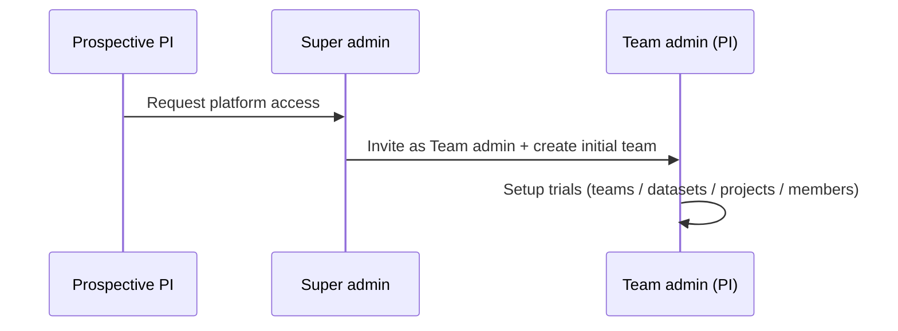
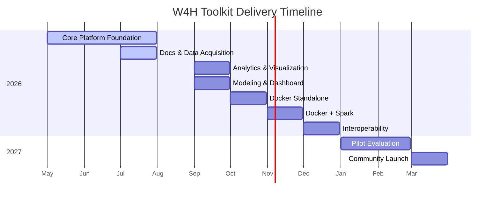
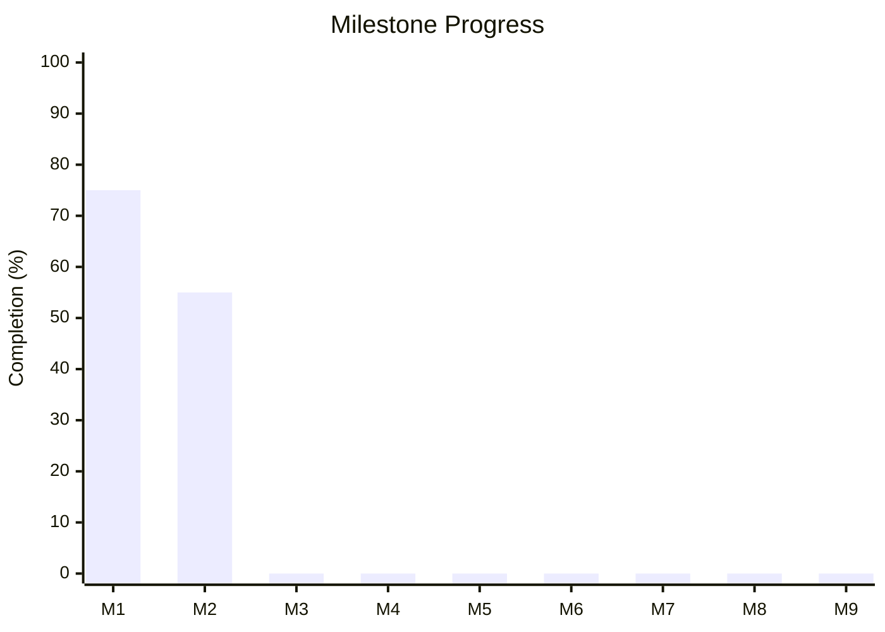

**Protocol Version:** 1

**Date Updated:** August 25, 2026

**Title:** W4H Toolkit — Validating and Promoting the W4H Toolkit

**Principal PI:** Cyrus Shahabi, shahabi@usc.edu

**Co-Investigator:** Luciano Nocera, nocera@usc.edu

**Funding:** SC CTSI Pilot Funding Program

**Document Status:** Draft v0.32

> **Changelog (v0.31 → v0.32):** Pulled **[ADR-021](ADR-021-cohort-control-group-comparison.md)** filter-based cohort comparison onto the project Analytics tab (ICDE demo offline query: selected subjects vs control, date range, optional time-of-day windows, KPI deltas, downsampled series, comparison bars). Live `GET`/`POST /datasets/:id/analytics/cohort` over mapped signals — not Streamlit, not free SQL, not a third MET formula. Attribute matching, maps, and real-time remain out. A-02/A-03/A-07 moved to in progress.
> **Changelog (v0.30 → v0.31):** Opened **[ADR-024](ADR-024-ingest-assistant.md)** (Draft): in-app ingest assistant for a team’s own files — browser file chooser builds a **PHI-obscured** profile (headers, types, sizes, redacted preview cells) for Import-mode chat; ingest still uses `POST /datasets/:id/import/csv-batch` (same as sample importers); durable output is a **downloadable runnable package** (generic `w4h-ingest` scaffold + generated `manifest.yaml` + notebook/CLI/`run.sh`) the researcher can edit if the UI mapping fails. Not a new ICDE-style git pair per study and not a project notebook registry (ADR-018). Added **D-35**. D-09 remains the CSV ingest requirement (still `🚩 Todo`).
> **Changelog (v0.29 → v0.30):** **[ADR-023](ADR-023-sql-analytics-contributions.md)** Accepted — YAML-bound SQL analytics contributions executed by the API (`kind: sql`), not free SQL and not ADR-022 `run.sh`. First listing is a **new** planned repo **`w4h-sql-compute-mets`**; the pandas **`w4h-compute-mets`** notebook/CLI (ADR-019) is unchanged. Added **D-34** (discovery + bind/execute engine + mapping interval/unit; `🚩 Todo`). D-14/D-25 list the SQL kind and the new slug. Analytics cards (A-04c) still read cached summaries — not flipped to done. Options memo [analytics-sql-engine-options.md](analytics-sql-engine-options.md) is superseded.
> **Changelog (v0.28 → v0.29):** **D-29**: Contributions admin (`/admin/contributions`) gets a **Fetch repo info** action — paste a repo URL and `POST /contributions/inspect` (`w4h-api`, new `lib/contributions-manifest.js`) auto-fills the catalog row from the README and, for sample-data repos, `manifest.yaml`, running a minimal manifest sanity check (required fields, unusual column types, `geomts_mapping.values[].source` not matching a declared column) surfaced as errors/warnings before save. Manual entry is unchanged and never blocked by validation. Scoped to Super-admin curation of first-party contributions the team keeps producing/improving — not a community self-publish validator (still M9). Also fixed the PHI-safe AI chat (ADR-014): it was telling Super admins to "go to /admin/contributions" as plain text instead of a link, and had no grounded facts about the ADR-016 dataset-vs-importer publish order, so it improvised (and got the manifest filename wrong). `linkInstructions()` now knows the static Platform Admin routes; a new `contributingInstructions()` block states the real manifest.yaml field and the publish-order guidance (`w4h-api/lib/ai/prompt.js`).
> **Changelog (v0.27 → v0.28):** Added **D-33**: Run import dialog (D-31) now covers re-fixing a partial/failed import, not just first load — datasets that already have data are now valid run targets, with an explicit **Update** (`--mode append`, adds missing rows/tables, default) vs **Full re-import** (`--mode replace`, truncates and reloads) choice; both flags already existed in the importer CLI and `run.sh`'s pass-through, only `w4h-api`'s spawn call and the dialog were hardcoded to always replace. Full re-import against a non-empty dataset calls a new `GET /datasets/:id/dependents` (other linked projects via `project_datasets`, active shares via `dataset_shares`) and requires an explicit confirmation checkbox if either is non-empty; with none, it proceeds with just a note — **not gated by Super admin**, same Team admin/project-owner authority as D-12/D-13 throughout. Every run start now writes a `w4h.audit_log` row (`dataset.import.update` / `dataset.import.full_reimport`) so the choice to fully re-import is retained per ADR-011 even though the dataset's own tables get truncated (distinct from the mutable `contribution_runs` status row). Known gap, called out rather than silently skipped: the dependents check has no way to see derived datasets or model runs yet (D-05, M-02 remain `🚩 Todo`), so those aren't part of "dependents" until that lineage tracking exists. See [ADR-022](ADR-022-in-app-contribution-run-trigger.md).
> **Changelog (v0.26 → v0.27):** **D-31**: replaced the single "Run" button with a **"Run import…" dialog** (`ProjectDatasetMasterDetail.vue`) — pick the `runnable` contribution and the target dataset, grouped **already in this project** vs **from team catalog** (picking a catalog one links it as part of starting the run). `w4h-api`'s `contribution-runner.js` now clones a contribution's repo (and its ADR-016 paired data repo) on demand and best-effort fast-forwards it if already checked out — never force/reset, so it can't clobber a developer's own working copy — instead of 500ing when the sibling checkout is missing. A successful run refreshes the dataset's stats in place (`ProjectsEdit.vue`'s new `refreshDatasetsOnly`, no full page reload). Fixed a real bug this surfaced: `hydrateDatasetSummaries` (`w4h-api/routes/projects.js`) resolved a registered table's physical presence assuming `public.<name>`, but ingested tables are schema-qualified (`physical_schema`/`physical_table`, e.g. `ds_sample_dataset.fitbit_subjects`) — so `physical_table_count` stayed `0` and datasets looked stuck on "Needs ingest" even after import succeeded. All four changes verified against the live dev DB (real runs via `startContributionRun`, not mocked), not just read.
> **Changelog (v0.25 → v0.26):** Fixed **D-31**: `getContribution`'s `SELECT_COLS` (`w4h-api/lib/contributions.js`) never selected the `runnable` column, so every in-app run request 400'd with "not runnable from the app" — the button was wired end-to-end but could never actually succeed. Also **generalized the trigger away from the single hardcoded fitbit slug/dataset**: `ProjectDatasetMasterDetail.vue` now loads whichever catalog contributions are `runnable = true` and offers a "Run" action on **any** empty, non-read-only dataset a Team admin/project owner manages (picker if more than one runnable contribution applies), not just the one seeded `sample-fitbit-csv` id — closing the "why not project admin's own datasets" gap ADR-022 review raised. Added a "Prefer the command line?" disclosure next to the button linking to the contribution's own `run.sh` instructions (its README, already documented per-repo). **Docker execution intentionally deferred** — confirmed `w4h-docker/api/Dockerfile` builds `api` from plain `node:22` with no Python and no sibling contribution checkout, so `run.sh` cannot run inside it today; the Friday demo runs the dev/local (Modality B1) path only. Authorization unchanged: still gated solely by the existing dataset-ingest ACL, no new grant model.
> **Changelog (v0.24 → v0.25):** Corrected **D-12**: catalog-row dataset creation already works for Team admin/Super admin via the project workspace's inline "Create new catalog dataset…" control (`ProjectHub.vue`), moved from `🚩 Todo` to `🚧 In progress` — only signal-table DDL/ingest UI (D-09–D-11) remains Todo. Added **D-32** to track dataset **archive** (ADR-010: Team admin/Super admin, no `status` column or endpoint yet — `🚩 Todo`), distinct from dataset delete which W4H never does (ADR-010). Fixed a **P-01** gap: archived projects were not actually hidden from default lists (`w4h-api` `listProjects` had no status filter), contradicting ADR-010's "invisible in default UI" — added a default active-only filter plus an Active/Archived/All override so admins can find and unarchive a project (`/admin/projects`). Confirmed and documented in ADR-010 that archiving a **project** does not cascade to its linked datasets or dataset shares (only dataset archive cascades to that dataset's own shares) — raised while auditing why an Admin couldn't find dataset add/delete controls.
> **Changelog (v0.23 → v0.24):** Opened **[ADR-022](ADR-022-in-app-contribution-run-trigger.md)** (Draft): a Super-admin-curated `runnable` flag on `w4h.contributions`, a standardized `run.sh` entrypoint convention (`w4h-sample-fitbit-csv-importer` first), and an in-app **"Run sample import"** button that has `w4h-api` run it on the calling user's own API key — no new ACL, it inherits the existing dataset-ingest check (D-12/D-13). Built and local-dev-only (no Docker) this session; tracked as new **D-31** (`⚠️ Draft` / `🚧 In progress`). Docker-distribution execution (delegating to the `notebooks` container) is designed in the ADR but not yet built. Candidate addition to the [§17.1 demo checkpoint](#171-demo-checkpoint-friday-august-21-2026) if verified end-to-end in time.
> **Changelog (v0.22 → v0.23):** **D-16a shipped** — a personal API key is now automatically issued at Super admin bootstrap ([lib/db-init.js](https://github.com/USC-InfoLab/w4h-api/blob/main/lib/db-init.js) `createInitialAdmin`) and at invite acceptance ([routes/users.js](https://github.com/USC-InfoLab/w4h-api/blob/main/routes/users.js) `acceptInvite`), reusing a new shared `issueApiKeyForUser` helper (`lib/utils/apiKeys.js`) also adopted by the existing manual rotate endpoint. Best-effort: a key-issuance failure does not block account creation/activation. Audited as `user.api_key.auto_issued`. Req/Impl status moved to `✅ Stable` / `✅ Done`. First gap closed from the [§17.1 demo checkpoint](#171-demo-checkpoint-friday-august-21-2026)'s status table.
> **Changelog (v0.21 → v0.22):** Added **§17.1 Demo checkpoint (Friday, Aug 21, 2026)** — an ad hoc internal demo, not an `M#` milestone, built on the pre-M3 notebook path already smoke-tested in August (see [august-2026-release-plan.md](august-2026-release-plan.md)). Includes an honest "what's real today vs. planned" status table and opens **[ADR-021](ADR-021-cohort-control-group-comparison.md)** (Draft) to formally scope cohort **control-group comparison** (A-03), which previously had no decision record. Outlier detection (A-05) and the legacy prototype's real-time/trajectory-mapping ideas remain unscoped — candidates for future ADRs only if pilot/community demand justifies them.
> **Changelog (v0.20 → v0.21):** Pulled a slice of M3 into **August 2026**: notebook **CLI automation** for `w4h-fitbit-wear-compliance` / `w4h-compute-mets` (parity with the Fitbit importer, ADR-019), new demo contribution **w4h-demo-approximate-queries**, and a vendor-agnostic **basic dataset stats card** (A-01) split out into new **ADR-020**. Assigned to Tracy (10h) and Bharghav (20h); see [dev/analytics-contributions.md](analytics-contributions.md#assignments-august-2026) for tasks and timeline. API cohort summary + wear/MET UI cards (WP4/WP5) remain **September (M3)**.
> **Changelog (v0.19 → v0.20):** **METs & wear compliance** (ADR-019): two planned first-party Contributions (`w4h-fitbit-wear-compliance`, `w4h-compute-mets`); extend Fitbit sample with `heart_rate` + `calories`; basic cohort stats on project **Analytics** tab (A-01a, A-04a–c). Full chart library (A-02–A-03, A-05–A-06) stays deferred within M3. RA handoff: [dev/analytics-contributions.md](analytics-contributions.md).
> **Changelog (v0.18 → v0.19):** **Contributions catalog** (ADR-018): drop `project_notebooks`; in-app catalog is `w4h.contributions` (publisher, kind, language, repo README). `fft_approximate` listed as an external Postgres extension. Ingest notebooks `w4h-load-csv` / `w4h-load-json`. D-14/D-25 retargeted; project workspace no longer tracks notebooks.
> **Changelog (v0.17 → v0.18):** **PHI-safe AI chat** shipped (ADR-014): docked Cursor-like panel; team BYOK Anthropic keys; Super admin **provisioned** platform key with **per-team monthly token quota**; Help / Import / IRB / Process modes; strict PHI egress filter. AI-01…AI-04, AI-13…AI-16, AI-05…AI-08 (IRB drafting mode) marked in progress/done as applicable.
>
> **Changelog (v0.16 → v0.17):** **Community package registry** (ADR-017 Draft): in-app **Packages** browse/search (`registry/packages.json`); Help is contribute-by-PR, not a page per package. **W4H Samples** sandbox — Super admin seeds canonical demo datasets; members auto-enroll and re-run analysis with **personal** API keys (no shared team key; no per-user sample ingest). D-14/D-25 rewritten; D-28–D-30 added. ADR-016 listing decision points at ADR-017.
>
> **Changelog (v0.16 mapping clarification):** GeoMTS is a **role mapping** over physical tables (`w4h.tables` in platform schema), not forced column rename to `subject_id`/`ts`/`lat`/`lon`. ADR-003 / ADR-008 / architecture dataset model revised 2026-08-14. D-03 updated.
>
> **Changelog (v0.15 → v0.16):** **ADR-014 Accepted** — **PHI-safe AI chat** (Claude): Cursor-like multi-chat; **team-scoped API keys** (team pays) + optional Super admin **platform key**; context chips; default **PHI-safe (strict)** egress filter with team setting. Expanded MVP §13.1 (AI-01a…, AI-13…AI-16). CTSI pilot: assistant supports knowledge-transfer / usability without central LLM budget.
>
> **Changelog (v0.14 → v0.15):** Documentation Quality assessments split into **platform Help** vs **project pages**. Account menu: **About** + **Report an issue** (email to `HELP_EMAIL`). Docs mention GitHub Issues for technical contributors (no PHI). UI adoption events (`user.login`, `session.start`, `page.view`) feed `/admin/usage`; unique users expanded (UI vs API). Admin home remains a thin snapshot.
>
> **Changelog (v0.13 → v0.14):** Aligned **Usage** operator surface with CTSI protocol Study Assessments and Measures. Renamed route/menu `/admin/api-usage` → `/admin/usage` (label **Usage**). Expanded D-18/D-19*; ledger purpose is platform study metrics (adoption, latency/reliability, workflow outcomes, knowledge transfer, usability aggregates) — still distinct from HIPAA `audit_log` and anonymous telemetry. Added study-assessment → surface map; M8 export of descriptive usage metrics.
>
> **Changelog (v0.12 → v0.13):** **PI / trial onboarding model:** Super admin bootstraps **platform access** (Team admin account + first team) — they do **not** approve or manage individual trials. After onboard, the Team admin (PI) self-serves trial setup (teams/projects/datasets/members). Draft **T-15–T-18** / **U-17**; revises who may create teams (T-01). **UI:** Super admin always stays in Platform Admin (no app-shell toggle); Team admin **Add Team** self-service.
>
> **Changelog (v0.11 → v0.12):** **Discoverable** datasets (`discoverable`, default **on**): other teams may see name, description, and owning team in the catalog without access to link or query until an explicit share. Catalog filters: **Mine** / **Others** / **Shared**. Clarifies discoverability ≠ share (D-07, S-07 updated).
>
> **Changelog (v0.10 → v0.11):** **Per-team roles** on `team_members` (`team_admin` | `member`) so the same account can be Team admin on one team and a regular member on another (dual-hat). Effective Team admin is membership-scoped, not a single global `users.role`. Clarified that **PI → student ingest without full Team admin** is a finer-grained **ACL/capability** (not solved by per-team roles alone) — tracked as Draft D-22.
>
> **Changelog (v0.9 → v0.10):** Documented **home surfaces** for operators: Super admin Platform Admin home (`/admin/home`) with KPIs, platform-health checks, and usage/audit deep links to validate the deployment; Team admin home (normal app shell — not Platform Admin) with team-scoped **IRB access reports** (H-09). Super admin **attention strip**: invites pending, datasets without team, teams without Team admin, last successful backup / reminder, link to HIPAA checklist. Clarified ledger split: HIPAA `audit_log` vs API usage (D-19) vs optional product telemetry. Project users / project `owner`s do not browse the raw audit log (H-11); owners may generate project-scoped IRB reports from the workspace. **Impl:** Super admin home + `GET /config/admin-home` + stub `/admin/audit-log` and `/admin/api-usage` shipped as 🚧 In progress.
>
> **Changelog (v0.8 → v0.9):** Invite flow aligned with U-14/U-15: time-limited activation link (no password in email); resend/revoke; `invited` user status; quick-start updated. Hard user delete replaced by discontinue/resume (ADR-010, U-01/U-05/U-08–U-12). **Platform Admin UI is Super admin only**; Team admins manage their team from the normal app shell (not “W4H Toolkit Admin”).
> **Changelog (v0.7 → v0.8):** Re-audited **Impl Status** against `w4h-api` / `w4h-app` (teams/projects/datasets catalog, platform docs, roles). Corrected overstated M1/M2 progress. Gaps remain: user discontinue/resume, dataset share CRUD, GeoMTS/ingestion, project-scoped docs, HIPAA audit viewer.
>
> **Changelog (v0.6 → v0.7):** MVP doc editor is a **Markdown editor with preview** (not rich-text WYSIWYG). Project page edit rights follow project membership and may be refined via project ACL `resource_type=doc`. Corrected Doc-* implementation statuses to match existing platform docs work. Removed misplaced “project UI editor for admins” row that collided with Doc-08.
>
> **Changelog (v0.5 → v0.6):** Clarified **project documentation pages** as distinct from platform docs: separate DB table, project-scoped hierarchy (same patterns as platform docs), member edit access, and owner/Super-admin import/export for team versioning. Retires the “link platform doc slug to project” model for project pages.
>
> **Changelog (v0.4 → v0.5):** Renamed document to *MVP*. Unified two-column status tracking (`Req Status` / `Impl Status`) across all sections. Added status and progress tracking to milestone table. Sections previously lacking status columns (Teams, Sharing, REDCap, Analytics, ML, Docs, AI, Deployment) now fully tracked. Redefined **M1** as *Core Platform Foundation* (requirements, architecture, auth, users, teams, projects, datasets, RBAC, core schema) — in progress.
>
> **Changelog (v0.3 → v0.4):** Aligned role vocabulary with ADR-004 (**Super admin** · **Team admin** · **Project user**; "Group Admin" retired as an alias). Documented shared-dataset vs project visibility (ADR-012). Clarified push-share UX and multi-dataset project linking. Project membership simplified to `owner` / `editor` / `viewer` (dropped project `admin`).
>
> **Changelog (v0.2 → v0.3):** Added user discontinue/resume lifecycle (replaces hard "remove"); added personal API key timeout and revocation-on-discontinuation; scoped audit log *viewing* access to Super admin / Team admin; added grant-writing device & trial-design AI capabilities; moved basic email invitation (Google SMTP) into MVP scope and out of "Out of Scope."

---

## Status Key

### Required Status
| Value | Meaning |
|-------|---------|
| `✅ Stable` | Requirement is agreed and unlikely to change |
| `⚠️ Draft` | Placeholder; not yet agreed |
| `❌ Deprecated` | Removed from scope |

### Implementation Status
| Value | Meaning |
|-------|---------|
| `✅ Done` | Fully implemented and verified |
| `🔁 In review` | Implemented; pending verification or rework |
| `🚧 In progress` | Actively being built |
| `🚩 Todo` | No implementation yet |

---

## 1. Overview

The W4H Toolkit is a research-grade, open-source wearable health data platform for clinical research teams. It enables researchers to ingest, store, analyze, visualize, and model wearable data — standardized using the **GeoMTS (Geospatial Multivariate Time Series)** abstraction — within a secure, multi-tenant, HIPAA-compliant environment.

The MVP establishes the core platform architecture: multi-tenant team isolation, dataset sharing across teams, HIPAA-compliant data pipelines, REDCap data import, project-scoped analytics, AI-assisted research tools, and a comprehensive documentation system.

Role and sharing semantics follow [ADR-004](ADR-004-acl-roles.md), [ADR-002](ADR-002-cross-trial-sharing.md), and [ADR-012](ADR-012-project-dataset-linking.md).

---

## 2. Roles & Access Model

Access is layered: **platform role** → **team membership role** → **project membership role** → optional **resource ACL** (e.g. docs). See [ADR-004](ADR-004-acl-roles.md).

| # | Requirement | Req Status | Impl Status |
|---|-------------|------------|-------------|
| R-01 | Platform role **Super admin** is account-wide (`users.role`). Non–Super-admin accounts are standard users whose team/project authority comes from memberships (ADR-004). | `✅ Stable` | `🔁 In review` |
| R-02 | Project membership roles are `owner`, `editor`, and `viewer`; project `admin` is retired. | `✅ Stable` | `✅ Done` |
| R-03 | A user may belong to multiple teams, each with its own **team membership role**. | `✅ Stable` | `🚧 In progress` |
| R-04 | Every project belongs to exactly one owning team. | `✅ Stable` | `🔁 In review` |
| R-05 | Sharing a dataset never shares a project (ADR-012). | `✅ Stable` | `🚧 In progress` |
| R-06 | All users (except Super admin), projects, and datasets must belong to a team. | `✅ Stable` | `🚧 In progress` |
| R-07 | Users are never hard-deleted; lifecycle uses `active` / `discontinued`. | `✅ Stable` | `✅ Done` |
| R-08 | **Team membership roles** on `team_members.role`: `team_admin` \| `member`. The same user may be `team_admin` on team A and `member` on team B (dual-hat). | `✅ Stable` | `🚧 In progress` |
| R-09 | Effective Team admin for team T = Super admin **or** membership on T with role `team_admin`. Global `users.role = team_admin` is legacy and migrates onto `team_members`. | `✅ Stable` | `🚧 In progress` |

Project membership roles are **not** a fourth platform tier. Team membership roles are **not** a fourth platform tier either — they scope Team admin vs member **per team**.

### 2.1 Key Rules

- A user **can belong to multiple teams** with **different roles per team** (e.g. Team admin on their home trial, `member` on a collaborator team).
- **Team admins** (per team) manage that team's users, projects, and datasets — including inviting, discontinuing, and resuming members — within that team only.
- **All projects belong to one owning team.** There are no dual-owned or platform-level "Super admin" projects.
- **Sharing a dataset does not share a project.** A Team A project that links Team B's shared dataset is visible to Team A only (ADR-012). Team B sees the share agreement, not Team A's project.
- New deployments **must** assign all non–Super-admin users, projects, and datasets to a team at setup time. Unscoped records are not permitted.
- Users are **never hard-deleted** from the platform. A user account has a `status` of `active` or `discontinued`; discontinuing a user is reversible (see §4).
- **Ingest without full Team admin** (PI delegates wearable ETL to a student) is **not** covered by per-team roles alone — that is a finer-grained ACL/capability (see D-22).
---

## 3. Multi-Tenancy (Research Teams)

### 3.0 Platform access vs trial setup (onboarding)

Super admin **does not** manage or approve individual trials — they have no trial-domain knowledge. Separation of duties:

| Stage | Who | What |
|---|---|---|
| 1. Request access | Prospective PI (guest) | Submits a **platform access** request (identity + affiliation + brief purpose) |
| 2. Bootstrap | Super admin | Creates the **Team admin** account (invite) and an **initial team**; does **not** configure projects, datasets, or IRB for the trial |
| 3. Trial setup | Team admin (PI) | Creates further teams if needed, datasets, projects, members, shares — full self-service |

### 3.1 Team Management

| # | Requirement | Who | Req Status | Impl Status |
|---|-------------|-----|------------|-------------|
| T-01 | Create a research team (name, slug). **Bootstrap:** Super admin may create the PI’s initial team at onboarding. **Self-service:** Team admin may create additional teams for their trials after they have been onboarded (T-15). | Super admin; Team admin (after onboard) | `⚠️ Draft` | `🚧 In progress` |
| T-02 | List all teams with member count and project count. | Super admin | `✅ Stable` | `🔁 In review` |
| T-03 | Edit any team's name and metadata. | Super admin | `✅ Stable` | `✅ Done` |
| T-04 | Deactivate any team (soft-delete; preserves data). | Super admin | `✅ Stable` | `✅ Done` |
| T-05 | View, edit, and manage their own team's details, metadata, and membership. | Team admin (scoped to own team) | `✅ Stable` | `✅ Done` |
| T-06 | Each team has a unique URL-friendly `slug`. | System | `✅ Stable` | `✅ Done` |
| T-15 | After platform onboarding, Team admin can create additional teams (new trials / study tenancies) without Super admin involvement. Super admin does **not** approve each new team/trial. | Team admin | `⚠️ Draft` | `🚧 In progress` |
| T-16 | Prospective users can submit a **platform access request** (name, email, affiliation, short purpose). This is **not** a per-trial approval queue. | Guest / System | `⚠️ Draft` | `🚩 Todo` |
| T-17 | Super admin can list pending access requests and **fulfill** one by inviting the requester as Team admin and creating their **initial team** (guided or one-step). | Super admin | `⚠️ Draft` | `🚩 Todo` |
| T-18 | Super admin attention / home surfaces pending **access requests** (not trial setup tasks). | Super admin | `⚠️ Draft` | `🚩 Todo` |

### 3.2 User–Team Association

| # | Requirement | Who | Req Status | Impl Status |
|---|-------------|-----|------------|-------------|
| T-07 | Assign a user to one or more teams at creation, with a **team membership role** per team (`team_admin` \| `member`). | Super admin / Team admin (own team only) | `✅ Stable` | `🚧 In progress` |
| T-08 | Remove a user from a team (membership link only — does **not** discontinue the user's account or their membership in other teams). | Super admin / Team admin (own team only) | `✅ Stable` | `🚧 In progress` |
| T-09 | Users with no team assignment are Super admins. | System | `✅ Stable` | `🔁 In review` |
| T-10 | Team admin can view, invite, edit, discontinue, and resume members of their team (scoped by that team's membership). | Team admin | `✅ Stable` | `🔁 In review` |
| T-11 | Users can see teammates across all their teams; Super admin sees all users globally. | System | `✅ Stable` | `✅ Done` |
| T-12 | Discontinuing a user does not remove their team or project memberships; resuming restores their prior access immediately. | System | `✅ Stable` | `🚩 Todo` |
| T-13 | Change a member's **team membership role** on a team without changing their roles on other teams (dual-hat). | Super admin / Team admin (own team) | `✅ Stable` | `🚧 In progress` |
| T-14 | Add an existing user to a team with an explicit team membership role (no duplicate account). | Super admin / Team admin (own team) | `✅ Stable` | `🚧 In progress` |

---

## 4. User Management

### 4.1 Core Lifecycle

| # | Requirement | Req Status | Impl Status |
|---|-------------|------------|-------------|
| U-01 | Create, edit, discontinue, and resume users. Users are never hard-deleted. | `✅ Stable` | `✅ Done` |
| U-02 | Assign platform role `super_admin` (account-wide). Non–Super-admin authority is via **team membership roles** and **project membership roles** (ADR-004). Legacy `users.role` values `team_admin` / `project_user` / `admin` / `researcher` / `clinician` migrate accordingly. | `✅ Stable` | `🔁 In review` |
| U-03 | Users have multi-valued team membership (`team_members`) including per-team role. | `✅ Stable` | `🚧 In progress` |
| U-04 | Team admin can invite/add members to their team (with team membership role). | `✅ Stable` | `🚧 In progress` |
| U-05 | Team admin can discontinue and resume Project users in their team. | `✅ Stable` | `✅ Done` |
| U-06 | `team_id` (primary) embedded in JWT at login for request scoping. | `✅ Stable` | `✅ Done` |
| U-07 | User profile displays their team(s) and project memberships. | `✅ Stable` | `🚩 Todo` |
| U-08 | Users have a `status` field: `active` or `discontinued`. | `✅ Stable` | `✅ Done` |
| U-09 | Discontinuing a user preserves their full historical record (audit trail, prior contributions, team/project links) — only their ability to authenticate and access data is suspended. | `✅ Stable` | `✅ Done` |
| U-10 | Discontinuing a user immediately invalidates all of that user's active web-app sessions/JWTs and all of their personal API keys (see D-20). | `✅ Stable` | `✅ Done` |
| U-11 | Resuming a discontinued user restores web-app login ability; the user must issue new API key(s) post-resume (old keys remain revoked). | `✅ Stable` | `✅ Done` |
| U-12 | `/admin/users` list and `/admin/users/:id` detail show current status (`active` / `discontinued`) with a toggle action, scoped per role. | `✅ Stable` | `✅ Done` |

### 4.2 Email Invitations

| # | Requirement | Req Status | Impl Status |
|---|-------------|------------|-------------|
| U-13 | Super admin / Team admin can invite a new user by email via **Google SMTP**. | `✅ Stable` | `✅ Done` |
| U-14 | Invitation email contains a time-limited signed link for password set and account activation. | `✅ Stable` | `✅ Done` |
| U-15 | Expired or unused invitations can be revoked or resent by the inviting admin. | `✅ Stable` | `✅ Done` |
| U-16 | Invite flow is intentionally basic for MVP: single SMTP provider (Google), plain-text/simple HTML template, no custom branding. | `✅ Stable` | `✅ Done` |
| U-17 | Platform access request (T-16) is distinct from Team admin **inviting** members to an existing team (U-13). Fulfilling an access request uses the invite flow with team membership role `team_admin` and an initial team (T-17). | `⚠️ Draft` | `🚩 Todo` |

---

## 5. Project Management

| # | Requirement | Req Status | Impl Status |
|---|-------------|------------|-------------|
| P-01 | Create, list, view, edit, archive projects. Archived projects are hidden from default lists (per [ADR-010](ADR-010-soft-delete-no-hard-deletion.md)) with an Active/Archived/All filter (Team admin, project `owner`, Super admin) to find and unarchive one. Archiving a project leaves its linked datasets and dataset shares untouched — no cascade. | `✅ Stable` | `✅ Done` |
| P-02 | Project member roles: `owner`, `editor`, `viewer` (retire project `admin`). | `✅ Stable` | `✅ Done` |
| P-03 | At least one `owner` enforced per project. | `✅ Stable` | `✅ Done` |
| P-04 | Projects have a `team_id` (owning team). | `✅ Stable` | `✅ Done` |
| P-05 | Team admin can create projects within their team and link multiple owned or inbound-shared datasets (D-06, ADR-012). | `✅ Stable` | `✅ Done` |
| P-06 | Users see only projects in their team(s) or where explicitly added as members (same team only in MVP). | `✅ Stable` | `✅ Done` |
| P-07 | Super admin sees all projects across all teams. | `✅ Stable` | `✅ Done` |
| P-08 | Project list and detail views display the owning team name. | `✅ Stable` | `✅ Done` |
| P-09 | Project documentation pages stored in a dedicated project-scoped table (see §12.2). | `✅ Stable` | `✅ Done` |
| P-10 | IRB protocol metadata stored per project (protocol ID, expiry date). | `✅ Stable` | `✅ Done` |

---

## 6. Dataset Management & GeoMTS Abstraction

All datasets in the W4H Toolkit are interpreted using the **GeoMTS (Geospatial Multivariate Time Series)** abstraction: subject-anchored, multivariate time series with **optional** geospatial context. GeoMTS roles (`subject`, `time`, optional lat/lon, values) are applied through a **platform mapping registry** in `w4h` (`w4h.tables`) — physical tables keep researcher-/device-familiar column names and need not include lat/lon ([ADR-003](ADR-003-dataset-table-model.md), [ADR-008](ADR-008-geomts-data-model.md)).

### 6.1 Dataset Core

| # | Requirement | Req Status | Impl Status |
|---|-------------|------------|-------------|
| D-01 | Datasets have a `team_id` (owning team). | `✅ Stable` | `✅ Done` |
| D-02 | Datasets have rich metadata: name, description, device type, sampling rate, subject count, date range, GeoMTS schema, IRB reference. | `✅ Stable` | `🚧 In progress` |
| D-03 | Datasets used for GeoMTS analysis have registered tables in `w4h.tables` with a role **mapping** (subject, time, optional geo, values). Physical column names are not required to be normalized. | `✅ Stable` | `🚧 In progress` |
| D-04 | Original data is always preserved. Derived or modified data is stored separately (additive model). | `✅ Stable` | `🚩 Todo` |
| D-05 | Each dataset version (original, derived) is tracked with provenance metadata. | `✅ Stable` | `🚩 Todo` |
| D-06 | Datasets can be linked to one or more projects with per-link access type (`read` / `read_write`). Linkable set = project team’s owned datasets ∪ inbound shares ∪ datasets the actor admins on their other teams (linking those auto-creates a team share). | `✅ Stable` | `🚧 In progress` |
| D-07 | Team catalog shows: (1) **Mine** — owned datasets; (2) **Shared** — inbound shares (linkable); (3) **Others** — peer datasets marked **Discoverable** (name, description, owning team only — **not** linkable until shared). Non-discoverable peer datasets stay hidden. | `✅ Stable` | `🚧 In progress` |
| D-08 | Super admin sees all datasets across all teams. | `✅ Stable` | `✅ Done` |
| D-23 | **Discoverable** flag on each dataset: when on, other teams can see the dataset’s name, description, and owning team in **Others**. Does **not** grant link, query, or project access (share still required). Default **on** at create; Team admin / Super admin can change anytime. | `✅ Stable` | `🚧 In progress` |
| D-24 | Datasets list supports filters **All** / **Mine** / **Others** / **Shared** (D-07). | `✅ Stable` | `🚧 In progress` |
| D-32 | Datasets can be **archived** (Team admin / Super admin, per [ADR-010](ADR-010-soft-delete-no-hard-deletion.md)): archiving hides a dataset from default views and blocks new ingestion without deleting data; archiving auto-revokes that dataset's own sharing agreements and unlinks it from projects. Restore via catalog **Archived** filter. No hard delete. | `✅ Stable` | `✅ Done` |

### 6.2 Data Ingestion

| # | Requirement | Req Status | Impl Status |
|---|-------------|------------|-------------|
| D-09 | Import datasets via **CSV**. | `✅ Stable` | `🚩 Todo` — API `csv-batch` exists for sample importers; in-app chooser + ingest assistant is [ADR-024](ADR-024-ingest-assistant.md) (D-35) |
| D-10 | Import datasets via **JSON**. | `✅ Stable` | `🚩 Todo` |
| D-11 | Import datasets via **REDCap** (see §9). | `✅ Stable` | `🚩 Todo` |
| D-12 | **Super admin** or **Team admin** (team membership role on the owning team) can create datasets and ingest data via the privileged path (catalog + signal-table DDL via `w4h_platform`). | `✅ Stable` | `🚧 In progress` — catalog-row creation is done (inline "Create new catalog dataset…" in the project workspace, `w4h-app` `ProjectHub.vue`; backend `actorCanManageCatalogOnTeam`); signal-table DDL / ingest UI is still Todo, tracked as D-09–D-11 |
| D-13 | **Team members** who are not Team admin ingest data via **API key** only (no direct DB / DDL) when so authorized (project membership + key scope). | `✅ Stable` | `🚧 In progress` |
| D-14 | Catalog first-party tools (ADR-018): paired **w4h-sample-fitbit-csv** + **w4h-sample-fitbit-csv-importer** (ADR-016), **w4h-load-json**, and listed **`fft_approximate`** Postgres extension (not vendored into the API). **In progress, August 2026 (ADR-019):** extend Fitbit sample with `heart_rate` + `calories`; catalog **w4h-fitbit-wear-compliance** and **w4h-compute-mets**, each with a CLI automation entry point (`kinds: notebook, cli`) mirroring the Fitbit importer; catalog demo notebook **w4h-demo-approximate-queries** for `fft_approximate`. **Planned (ADR-023):** separate SQL contribution **`w4h-sql-compute-mets`** (`kind: sql`) — YAML + parameterized SQL via the API; do not rewrite the pandas METS repo. | `✅ Stable` | `🚧 In progress` |
| D-15 | Ingestion logs stored with timestamp, user, row count, and status. | `✅ Stable` | `🚩 Todo` |
| D-22 | **Ingest delegation (ACL/capability):** a Team admin may grant a team `member` permission to create/ingest datasets for that team **without** elevating them to `team_admin` (e.g. PI delegates wearable ETL to a student). This is finer-grained than per-team RBAC; exact grant model TBD (team capability flag vs resource ACL). | `⚠️ Draft` | `🚩 Todo` |
| D-25 | **Contributions catalog** in `w4h.contributions` (ADR-018): publisher, one or more kinds (`notebook` \| `cli` \| `script` \| `postgres_extension` \| `dataset` \| `sql`), language, git repo, README. `kind: sql` is a YAML-bound SQL **job** executed by the API ([ADR-023](ADR-023-sql-analytics-contributions.md)), distinct from `postgres_extension`. Super admin CRUD; authenticated browse (`GET /contributions`). Help is contribute-only, not a page per tool. | `✅ Stable` | `🚧 In progress` |
| D-26 | Importer repos support **incremental sync** (append/delta CSV) with documented cron path. | `✅ Stable` | `🚧 In progress` |
| D-27 | Importer credentials via **environment / local `.env` only** — API keys never in git (ADR-007). | `✅ Stable` | `🚧 In progress` |
| D-28 | **W4H Samples sandbox:** platform team owns one canonical ingested demo per curated sample. Auto-enroll all accounts as team `member` + sandbox project **viewer**. **Super admin only** seeds/replaces canonical tables. Members re-run analysis notebooks (read). Concurrent query OK; concurrent ingest not allowed. Synthetic data only. | `✅ Stable` | `🚧 In progress` |
| D-29 | Contribute a package by **PR** to `registry/packages.json` (plus git repos). No in-app **community self-publish** UI in MVP (M9). Super admin curating first-party contributions has an in-app assist: paste a repo URL on `/admin/contributions` and **Fetch repo info** auto-fills the catalog row from the README / `manifest.yaml` **and detected kinds** (notebook, CLI, Postgres extension, dataset, SQL job) and runs a minimal manifest sanity check (`POST /contributions/inspect`), shown as errors/warnings before save; manual entry still works and is never blocked by validation. | `✅ Stable` | `🚧 In progress` |
| D-30 | Sandbox notebook access uses each user’s **personal API key** scoped by Samples project membership. No shared sample-team key in multi-user deployments. | `✅ Stable` | `🚩 Todo` |
| D-31 | **In-app run trigger** for Super-admin-curated `runnable` catalog contributions (ADR-022): a **"Run import…" dialog** — pick contribution + dataset (already-linked or from team catalog) — POSTs to `w4h-api`, which clones/updates the contribution's repo on demand and runs its standardized `run.sh` entrypoint using the calling user's own API key, then refreshes the dataset's stats in place on success. Offered on **any** non-read-only dataset a Team admin/project owner manages (empty or already loaded, D-33) — not tied to one hardcoded dataset — for whichever contribution(s) are marked `runnable`. Built and working for `w4h-api` running directly on a host with Python (no Docker); the earlier `runnable`-column read bug and a `physical_table_count` resolution bug are both fixed. Docker-distribution execution — `api` delegating to the existing `notebooks` container (ADR-015) since the `api` image has no Python — is designed but not yet built and is **out of scope for the Aug 21 demo**. Authorization reuses the existing dataset-ingest ACL (D-12/D-13); no new grant model, distinct from D-22's ingest-delegation capability. | `⚠️ Draft` | `🚧 In progress` |
| D-33 | **Update vs Full re-import mode** on the Run import dialog (ADR-022): **Update** (`--mode append`, default) adds missing rows/tables without touching existing data; **Full re-import** (`--mode replace`) truncates and reloads every table from source — the fix path for a partial/failed prior import (e.g. missing tables), instead of archiving and recreating the dataset (no such thing exists per ADR-010 anyway). Full re-import against a dataset that already has data runs a dependents check (`GET /datasets/:id/dependents`: other linked `project_datasets`, active `dataset_shares`) and requires explicit confirmation if either is non-empty; otherwise it proceeds with just a note. No Super admin approval required — same Team admin/project-owner ACL as D-12/D-13. Every run start writes a `w4h.audit_log` row (`dataset.import.update` / `dataset.import.full_reimport`), independent of the mutable `contribution_runs` status row, so the audit trail survives even though a full re-import truncates the dataset's own tables. Does **not** check derived datasets / model runs as dependents — no lineage table exists yet (D-05, M-02 still `🚩 Todo`). | `✅ Stable` | `🚧 In progress` — backend (`contribution-runner.js`, `POST /contributions/:slug/run`, `GET /datasets/:id/dependents`) and UI (`ProjectDatasetMasterDetail.vue`) built; not yet verified against a live run |
| D-34 | **SQL analytics contributions** ([ADR-023](ADR-023-sql-analytics-contributions.md)): catalog `kind: sql`; `GET /datasets/:id/signals` discovery over `w4h.tables`; `POST /datasets/:id/contributions/:slug/sql` binds Super-admin-vetted YAML + parameterized SQL (no free SQL body); persist `sampling_interval` on mapping at ingest; materialize derived signals as **new** tables (`table_prefix`). First listing **`w4h-sql-compute-mets`** (SQL job plus notebook/CLI that target one dataset in a project). Users preview; Team admin / project owner materializes. Distinct from ADR-022 `run.sh`. | `✅ Stable` | `🚧 In progress` — discovery + bind/execute + catalog seed + thin notebook/CLI; GitHub remote for the SQL repo not required for local sibling checkout |
| D-35 | **Ingest assistant** ([ADR-024](ADR-024-ingest-assistant.md)): PI / Team admin uses **Import files…** on a writable dataset **in their project** (distinct from catalog **Run import…**). Private by default: no share, `discoverable = false`, no `w4h.contributions` row, no Samples seed. JS builds a **PHI-obscured** profile; spec stored on that dataset; App posts `csv-batch` (**Update** / **Full**). Optional download of importer zip for local edit/cron. **Submit to Super admin** is later and explicit: importer package + synthetic/de-identified sample data package (not live PHI). Claude has no filesystem access. | `⚠️ Draft` | `🚩 Todo` |

### 6.3 API Key Data Access

| # | Requirement | Req Status | Impl Status |
|---|-------------|------------|-------------|
| D-16 | Project users authenticate against the data API using a **personal**, individually-issued API key. | `✅ Stable` | `🚧 In progress` |
| D-16a | A personal API key is **automatically generated when a user account is created/activated** (Super admin bootstrap, invite acceptance) — removes the manual first-use "Generate new key" step. Shared `issueApiKeyForUser` helper (`lib/utils/apiKeys.js`) used by bootstrap, invite acceptance, and the existing manual rotate endpoint; best-effort, does not block account creation/activation on failure; audited as `user.api_key.auto_issued`. Discontinuing a user still immediately invalidates it (D-21); TTL (D-20) applies the same as a manually generated key. | `✅ Stable` | `✅ Done` |
| D-17 | API keys are scoped to a user's project memberships and their allowed datasets. | `✅ Stable` | `🚩 Todo` |
| D-18 | API key analytics: log every API access event to `usage_events` (user, timestamp, duration; `metadata` includes status, path/method, and when available dataset, query type, row count). | `✅ Stable` | `🚧 In progress` |
| D-19 | **Usage** dashboard at `/admin/usage` (menu: **Usage**) visible to Super admin (platform-wide) and Team admin (team-scoped). Sections: **Adoption / key hygiene**; **System performance** (latency p50/p95, error rate); **Workflow outcomes** when richer event types exist; **Knowledge transfer** milestones; optional **Usability** summary. Not a HIPAA audit viewer. | `✅ Stable` | `🚧 In progress` |
| D-19a | Super admin home (`/admin/home`) surfaces a **thin usage snapshot** (API calls, active keys / 24h–7d) with deep link to `/admin/usage`. Full study metrics live on the Usage page — not on home. | `✅ Stable` | `✅ Done` |
| D-19b | Richer `usage_events` beyond `api.request` (e.g. `dataset.import`, `query.run` with success/fail, duration, format/row counts) feed Data Integration and Workflow Performance assessments. Depends on D-15 ingest logging. | `⚠️ Draft` | `🚩 Todo` |
| D-19c | Knowledge-transfer metrics on `/admin/usage`: time from invite → first API key → first successful data action; % of invited users completing a representative task within N days (supports M8 / protocol Knowledge Transfer). | `⚠️ Draft` | `🚩 Todo` |
| D-19d | Usability aggregates on `/admin/usage` from `survey_responses` (e.g. SUS / satisfaction summary) or deep link; raw survey entry elsewhere. CSV/export for SC-CTSI descriptive reporting. | `⚠️ Draft` | `🚩 Todo` |
| D-19e | UI adoption events in `usage_events`: `user.login` (password / email-code), `session.start`, `page.view` (JWT). Usage page reports unique UI users, logins, page views separately from unique API users — so dashboard use is visible without collapsing into admin home KPIs. | `✅ Stable` | `🚧 In progress` |
| D-20 | API keys have a configurable timeout/expiration (TTL). | `✅ Stable` | `🚩 Todo` |
| D-21 | When a user is `discontinued`, all personal API keys are immediately invalidated. | `✅ Stable` | `✅ Done` |

---

## 7. Dataset Sharing (Cross-Team)

Sharing is **dataset-scoped**, not project-scoped. See [ADR-002](ADR-002-cross-trial-sharing.md) and [ADR-012](ADR-012-project-dataset-linking.md).

**Push-share UX (MVP default):** Team admin A opens an **owned** dataset → Share → Team B (or a Team B project). Team admin B then sees it as *"Shared by [Team A]"* and may **link** it to a Team B project. A's modeling project that also uses that dataset remains **visible only to Team A**.

**Discoverable ≠ share:** Turning **Discoverable** on only lists metadata for other teams (**Others** filter). Access to link or query still requires an explicit share (S-01).

| # | Requirement | Who | Req Status | Impl Status |
|---|-------------|-----|------------|-------------|
| S-01 | Share a dataset owned by your team with one or more other teams (push share). | Team admin, Super admin | `✅ Stable` | `🚧 In progress` |
| S-02 | Share is **team-wide** (recipient team can link from any of their projects). Project-scoped share is deferred. | Team admin | `✅ Stable` | `🚧 In progress` |
| S-03 | Default share access type is `read`; `read_write` is explicitly granted. | Team admin | `✅ Stable` | `🚧 In progress` |
| S-04 | Revoke a dataset share at any time. | Team admin (own datasets), Super admin | `✅ Stable` | `🚧 In progress` |
| S-05 | Shared datasets show owner team name in the UI: *"Shared by [Team Name]"*. | System | `✅ Stable` | `🚧 In progress` |
| S-06 | Super admin can view all active share agreements across all teams. | Super admin | `✅ Stable` | `🚧 In progress` |
| S-07 | Recipient catalog: **Mine** ∪ **Shared** (linkable) ∪ **Others** (discoverable metadata only). Never expose non-discoverable peer catalogs or peer project links. | System | `✅ Stable` | `🚧 In progress` |
| S-08 | Linking a shared dataset into a project does not grant the source team visibility into that project. | System | `✅ Stable` | `✅ Done` |
| S-09 | Optional: recipient may request share; owner Team admin or Super admin approves (pull path). | Team admin, Super admin | `⚠️ Draft` | `🚩 Todo` |
| S-10 | Discoverable listing does not auto-create a share and does not appear in the project linkable set until shared. | System | `✅ Stable` | `🚧 In progress` |

---

## 8. HIPAA Compliance

The platform must comply with HIPAA Security Rule requirements for handling Protected Health Information (PHI).

| # | Requirement | Req Status | Impl Status |
|---|-------------|------------|-------------|
| H-01 | Append-only audit log for all PHI access and mutations (`w4h.audit_log`). | `✅ Stable` | `🚧 In progress` |
| H-02 | Audit log records: timestamp, user, action, resource type, resource ID, IP address, user agent. | `✅ Stable` | `🔁 In review` |
| H-03 | Audit log records must be retained for a minimum of **6 years**. No deletions permitted. | `✅ Stable` | `🚩 Todo` |
| H-04 | All PHI-modifying API endpoints must write to the audit log. | `✅ Stable` | `🚩 Todo` |
| H-05 | Data at rest encrypted (PostgreSQL-level or filesystem-level encryption). | `✅ Stable` | `🚩 Todo` |
| H-06 | Data in transit encrypted via TLS/HTTPS. | `✅ Stable` | `🚩 Todo` |
| H-07 | Role-based access enforcement on all data endpoints (least-privilege), including immediate revocation for `discontinued` users. | `✅ Stable` | `🚧 In progress` |
| H-08 | Automated HIPAA compliance checks as part of CI/CD pipeline. | `✅ Stable` | `🚩 Todo` |
| H-09 | Ability to generate an access audit report per dataset or project for IRB review (filtered summary from `audit_log`; not a dump of unrelated teams). | `✅ Stable` | `🚩 Todo` |
| H-09a | **Team admin home** (normal app shell) provides entry points to generate / download **IRB access reports** for the team's datasets and projects. | `✅ Stable` | `🚩 Todo` |
| H-09b | **Project `owner`** may generate an IRB access report for **their project only** from the project workspace. They cannot browse the raw platform audit log. | `✅ Stable` | `🚩 Todo` |
| H-10 | Support de-identification pipelines before data is shared across teams. | `⚠️ Draft` | `🚩 Todo` |
| H-11 | Audit log viewing access is role-scoped: Super admin sees all; Team admin sees own team only; Project users cannot browse raw audit log. | `✅ Stable` | `🚧 In progress` |
| H-12 | Super admin Platform Admin home (`/admin/home`) shows a **compliance / ops snapshot** (audit write health, recent privileged events, failed logins) with deep links to `/admin/audit-log` — not a full log table on the home page. | `✅ Stable` | `✅ Done` |
| H-12a | Super admin home **attention strip** flags: invites pending; datasets without an owning team; teams without a Team admin; last successful backup / backup-reminder ops note; plus a link to the in-app **HIPAA compliance checklist** doc. | `✅ Stable` | `✅ Done` |

**Ledger split (do not conflate on home pages):**

| Ledger | Store | Purpose | Who |
|--------|-------|---------|-----|
| HIPAA audit | `w4h.audit_log` | PHI access, ACL, auth, privileged admin actions (ADR-011) | Super admin (all); Team admin (own team); IRB reports for Team admin / project owner |
| Platform usage | `usage_events` + key analytics (D-18 / D-19*) | CTSI study assessments: adoption, latency/reliability, workflow/ingest outcomes, knowledge transfer; optional usability aggregates — **not** PHI compliance | Super admin; Team admin (own team) via `/admin/usage` |
| Product telemetry | external / opt-in | Product improvement | Settings toggle only — never a compliance or study-assessment surface |

### Study assessments → platform surfaces (CTSI protocol)

Maps protocol **Study Assessments and Measures** to where operators observe descriptive metrics. Analyses remain primarily descriptive (protocol §XIII).

| Protocol domain | Platform surface | MVP reqs |
|-----------------|------------------|----------|
| System performance (latency, speed) | `/admin/usage` — duration percentiles, error rate | D-18, D-19 |
| Data integration (ingest success, formats) | `/admin/usage` + ingest logs when available | D-15, D-19b |
| Workflow performance (task completion / time) | `/admin/usage` — event completion and duration | D-19b |
| Modeling performance | Model-run tracking (later); PHI aspects in audit | M-04; M-08 |
| Usability (SUS / satisfaction) | Survey entry elsewhere; summary on `/admin/usage` | D-19d |
| Usability (unprompted feedback) | Account menu **Report an issue** → email to `HELP_EMAIL` | UX-01 |
| Knowledge transfer (assistant-assisted tasks) | Optional **PHI-safe AI chat** (ADR-014); task time in M8 | AI-01…; D-19c |
| Documentation quality — platform Help | Doc-assisted onboarding tasks; platform doc completeness surveys | Doc-01…Doc-07; Doc-17 |
| Documentation quality — project pages | % projects with pages; task success finding trial materials in project docs | Doc-08…Doc-16; Doc-18 |
| Compliance (HIPAA / FHIR) | `/admin/audit-log`, H-* — **not** Usage | H-01… |
| Knowledge transfer (time-to-task) | `/admin/usage` onboarding milestones | D-19c |
| Wearable value quantification | Pilot analysis / notebooks — not admin Usage KPIs | M8 analysis |
| Community engagement / outreach | GitHub Issues / stars (external); workshops | M9; FAQ |

**Protocol note (Documentation Quality):** Amend the study assessment table to list **platform documentation** and **project documentation** as two outcome lines under the same domain (not a new Aim).

---

## 9. REDCap Integration

REDCap is the most widely used data capture platform in academic clinical trials. W4H must interoperate with it.

| # | Requirement | Req Status | Impl Status |
|---|-------------|------------|-------------|
| R-01 | Connect to a REDCap instance via REDCap API (token-based). | `✅ Stable` | `🚩 Todo` |
| R-02 | Import a REDCap project's records into a W4H dataset. | `✅ Stable` | `🚩 Todo` |
| R-03 | Map REDCap field names to GeoMTS schema fields during import. | `✅ Stable` | `🚩 Todo` |
| R-04 | Schedule recurring REDCap syncs (incremental import of new/updated records). | `✅ Stable` | `🚩 Todo` |
| R-05 | Log REDCap import events in the audit log. | `✅ Stable` | `🚩 Todo` |
| R-06 | Validate imported REDCap data against the dataset's GeoMTS schema. | `✅ Stable` | `🚩 Todo` |
| R-07 | Surface import errors and validation warnings in the admin UI. | `✅ Stable` | `🚩 Todo` |

---

## 10. Analytics Dashboards

Basic analytics dashboards allow researchers to understand the data available in their projects without writing code. **M3 (September 2026)** ships **basic cohort stat cards** on the project Analytics tab (A-01a, A-04a–c) plus **Contributions** notebooks for protocol-grade wear and MET reports (A-04). A **filter-based cohort comparison** (A-02/A-03 v1) is on the Analytics tab now — selected subject IDs vs a control group, [ADR-021](ADR-021-cohort-control-group-comparison.md). Remaining chart-library work (A-05–A-06, attribute filters, maps) stays later in M3. A slice of this — the vendor-agnostic **basic dataset stats card** ([ADR-020](ADR-020-basic-dataset-stats-dashboard.md)) and **Contributions** notebook automation tooling ([ADR-019](ADR-019-mets-wear-compliance-analytics.md)) — is pulled into **August 2026**, assigned to Tracy / Bharghav; see [analytics-contributions.md](analytics-contributions.md#assignments-august-2026) for the timeline. The API wear/MET summary cards (WP4/WP5) stay on the September track.

| # | Requirement | Req Status | Impl Status |
|---|-------------|------------|-------------|
| A-01 | Per-project summary dashboard: subject count, date range, device types, dataset sizes. **Basic stats card:** [ADR-020](ADR-020-basic-dataset-stats-dashboard.md), in progress August 2026 (Tracy). | `✅ Stable` | `🚧 In progress` |
| A-01a | **Analytics tab cohort overview** — cached wear/MET cohort stat cards when linked dataset has HR/calories/MET signals (Users + Admins). | `✅ Stable` | `🚩 Todo` |
| A-02 | Signal-level visualization: time series plots for individual subjects or group averages. **v1:** downsampled heart rate / calories / METs series on the Analytics tab (ADR-021). | `✅ Stable` | `🚧 In progress` |
| A-03 | Comparative analytics: compare selected subjects against a control group. **v1:** filter-based subject IDs + control (entire dataset / everyone else / IDs), not matched cohorts — [ADR-021](ADR-021-cohort-control-group-comparison.md). | `✅ Stable` | `🚧 In progress` |
| A-04 | **Wear compliance (Contributions)** — catalog notebook + CLI (`w4h-fitbit-wear-compliance`); per-subject protocol wear reports; port legacy `ComplianceAnalyzer`. CLI automation in progress August 2026 (Tracy). | `✅ Stable` | `🚧 In progress` |
| A-04a | **Wear compliance (cohort)** — cached cohort wear stats on Analytics tab (% subjects meeting threshold, median daily wear %). | `✅ Stable` | `🚩 Todo` |
| A-04b | **Wear compliance (subject filter)** — same stats scoped to selected subject(s) on Analytics tab. | `✅ Stable` | `🚩 Todo` |
| A-04c | **METs cohort summary** — when `mets` or `mets_computed` exists, show mean MET-hours / simple cohort summary on Analytics tab. | `✅ Stable` | `🚩 Todo` |
| A-05 | Outlier detection visualization for health metrics. | `✅ Stable` | `🚩 Todo` |
| A-06 | Export dashboard views as PDF or PNG for reporting. | `✅ Stable` | `🚩 Todo` |
| A-07 | Dashboard cohort stats accessible to all project members (Viewer and above); Admins additionally get Contributions links for full notebook reports. | `✅ Stable` | `🚧 In progress` |

---

## 11. ML Model Capabilities

The W4H Toolkit supports applying, retraining, and extending pre-built ML models on a team's own data. Built-in models include GeoMTS-based frameworks (BysGNN, NeuroGNN, WaveGNN, Motif analysis).

| # | Capability | Requirement | Req Status | Impl Status |
|---|-----------|-------------|------------|-------------|
| M-01 | **Apply model** | Run a pre-trained model against a project's dataset and view predictions/outputs. | `✅ Stable` | `🚩 Todo` |
| M-02 | **Apply model** | Model outputs stored as a derived dataset (additive; original preserved). | `✅ Stable` | `🚩 Todo` |
| M-03 | **Retrain model** | Fine-tune an existing model with a team's own labeled data. | `✅ Stable` | `🚩 Todo` |
| M-04 | **Retrain model** | Track retraining runs: parameters, dataset version, performance metrics. | `✅ Stable` | `🚩 Todo` |
| M-05 | **Extend model** | Define a new model variant based on an existing architecture with custom hyperparameters. | `✅ Stable` | `🚩 Todo` |
| M-06 | **Extend model** | Share a trained model with another team (with permission). | `⚠️ Draft` | `🚩 Todo` |
| M-07 | **All** | Model execution runs in a notebook environment (Jupyter/VS Code). | `✅ Stable` | `🔁 In review` |
| M-08 | **All** | Model runs logged in the audit trail with user, model version, and dataset reference. | `✅ Stable` | `🚩 Todo` |

---

## 12. Documentation System

### 12.1 Platform Documentation (External Repository)

Platform Help docs are global (not project-owned). Managed by Super admin; synced with `w4h-docs`.

**Editor (MVP):** Platform and project page editing use a **Markdown editor with preview** (source + rendered preview). True rich-text WYSIWYG is out of scope for MVP.

| # | Requirement | Req Status | Impl Status |
|---|-------------|------------|-------------|
| Doc-01 | Documentation is maintained as Markdown files in an external git repository (`w4h-docs`). | `✅ Stable` | `✅ Done` |
| Doc-02 | Admin UI provides a path to **pull and update docs** from the external repository / source path. | `✅ Stable` | `✅ Done` |
| Doc-03 | Admin UI provides a path to **export** docs (Markdown zip) for publish / round-trip with the repository. | `✅ Stable` | `✅ Done` |
| Doc-04 | Docs rendered in the app are fetched from the database (previously synced from the repo). | `✅ Stable` | `✅ Done` |
| Doc-05 | Markdown editor with preview for editing platform documentation pages within the admin UI. | `✅ Stable` | `✅ Done` |
| Doc-06 | Documentation supports embedded code examples, GeoMTS schema snippets, and mermaid diagrams. | `✅ Stable` | `✅ Done` |
| Doc-07 | Platform docs support import from path and export to zip for source-controlled management with an external repository. | `✅ Stable` | `✅ Done` |

### 12.2 Project Documentation Pages (Project-Scoped)

Project pages are **not** platform docs. They use a **separate database table** (not `w4h.docs`, and not a join that only links platform slugs). Each page belongs to exactly one project and never appears in the global Help / platform docs tree.

Hierarchy and authoring match platform docs **within the project**: page types/groupings, sort order, sidebar navigation, Markdown body, TOC, and the same Markdown editor with preview — scoped so one project’s structure cannot leak into another.

| # | Requirement | Req Status | Impl Status |
|---|-------------|------------|-------------|
| Doc-08 | Project documentation pages are stored in a dedicated table separate from platform `docs`; each row has a `project_id` and is owned by that project only. | `✅ Stable` | `✅ Done` |
| Doc-09 | Within a project, pages support the same hierarchy functionality as platform docs: typed groupings (doc types), sort order, sidebar nav, slug/title, Markdown/HTML/TOC, and Markdown editor with preview for create/edit. | `✅ Stable` | `🚧 In progress` |
| Doc-10 | Project pages may include protocol descriptions, data dictionaries, analysis notes, and similar project materials. | `✅ Stable` | `🚩 Todo` |
| Doc-11 | **Default access from project membership:** any project member can **read, create, edit, reorder, and delete** project documentation pages from the project workspace (no Admin UI required). Super admin can manage pages for any project. | `✅ Stable` | `✅ Done` |
| Doc-12 | **ACL:** Project ACL rules must support `resource_type = doc` with `view` / `edit` (and optional `resource_key` for a specific page). Defaults from Doc-11 apply when no ACL rule matches; explicit allow/deny rules may further restrict or grant access on a locked page. | `✅ Stable` | `🚧 In progress` |
| Doc-13 | Project `owner` (and Super admin) can **export** and **import** that project’s documentation as a Markdown archive so teams can version docs outside the platform (analogous to Doc-02/Doc-03, but project-scoped — not the global `w4h-docs` repo). | `✅ Stable` | `🚩 Todo` |
| Doc-14 | Project pages do not appear in platform Help documentation; navigation and APIs are always filtered by `project_id`. | `✅ Stable` | `✅ Done` |
| Doc-15 | Project Docs may link to platform documentation pages. | `⚠️ Draft` | `🚩 Todo` |
| Doc-16 | Retire the current `project_docs` “link platform `docs.slug` to project” model for storing project page content; replace with the dedicated project-pages table (Doc-08). | `✅ Stable` | `🚩 Todo` |
| Doc-17 | **Study metric (platform):** documentation completeness / documentation-assisted task success for **platform Help** (surveys + timed tasks). Distinct from project pages. | `✅ Stable` | `🚩 Todo` |
| Doc-18 | **Study metric (project):** share of pilot projects with ≥1 project doc page; task success locating trial materials (protocol notes, data dictionaries) via **project pages**. | `✅ Stable` | `🚩 Todo` |

### 12.3 Feedback and community channels

| # | Requirement | Req Status | Impl Status |
|---|-------------|------------|-------------|
| UX-01 | Authenticated **app-shell** users can **Report an issue** from the account dropdown; the form emails `HELP_EMAIL` (fallback: SMTP from). No PHI in reports. Not shown in Platform Admin (Super admin receives these). | `✅ Stable` | `✅ Done` |
| UX-02 | Account dropdown **About** modal: product name, SC CTSI funding, PIs, app version, links to Help docs and public GitHub documentation / Issues. Not a routed page. | `✅ Stable` | `✅ Done` |
| UX-03 | Help / FAQ documents that technical contributors may use **GitHub Issues** on the public docs repository; clinical users should prefer in-app Report an issue. Never post PHI to GitHub. | `✅ Stable` | `✅ Done` |

---

## 13. AI Assistant Features

See [ADR-014](ADR-014-ai-assistant-claude.md) (**Accepted**) for **PHI-safe AI chat**: provider, team vs platform keys, Cursor-like UX, and PHI egress filter.

### 13.1 Chat AI Helper (substrate) — PHI-safe AI chat

| # | Requirement | Req Status | Impl Status |
|---|-------------|------------|-------------|
| AI-01 | Embedded **PHI-safe AI chat** accessible from any authenticated page (app shell and Platform Admin). Cursor-like docked panel; optional open-in-tab. Persistent **PHI-safe** badge when filter is strict. | `✅ Stable` | `🚧 In progress` |
| AI-01a | Multi-chat per user: create threads, rename, pin, delete, resume history; streaming replies. | `✅ Stable` | `🚧 In progress` |
| AI-01b | Chat history stored server-side, scoped to the owning user (no shared threads in MVP). | `✅ Stable` | `✅ Done` |
| AI-02 | Context-aware: shell (admin vs app), route, user role, active team / project / dataset metadata. | `✅ Stable` | `✅ Done` |
| AI-02a | Visible **context chips** (removable before send); docs-aware when viewing Help or project pages; domain primer (GeoMTS / trials). | `✅ Stable` | `✅ Done` |
| AI-02b | **Claude** via server-side proxy. **Team Claude API key** configured by Team admin (team pays). Optional **platform Claude key** for Super admin Platform Admin use only. | `✅ Stable` | `✅ Done` |
| AI-02c | Modes on one substrate: Help · Ops · Analysis · IRB (AI-05…AI-08 attach here; AI-09…AI-12 later). | `⚠️ Draft` | `🚧 In progress` |
| AI-03 | Answers questions about platform features, schemas, and workflows; cites Help / project doc slugs when grounded. | `✅ Stable` | `🚧 In progress` |
| AI-04 | Can generate notebook code snippets for common data tasks (filtering, plotting, aggregation) without pasting raw PHI rows. | `✅ Stable` | `🚧 In progress` |
| AI-13 | **PHI-safe mode (default):** egress filter **strict** — allowlist metadata + docs; block subject IDs, raw timeseries, query cells; no row-fetch tools into prompts. UI label: **PHI-safe AI chat**. | `✅ Stable` | `✅ Done` |
| AI-14 | Team (and platform) setting `ai_phi_filter`: **PHI-safe (strict)** (default) \| **Permissive** (confirmed paste / metadata only; still no bulk row injection). Permissive requires Team admin (or Super admin for platform key) and shows a warning (not PHI-safe). | `✅ Stable` | `✅ Done` |
| AI-15 | Blocked sends recorded as `ai.chat_blocked` in `usage_events`; successful turns as `ai.chat`. PHI-class tool use under permissive mode also audited (ADR-011). | `✅ Stable` | `✅ Done` |
| AI-16 | Rate/token budgets per team (and platform); Super admin may disable AI platform-wide. Empty state when no key for active context. | `✅ Stable` | `✅ Done` |

### 13.2 IRB Grant Assistant

Modes / guided flows on the §13.1 substrate (ADR-014) — not separate chat products.

| # | Requirement | Req Status | Impl Status |
|---|-------------|------------|-------------|
| AI-05 | AI assistant guides researchers through drafting IRB submission documents. | `✅ Stable` | `🚧 In progress` |
| AI-06 | Provides templates and guidance for wearable-specific IRB sections (data privacy, HIPAA considerations, device descriptions). | `✅ Stable` | `🚧 In progress` |
| AI-07 | Pre-populates IRB fields from project metadata (PI name, team, dataset types, IRB protocol ID). | `✅ Stable` | `🚧 In progress` |
| AI-08 | Generates a draft Data Management Plan (DMP) based on the project's dataset configuration. | `✅ Stable` | `🚧 In progress` |

### 13.3 Research AI Tools

| # | Requirement | Req Status | Impl Status |
|---|-------------|------------|-------------|
| AI-09 | **Sample size calculator**: compute required sample sizes for wearable-based clinical studies. | `✅ Stable` | `🚩 Todo` |
| AI-10 | **Study design advisor**: recommends statistical methods and study designs for a given wearable data type and clinical question, including trial/protocol design guidance. | `✅ Stable` | `🚩 Todo` |
| AI-11 | **Literature assistant**: surfaces relevant published research based on clinical domain, device type, and target outcome. | `✅ Stable` | `🚩 Todo` |
| AI-12 | **Endpoint-to-device advisor**: given a target clinical endpoint, recommends candidate wearable devices and data streams needed to capture it. | `✅ Stable` | `🚩 Todo` |

---

## 14. Deployment

| # | Requirement | Req Status | Impl Status |
|---|-------------|------------|-------------|
| Dep-01 | **Standalone Docker** deployment: single-container or docker-compose without Spark. | `✅ Stable` | `🚩 Todo` |
| Dep-02 | **Spark-enabled Docker** deployment: scalable version with Apache Spark for large dataset processing. | `✅ Stable` | `🚩 Todo` |
| Dep-03 | Environment configured via `.env` file (DB credentials, API keys, ports, Google SMTP credentials). | `✅ Stable` | `🔁 In review` |
| Dep-04 | Docker images published to a public registry (Docker Hub or GitHub Container Registry). | `✅ Stable` | `🚩 Todo` |
| Dep-05 | Setup documentation covers both deployment modes. | `✅ Stable` | `🚩 Todo` |

---

## 15. Admin & Operator UI

**Platform Admin shell (`W4H Toolkit Admin`) is Super admin only** (v0.9). Super admins **always** use this shell after login — there is no “Exit to app” / Admin UI toggle. Team admins manage trials from the **app shell** (`W4H Toolkit`) and never enter Platform Admin.

### 15.1 Home surfaces

| Home | Who | Purpose | Req Status | Impl Status |
|------|-----|---------|------------|-------------|
| `/admin/home` | Super admin | **Platform ops home:** setup checklist (when needed); KPIs (teams, users by status, projects, datasets, active shares); platform health (SMTP, DB, audit-write OK); thin usage snapshot (API calls / active keys); **attention strip** (failed logins, break-glass, **invites pending**, **datasets without team**, **teams without Team admin**, **last successful backup / backup reminder**); link to **HIPAA compliance checklist** doc; deep links to `/admin/audit-log`, `/admin/usage`, Users, Teams, Settings. Full log tables live on dedicated pages — not on home. | `✅ Stable` | `🚧 In progress` |
| App `/home` (Team admin) | Team admin | **Team operator home:** team-scoped summary (members, projects, datasets, inbound/outbound shares); **IRB access reports** entry (H-09a); deep links to team-scoped management (projects, users, datasets, teams). | `✅ Stable` | `🚧 In progress` |
| Project workspace | Project `owner` | Generate **project-scoped IRB access report** (H-09b). No raw audit browse. | `✅ Stable` | `🚩 Todo` |

### 15.2 Pages

| Page | Req Status | Impl Status | Notes |
|------|------------|-------------|-------|
| `/admin/home` | `✅ Stable` | `✅ Done` | Super admin KPIs + usage/compliance snapshots + attention strip via `GET /config/admin-home` (§15.1, H-12/H-12a) |
| `/admin/teams` | `✅ Stable` | `✅ Done` | List teams (Super admin); Team admin sees own |
| `/admin/teams/add` | `⚠️ Draft` | `🚧 In progress` | Super admin bootstrap; Team admin self-service create after onboard (T-01 / T-15) |
| Access request (public) | `⚠️ Draft` | `🚩 Todo` | PI requests platform access (T-16) |
| Access request queue | `⚠️ Draft` | `🚩 Todo` | Super admin fulfill → Team admin + initial team (T-17 / T-18) |
| `/admin/teams/:id/edit` | `✅ Stable` | `🔁 In review` | Edit team + members; remove-member UX incomplete |
| `/admin/datasets` | `✅ Stable` | `🚧 In progress` | Mine / Others / Shared filters; Discoverable; shares entry |
| `/admin/datasets/shares` | `✅ Stable` | `🚧 In progress` | Inbound/outbound share agreements; revoke |
| `/admin/datasets/:id/ingest` | `✅ Stable` | `🚩 Todo` | Ingestion UI (CSV, JSON, REDCap); ingest assistant [ADR-024](ADR-024-ingest-assistant.md) |
| `/admin/projects` | `✅ Stable` | `✅ Done` | Owning team column |
| `/admin/projects/:id/edit` | `✅ Stable` | `✅ Done` | Catalog/metadata; project pages on workspace (§12.2) |
| `/admin/users` | `✅ Stable` | `✅ Done` | Team column + filter; status badge for invited/discontinued |
| `/admin/users/add` | `✅ Stable` | `✅ Done` | Invite by email; activation link (no password in email); resend/revoke on edit |
| `/admin/users/:id` | `✅ Stable` | `🔁 In review` | Discontinue/resume done; API key list / status history still thin |
| `/admin/usage` | `✅ Stable` | `🚧 In progress` | Menu **Usage**. Adoption includes UI (logins, sessions, page views) vs API unique users (D-19e). Latency/error for `api.request`. Still open: Team admin scoped view, CSV export, richer workflow/usability (D-19b–d). Admin home stays thin — does not duplicate this breakdown. |
| `/admin/audit-log` | `✅ Stable` | `✅ Done` | Super admin filterable viewer + CSV export (`GET /config/audit-log`); view/export audited; Team admin scoped view still open (H-11) |
| Team IRB reports UI | `✅ Stable` | `🚩 Todo` | Team admin home / team page — generate H-09 reports (not Platform Admin) |
| Project IRB report UI | `✅ Stable` | `🚩 Todo` | Project workspace — owner-only project-scoped report (H-09b) |

---

## 16. Out of Scope for MVP

| Feature | Rationale |
|---------|-----------|
| Row-Level Security (RLS) in PostgreSQL | Application-layer scoping sufficient for MVP; RLS is a post-MVP hardening step. |
| Cross-team project membership | MVP limits project members to users within the project's owning team. Dataset share ≠ project access (ADR-012). |
| De-identification pipelines | Planned for post-MVP; raw data sharing relies on IRB-approved agreements. |
| FHIR API endpoints | Interoperability with FHIR is planned post-MVP. |
| Mobile application | Web platform only for MVP. |
| Multi-provider / branded email invitations | MVP ships a basic Google-SMTP-only invite flow (see U-13–U-16); custom templating and alternate providers are post-MVP. |
| White-label / multi-brand UI themes | MVP ships one USC Cardinal+Gold brand via CSS tokens + Super admin UI kit (`/admin/style-guide`). Bootswatch-style theme packs deferred — see [ADR-013](ADR-013-brand-theming-white-label.md). |
| Hard user deletion / GDPR-style erasure | MVP only supports discontinue/resume; permanent erasure workflows are post-MVP. |
| Community / outreach metrics on Usage page | GitHub stars/forks, workshop attendance stay external (M9); do not clutter `/admin/usage`. |
| Wearable-augmented vs standard-of-care outcome deltas on Usage page | Protocol Wearable Value Quantification belongs in pilot analysis notebooks / reports, not admin KPIs. |
| Device wear compliance and MET cohort stats on Usage page | Wear/MET **cohort summaries** belong on the project **Analytics** tab (A-01a, A-04a–c); detailed protocol reports in Contributions (A-04). Not admin Usage KPIs. |

---

## 17. Delivery Timeline

| # | Milestone | Deliverable | Target | Status | Progress |
|---|-----------|-------------|--------|--------|----------|
| M1 | Core Platform Foundation | Requirements, system architecture, authentication, user management, team management (multi-tenancy), project management, dataset management, RBAC, and core database schema | July 2026 | `🚧 In progress` | 75% |
| M2 | Documentation system and data acquisition modules | Markdown editor with preview; CSV/JSON/database ingestion | July 2026 | `🚧 In progress` | 55% |
| M3 | Analysis and visualization components | **Basic cohort dashboards** (A-01a, A-04a–c, A-07) + wear/MET **Contributions** (A-04); extend Fitbit sample; full chart library (A-02–A-03, A-05–A-06) later in M3 — [analytics-contributions.md](analytics-contributions.md) | September 2026 | `🚩 Todo` | 0% |
| M4 | Modeling components and dashboard integration | Plug-and-play dashboard with model interface | September 2026 | `🚩 Todo` | 0% |
| M5 | Docker deployment, standalone version | Containerized release without Spark support | October 2026 | `🚩 Todo` | 0% |
| M6 | Docker deployment, Spark-enabled version | Scalable deployment with Spark support | November 2026 | `🚩 Todo` | 0% |
| M7 | Interoperability and compliance testing | REDCap integration; HIPAA/FHIR checks | December 2026 | `🚩 Todo` | 0% |
| M8 | Pilot evaluation with trial researchers | Usability and workflow feedback; descriptive metrics exported from `/admin/usage` (adoption, latency/reliability, task-completion / knowledge-transfer) aligned with protocol Study Assessments | January 2027 | `🚩 Todo` | 0% |
| M9 | Community launch and dissemination | Open-source governance, documentation, tutorials, and public release | March 2027 | `🚩 Todo` | 0% |

> **Note:** Full FHIR API endpoints remain out of scope for MVP (§16). M7 "HIPAA/FHIR checks" means compliance readiness checks toward interoperability; a FHIR API is post-MVP.
>
> **M3 deferral (August 2026):** Monthly release **0.3.0 Peña Roja** does not ship analytics dashboards. M3 target moved to **September 2026** — see [august-2026-release-plan.md](august-2026-release-plan.md).
>
> **Progress** column is manually updated for now; planned for automation via `::w4h-milestone-tracker` component once the task tracker directive is implemented.

### 17.1 Demo checkpoint — Friday, August 21, 2026

An internal demo, not an `M#` delivery milestone — it walks the pre-M3 notebook path already smoke-tested during 0.3.0 Peña Roja (see [august-2026-release-plan.md](august-2026-release-plan.md) for the full script and talking points).

**What's real today vs. planned** — stated honestly so the demo doesn't overstate current status:

| Capability | Today | Planned |
|---|---|---|
| Multitenancy | Schema-per-trial isolation, core platform (M1) | — |
| Data ingestion | Fitbit CSV via personal API key + importer notebook/CLI (D-14), now also a one-command `run.sh` entrypoint on the importer repo, and an in-app **"Run import…" dialog** (ADR-022, D-31) working end-to-end on any Team admin/project owner's own dataset — pick the contribution and the dataset (linked or from team catalog), watch it run, stats update live — dev/local only (no Docker yet) | Docker-distribution execution (delegating to the `notebooks` container) — not built, not attempted for this demo. Ingestion UI (D-09–D-11) still `🚩 Todo` |
| API key provisioning | Auto-issued at account creation ([D-16a](#63-api-key-data-access), `✅ Done`) — bootstrap and invite acceptance | — |
| Cohort analytics | Wear-compliance + METs **notebooks**, smoke-tested manually (ADR-019); **filter-based cohort comparison** on the Analytics tab (ADR-021 v1) | Dashboard cards A-04a–c (Sept/M3); basic-stats card ADR-020; attribute filters / maps still out |
| Control-group comparison | **v1 on Analytics tab** — subject IDs vs control (entire dataset / everyone else / IDs), KPI deltas + series. Not matched cohorts. | Attribute filters once demographics exist; notebook `w4h-cohort-compare` still planned |
| Outlier detection / real-time / trajectory maps | Not built, not scoped | Candidate future ADRs — only if pilot/community demand justifies them |
| PHI-safe AI chat | Context-aware, egress-filtered, audited (ADR-014) | Modes AI-05–AI-12 (IRB drafting, sample-size calc, etc.) still in progress/Todo |
| Project documentation (translation layer) | Any project member can author/edit protocol notes, data dictionaries, analysis write-ups in-workspace (Doc-08, Doc-11, Doc-14 all `✅ Done`) | Export/import (Doc-13), cross-links to platform Help (Doc-15) still `🚩 Todo` |

**~10-minute agenda:**

| Segment | Min | Shows |
|---|---|---|
| Local deploy, multitenancy & platform setup | 2 | Setup wizard — DB bootstrap + SMTP config/test (~5 min estimate, Postgres/SMTP creds on hand); schema-per-trial isolation (ADR-001); log in as Super admin and open **What's New** — itself a feature: any team can showcase locally added capabilities (new Contributions notebooks, datasets, other community contributions), not just track W4H's own releases |
| Data ingestion | 1.5 | Fitbit CSV import via personal API key (already exists — auto-issued at account creation, D-16a), no direct DB access (D-13). Click **"Run import…"**, pick the dataset, watch it run instead of the notebook/CLI (ADR-022, D-31, verified end-to-end this session, dev/local only) — same API key, same ACL, no code shown |
| Cohort analytics (wear-compliance + METs) | 3 | Lead with the cohort-level output (subject counts, % meeting wear threshold, median wear %, mean METs) framed as "becomes a no-code dashboard card once these definitions are validated" — then show the two notebooks that compute it today (`w4h-fitbit-wear-compliance`, `w4h-compute-mets`). Reach goal: compute these stats via the `fft_approximate` extension |
| Platform value — beyond the chat | 2 | PHI-safe chat (context-aware, audited) is one example among several: reusable Contributions components, project docs as an RA↔PI translation layer, schema-per-trial isolation, What's New as a showcase mechanism |
| Access for non-AI/ML experts | 1.5 | RA-in-the-loop: builds the Contributions component and writes the project-docs translation for the PI/physician to read and rely on directly, no code required |

**Platform value-add, stated honestly and broadened beyond the AI chat:** the platform's throughline is turning ad hoc, one-off work into audited, reusable, **accessible** capability — not claiming Claude alone couldn't produce the same analytical result.

- **Platform-aware AI chat** — carries live team/project/dataset context, is scoped by role, every turn audited (ADR-014); a standalone Claude session has none of that.
- **Community-developed tooling** — wear-compliance/METs analysis, first built by one team's RA, becomes a vetted Contributions notebook+CLI any team can run; CLI entry points add recurring/incremental ingestion on a cron path (D-26), not just one-off runs.
- **Community-curated sample datasets** — the paired sample+importer repo pattern behind `w4h-sample-fitbit-csv` ([ADR-016](ADR-016-paired-sample-importer-repos.md)) is designed for any contributor to publish a new vendor/format pair, discoverable in Contributions the same way as the first-party one.
- **Project documentation as a translation layer** — the RA's plain-language write-up is read directly by the PI/physician in-workspace (Doc-08/Doc-11/Doc-14), no separate wiki or Slack thread.
- **IRB-curated support** — project IRB protocol metadata (P-10, `✅ Done`) feeds an **IRB Grant Assistant** chat mode drafting wearable-specific IRB sections and a Data Management Plan (AI-05–AI-08, `🚧 In progress`); IRB access reports for compliance review (H-09) are still `🚩 Todo`.
- **Multitenancy as a hard boundary** — schema-per-trial isolation (ADR-001) is enforced by the database, not application-layer trust.
- **What's New / Docs as a showcase mechanism** — the same documentation system that ships platform release notes lets any team announce what they've added locally.
- **Self-host for free** — bring your own already-provisioned Postgres, no W4H-managed service and no vendor lock-in.

To be candid: a skilled researcher *could* ask Claude to derive the same METs formula alone. The platform's edge is governance and reuse, not an analytical result Claude alone couldn't produce.

**Not covered live:** real-time streaming ingestion, geospatial trajectory maps, and outlier-detection charts are inherited vision from an earlier prototype — not built, and scoped further only if pilot/community demand justifies it. Control-group comparison is the one exception, now tracked in [ADR-021](ADR-021-cohort-control-group-comparison.md).
