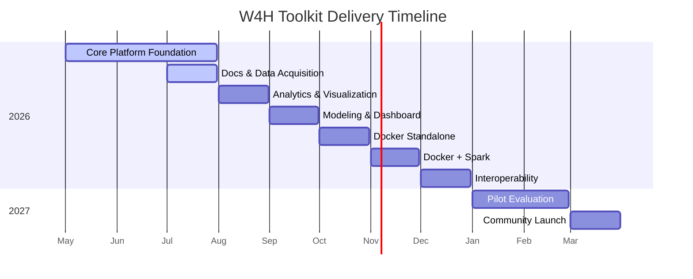
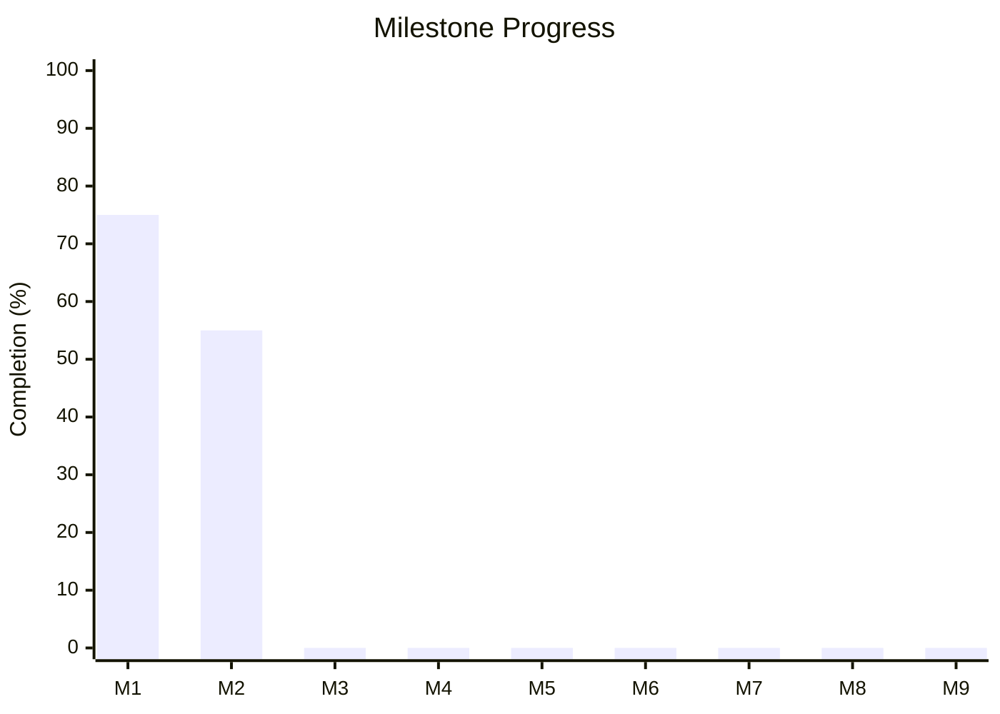

**Protocol Version:** 1

**Date Updated:** July 17, 2026

**Title:** W4H Toolkit — Validating and Promoting the W4H Toolkit

**Principal PI:** Cyrus Shahabi, shahabi@usc.edu

**Co-Investigator:** Luciano Nocera, nocera@usc.edu

**Funding:** SC CTSI Pilot Funding Program

**Document Status:** Draft v0.8

> **Changelog (v0.7 → v0.8):** Re-audited **Impl Status** against `w4h-api` / `w4h-app` (teams/projects/datasets catalog, platform docs, roles). Corrected overstated M1/M2 progress. Gaps remain: user discontinue/resume, dataset share CRUD, GeoMTS/ingestion, project-scoped docs, HIPAA audit viewer.
>
> **Changelog (v0.6 → v0.7):** MVP doc editor is a **Markdown editor with preview** (not rich-text WYSIWYG). Project page edit rights follow project membership (`owner`/`editor`) and may be refined via project ACL `resource_type=doc`. Corrected Doc-* implementation statuses to match existing platform docs work. Removed misplaced “project UI editor for admins” row that collided with Doc-08.
>
> **Changelog (v0.5 → v0.6):** Clarified **project documentation pages** as distinct from platform docs: separate DB table, project-scoped hierarchy (same patterns as platform docs), member edit access, and owner/Super-admin import/export for team versioning. Retires the “link platform doc slug to project” model for project pages.
>
> **Changelog (v0.4 → v0.5):** Renamed document to *MVP*. Unified two-column status tracking (`Req Status` / `Impl Status`) across all sections. Added status and progress tracking to milestone table. Sections previously lacking status columns (Teams, Sharing, REDCap, Analytics, ML, Docs, AI, Deployment) now fully tracked. Redefined **M1** as *Core Platform Foundation* (requirements, architecture, auth, users, teams, projects, datasets, RBAC, core schema) — in progress.
>
> **Changelog (v0.3 → v0.4):** Aligned role vocabulary with ADR-004 (**Super admin** · **Team admin** · **Project user**; "Group Admin" retired as an alias). Documented shared-dataset vs project visibility (ADR-012). Clarified push-share UX and multi-dataset project linking. Project membership simplified to `owner` / `editor` / `viewer` (dropped project `admin`).
>
> **Changelog (v0.2 → v0.3):** Added user discontinue/resume lifecycle (replaces hard "remove"); added personal API key timeout and revocation-on-discontinuation; scoped audit log *viewing* access to Super admin / Team admin; added grant-writing device & trial-design AI capabilities; moved basic email invitation (Google SMTP) into MVP scope and out of "Out of Scope."

---

## Status Key

### Required Status
| Value | Meaning |
|-------|---------|
| `✅ Stable` | Requirement is agreed and unlikely to change |
| `⚠️ Draft` | Placeholder; not yet agreed |
| `❌ Deprecated` | Removed from scope |

### Implementation Status
| Value | Meaning |
|-------|---------|
| `✅ Done` | Fully implemented and verified |
| `🔁 In review` | Implemented; pending verification or rework |
| `🚧 In progress` | Actively being built |
| `🚩 Todo` | No implementation yet |

---

## 1. Overview

The W4H Toolkit is a research-grade, open-source wearable health data platform for clinical research teams. It enables researchers to ingest, store, analyze, visualize, and model wearable data — standardized using the **GeoMTS (Geospatial Multivariate Time Series)** abstraction — within a secure, multi-tenant, HIPAA-compliant environment.

The MVP establishes the core platform architecture: multi-tenant team isolation, dataset sharing across teams, HIPAA-compliant data pipelines, REDCap data import, project-scoped analytics, AI-assisted research tools, and a comprehensive documentation system.

Role and sharing semantics follow [ADR-004](ADR-004-acl-roles.md), [ADR-002](ADR-002-cross-trial-sharing.md), and [ADR-012](ADR-012-project-dataset-linking.md).

---

## 2. Roles & Access Model

| # | Requirement | Req Status | Impl Status |
|---|-------------|------------|-------------|
| R-01 | Platform roles are **Super admin**, **Team admin**, and **Project user** (ADR-004). | `✅ Stable` | `🔁 In review` |
| R-02 | Project membership roles are `owner`, `editor`, and `viewer`; project `admin` is retired. | `✅ Stable` | `✅ Done` |
| R-03 | A user may belong to multiple teams. | `✅ Stable` | `✅ Done` |
| R-04 | Every project belongs to exactly one owning team. | `✅ Stable` | `🔁 In review` |
| R-05 | Sharing a dataset never shares a project (ADR-012). | `✅ Stable` | `🚧 In progress` |
| R-06 | All users, projects, and datasets must belong to a team. | `✅ Stable` | `🚧 In progress` |
| R-07 | Users are never hard-deleted; lifecycle uses `active` / `discontinued`. | `✅ Stable` | `🚩 Todo` |

These membership roles are **not** a fourth platform tier. Platform role remains **Project user**. Project-level `admin` is retired (legacy schema may still store it — map to `owner` on read).

### 2.1 Key Rules

- A user **can belong to multiple teams** (e.g., a researcher collaborating with two research groups).
- A user's primary team determines their default data scope and Team admin privileges when applicable.
- **Team admins** manage their team's users, projects, and datasets fully — including inviting, discontinuing, and resuming Project users.
- **All projects belong to one owning team.** There are no dual-owned or platform-level "Super admin" projects.
- **Sharing a dataset does not share a project.** A Team A project that links Team B's shared dataset is visible to Team A only (ADR-012). Team B sees the share agreement, not Team A's project.
- New deployments **must** assign all users, projects, and datasets to a team at setup time. Unscoped records are not permitted.
- Users are **never hard-deleted** from the platform. A user account has a `status` of `active` or `discontinued`; discontinuing a user is reversible (see §4).

---

## 3. Multi-Tenancy (Research Teams)

### 3.1 Team Management

| # | Requirement | Who | Req Status | Impl Status |
|---|-------------|-----|------------|-------------|
| T-01 | Create a new research team (name, slug). | Super admin | `✅ Stable` | `✅ Done` |
| T-02 | List all teams with member count and project count. | Super admin | `✅ Stable` | `🔁 In review` |
| T-03 | Edit any team's name and metadata. | Super admin | `✅ Stable` | `✅ Done` |
| T-04 | Deactivate any team (soft-delete; preserves data). | Super admin | `✅ Stable` | `✅ Done` |
| T-05 | View, edit, and manage their own team's details, metadata, and membership. | Team admin (scoped to own team) | `✅ Stable` | `✅ Done` |
| T-06 | Each team has a unique URL-friendly `slug`. | System | `✅ Stable` | `✅ Done` |

### 3.2 User–Team Association

| # | Requirement | Who | Req Status | Impl Status |
|---|-------------|-----|------------|-------------|
| T-07 | Assign a user to one or more teams at creation. | Super admin / Team admin (own team only) | `✅ Stable` | `✅ Done` |
| T-08 | Remove a user from a team (membership link only — does **not** discontinue the user's account or their membership in other teams). | Super admin / Team admin (own team only) | `✅ Stable` | `🚧 In progress` |
| T-09 | Users with no team assignment are Super admins. | System | `✅ Stable` | `🔁 In review` |
| T-10 | Team admin can view, invite, edit, discontinue, and resume all users in their team. | Team admin | `✅ Stable` | `🔁 In review` |
| T-11 | Users can see teammates across all their teams; Super admin sees all users globally. | System | `✅ Stable` | `✅ Done` |
| T-12 | Discontinuing a user does not remove their team or project memberships; resuming restores their prior access immediately. | System | `✅ Stable` | `🚩 Todo` |

---

## 4. User Management

### 4.1 Core Lifecycle

| # | Requirement | Req Status | Impl Status |
|---|-------------|------------|-------------|
| U-01 | Create, edit, discontinue, and resume users. Users are never hard-deleted. | `✅ Stable` | `🚧 In progress` |
| U-02 | Assign platform roles: `super_admin`, `team_admin`, `project_user` (maps to ADR-004; migrate off legacy `admin` / `researcher` / `clinician`). | `✅ Stable` | `🔁 In review` |
| U-03 | Users have a `team_id` (multi-valued) linking them to their teams. | `✅ Stable` | `✅ Done` |
| U-04 | Team admin can invite/add Project users to their team. | `✅ Stable` | `✅ Done` |
| U-05 | Team admin can discontinue and resume Project users in their team. | `✅ Stable` | `🚩 Todo` |
| U-06 | `team_id` (primary) embedded in JWT at login for request scoping. | `✅ Stable` | `✅ Done` |
| U-07 | User profile displays their team(s) and project memberships. | `✅ Stable` | `🚩 Todo` |
| U-08 | Users have a `status` field: `active` or `discontinued`. | `✅ Stable` | `🚩 Todo` |
| U-09 | Discontinuing a user preserves their full historical record (audit trail, prior contributions, team/project links) — only their ability to authenticate and access data is suspended. | `✅ Stable` | `🚩 Todo` |
| U-10 | Discontinuing a user immediately invalidates all of that user's active web-app sessions/JWTs and all of their personal API keys (see D-20). | `✅ Stable` | `🚩 Todo` |
| U-11 | Resuming a discontinued user restores web-app login ability; the user must issue new API key(s) post-resume (old keys remain revoked). | `✅ Stable` | `🚩 Todo` |
| U-12 | `/admin/users` list and `/admin/users/:id` detail show current status (`active` / `discontinued`) with a toggle action, scoped per role. | `✅ Stable` | `🚩 Todo` |

### 4.2 Email Invitations

| # | Requirement | Req Status | Impl Status |
|---|-------------|------------|-------------|
| U-13 | Super admin / Team admin can invite a new user by email via **Google SMTP**. | `✅ Stable` | `🔁 In review` |
| U-14 | Invitation email contains a time-limited signed link for password set and account activation. | `✅ Stable` | `🚩 Todo` |
| U-15 | Expired or unused invitations can be revoked or resent by the inviting admin. | `✅ Stable` | `🚩 Todo` |
| U-16 | Invite flow is intentionally basic for MVP: single SMTP provider (Google), plain-text/simple HTML template, no custom branding. | `✅ Stable` | `🔁 In review` |

---

## 5. Project Management

| # | Requirement | Req Status | Impl Status |
|---|-------------|------------|-------------|
| P-01 | Create, list, view, edit, archive projects. | `✅ Stable` | `✅ Done` |
| P-02 | Project member roles: `owner`, `editor`, `viewer` (retire project `admin`). | `✅ Stable` | `✅ Done` |
| P-03 | At least one `owner` enforced per project. | `✅ Stable` | `✅ Done` |
| P-04 | Projects have a `team_id` (owning team). | `✅ Stable` | `✅ Done` |
| P-05 | Team admin can create projects within their team and link multiple owned or inbound-shared datasets (D-06, ADR-012). | `✅ Stable` | `✅ Done` |
| P-06 | Users see only projects in their team(s) or where explicitly added as members (same team only in MVP). | `✅ Stable` | `✅ Done` |
| P-07 | Super admin sees all projects across all teams. | `✅ Stable` | `✅ Done` |
| P-08 | Project list and detail views display the owning team name. | `✅ Stable` | `✅ Done` |
| P-09 | Project documentation pages stored in a dedicated project-scoped table (see §12.2). | `✅ Stable` | `🚩 Todo` |
| P-10 | IRB protocol metadata stored per project (protocol ID, expiry date). | `✅ Stable` | `✅ Done` |

---

## 6. Dataset Management & GeoMTS Abstraction

All datasets in the W4H Toolkit are represented using the **GeoMTS (Geospatial Multivariate Time Series)** abstraction, which treats wearable data as geotagged, multi-sensor time series collections. This enables unified querying, analysis, and modeling across heterogeneous device types (Fitbit, Apple Watch, ActiGraph, etc.).

### 6.1 Dataset Core

| # | Requirement | Req Status | Impl Status |
|---|-------------|------------|-------------|
| D-01 | Datasets have a `team_id` (owning team). | `✅ Stable` | `✅ Done` |
| D-02 | Datasets have rich metadata: name, description, device type, sampling rate, subject count, date range, GeoMTS schema, IRB reference. | `✅ Stable` | `🚧 In progress` |
| D-03 | All datasets conform to the GeoMTS abstraction layer. | `✅ Stable` | `🚩 Todo` |
| D-04 | Original data is always preserved. Derived or modified data is stored separately (additive model). | `✅ Stable` | `🚩 Todo` |
| D-05 | Each dataset version (original, derived) is tracked with provenance metadata. | `✅ Stable` | `🚩 Todo` |
| D-06 | Datasets can be linked to one or more projects with per-link access type (`read` / `read_write`). | `✅ Stable` | `✅ Done` |
| D-07 | Team can only see datasets they own, plus datasets explicitly shared with them. | `✅ Stable` | `🚧 In progress` |
| D-08 | Super admin sees all datasets across all teams. | `✅ Stable` | `✅ Done` |

### 6.2 Data Ingestion

| # | Requirement | Req Status | Impl Status |
|---|-------------|------------|-------------|
| D-09 | Import datasets via **CSV**. | `✅ Stable` | `🚩 Todo` |
| D-10 | Import datasets via **JSON**. | `✅ Stable` | `🚩 Todo` |
| D-11 | Import datasets via **REDCap** (see §9). | `✅ Stable` | `🚩 Todo` |
| D-12 | **Super admin / Team admin** can ingest data directly to the database. | `✅ Stable` | `🚩 Todo` |
| D-13 | **Project users** ingest data via **API key** only (no direct DB access) when so authorized. | `✅ Stable` | `🚧 In progress` |
| D-14 | Data ingestion notebooks available per dataset for script-based ETL pipelines. | `✅ Stable` | `🔁 In review` |
| D-15 | Ingestion logs stored with timestamp, user, row count, and status. | `✅ Stable` | `🚩 Todo` |

### 6.3 API Key Data Access

| # | Requirement | Req Status | Impl Status |
|---|-------------|------------|-------------|
| D-16 | Project users authenticate against the data API using a **personal**, individually-issued API key. | `✅ Stable` | `🚧 In progress` |
| D-17 | API keys are scoped to a user's project memberships and their allowed datasets. | `✅ Stable` | `🚩 Todo` |
| D-18 | API key analytics: log every API access event (user, dataset, query type, timestamp, row count). | `✅ Stable` | `🚩 Todo` |
| D-19 | API usage dashboard visible to Team admin and Super admin. | `✅ Stable` | `🚩 Todo` |
| D-20 | API keys have a configurable timeout/expiration (TTL). | `✅ Stable` | `🚩 Todo` |
| D-21 | When a user is `discontinued`, all personal API keys are immediately invalidated. | `✅ Stable` | `🚩 Todo` |

---

## 7. Dataset Sharing (Cross-Team)

Sharing is **dataset-scoped**, not project-scoped. See [ADR-002](ADR-002-cross-trial-sharing.md) and [ADR-012](ADR-012-project-dataset-linking.md).

**Push-share UX (MVP default):** Team admin A opens an **owned** dataset → Share → Team B (or a Team B project). Team admin B then sees it as *"Shared by [Team A]"* and may **link** it to a Team B project. A's modeling project that also uses that dataset remains **visible only to Team A**.

| # | Requirement | Who | Req Status | Impl Status |
|---|-------------|-----|------------|-------------|
| S-01 | Share a dataset owned by your team with one or more other teams (push share). | Team admin, Super admin | `✅ Stable` | `🚩 Todo` |
| S-02 | Share can be team-wide or project-specific. | Team admin | `✅ Stable` | `🚩 Todo` |
| S-03 | Default share access type is `read`; `read_write` is explicitly granted. | Team admin | `✅ Stable` | `🚩 Todo` |
| S-04 | Revoke a dataset share at any time. | Team admin (own datasets), Super admin | `✅ Stable` | `🚩 Todo` |
| S-05 | Shared datasets show owner team name in the UI: *"Shared by [Team Name]"*. | System | `✅ Stable` | `🚧 In progress` |
| S-06 | Super admin can view all active share agreements across all teams. | Super admin | `✅ Stable` | `🚩 Todo` |
| S-07 | Recipient team catalog lists owned datasets ∪ inbound shared datasets only — never another team's private catalog. | System | `✅ Stable` | `🚧 In progress` |
| S-08 | Linking a shared dataset into a project does not grant the source team visibility into that project. | System | `✅ Stable` | `✅ Done` |
| S-09 | Optional: recipient may request share; owner Team admin or Super admin approves (pull path). | Team admin, Super admin | `⚠️ Draft` | `🚩 Todo` |

---

## 8. HIPAA Compliance

The platform must comply with HIPAA Security Rule requirements for handling Protected Health Information (PHI).

| # | Requirement | Req Status | Impl Status |
|---|-------------|------------|-------------|
| H-01 | Append-only audit log for all PHI access and mutations (`w4h.audit_log`). | `✅ Stable` | `🚧 In progress` |
| H-02 | Audit log records: timestamp, user, action, resource type, resource ID, IP address, user agent. | `✅ Stable` | `🔁 In review` |
| H-03 | Audit log records must be retained for a minimum of **6 years**. No deletions permitted. | `✅ Stable` | `🚩 Todo` |
| H-04 | All PHI-modifying API endpoints must write to the audit log. | `✅ Stable` | `🚩 Todo` |
| H-05 | Data at rest encrypted (PostgreSQL-level or filesystem-level encryption). | `✅ Stable` | `🚩 Todo` |
| H-06 | Data in transit encrypted via TLS/HTTPS. | `✅ Stable` | `🚩 Todo` |
| H-07 | Role-based access enforcement on all data endpoints (least-privilege), including immediate revocation for `discontinued` users. | `✅ Stable` | `🚧 In progress` |
| H-08 | Automated HIPAA compliance checks as part of CI/CD pipeline. | `✅ Stable` | `🚩 Todo` |
| H-09 | Ability to generate an access audit report per dataset or project for IRB review. | `✅ Stable` | `🚩 Todo` |
| H-10 | Support de-identification pipelines before data is shared across teams. | `⚠️ Draft` | `🚩 Todo` |
| H-11 | Audit log viewing access is role-scoped: Super admin sees all; Team admin sees own team only; Project users cannot browse raw audit log. | `✅ Stable` | `🚩 Todo` |

---

## 9. REDCap Integration

REDCap is the most widely used data capture platform in academic clinical trials. W4H must interoperate with it.

| # | Requirement | Req Status | Impl Status |
|---|-------------|------------|-------------|
| R-01 | Connect to a REDCap instance via REDCap API (token-based). | `✅ Stable` | `🚩 Todo` |
| R-02 | Import a REDCap project's records into a W4H dataset. | `✅ Stable` | `🚩 Todo` |
| R-03 | Map REDCap field names to GeoMTS schema fields during import. | `✅ Stable` | `🚩 Todo` |
| R-04 | Schedule recurring REDCap syncs (incremental import of new/updated records). | `✅ Stable` | `🚩 Todo` |
| R-05 | Log REDCap import events in the audit log. | `✅ Stable` | `🚩 Todo` |
| R-06 | Validate imported REDCap data against the dataset's GeoMTS schema. | `✅ Stable` | `🚩 Todo` |
| R-07 | Surface import errors and validation warnings in the admin UI. | `✅ Stable` | `🚩 Todo` |

---

## 10. Analytics Dashboards

Basic analytics dashboards allow researchers to understand the data available in their projects without writing code.

| # | Requirement | Req Status | Impl Status |
|---|-------------|------------|-------------|
| A-01 | Per-project summary dashboard: subject count, date range, device types, dataset sizes. | `✅ Stable` | `🚩 Todo` |
| A-02 | Signal-level visualization: time series plots for individual subjects or group averages. | `✅ Stable` | `🚩 Todo` |
| A-03 | Comparative analytics: compare selected subjects against a control group. | `✅ Stable` | `🚩 Todo` |
| A-04 | Compliance and wear-time metrics per subject and per dataset. | `✅ Stable` | `🚩 Todo` |
| A-05 | Outlier detection visualization for health metrics. | `✅ Stable` | `🚩 Todo` |
| A-06 | Export dashboard views as PDF or PNG for reporting. | `✅ Stable` | `🚩 Todo` |
| A-07 | Dashboard is accessible to all project members (Viewer and above). | `✅ Stable` | `🚩 Todo` |

---

## 11. ML Model Capabilities

The W4H Toolkit supports applying, retraining, and extending pre-built ML models on a team's own data. Built-in models include GeoMTS-based frameworks (BysGNN, NeuroGNN, WaveGNN, Motif analysis).

| # | Capability | Requirement | Req Status | Impl Status |
|---|-----------|-------------|------------|-------------|
| M-01 | **Apply model** | Run a pre-trained model against a project's dataset and view predictions/outputs. | `✅ Stable` | `🚩 Todo` |
| M-02 | **Apply model** | Model outputs stored as a derived dataset (additive; original preserved). | `✅ Stable` | `🚩 Todo` |
| M-03 | **Retrain model** | Fine-tune an existing model with a team's own labeled data. | `✅ Stable` | `🚩 Todo` |
| M-04 | **Retrain model** | Track retraining runs: parameters, dataset version, performance metrics. | `✅ Stable` | `🚩 Todo` |
| M-05 | **Extend model** | Define a new model variant based on an existing architecture with custom hyperparameters. | `✅ Stable` | `🚩 Todo` |
| M-06 | **Extend model** | Share a trained model with another team (with permission). | `⚠️ Draft` | `🚩 Todo` |
| M-07 | **All** | Model execution runs in a notebook environment (Jupyter/VS Code). | `✅ Stable` | `🔁 In review` |
| M-08 | **All** | Model runs logged in the audit trail with user, model version, and dataset reference. | `✅ Stable` | `🚩 Todo` |

---

## 12. Documentation System

### 12.1 Platform Documentation (External Repository)

Platform Help docs are global (not project-owned). Managed by Super admin; synced with `w4h-docs`.

**Editor (MVP):** Platform and project page editing use a **Markdown editor with preview** (source + rendered preview). True rich-text WYSIWYG is out of scope for MVP.

| # | Requirement | Req Status | Impl Status |
|---|-------------|------------|-------------|
| Doc-01 | Documentation is maintained as Markdown files in an external git repository (`w4h-docs`). | `✅ Stable` | `✅ Done` |
| Doc-02 | Admin UI provides a path to **pull and update docs** from the external repository / source path. | `✅ Stable` | `✅ Done` |
| Doc-03 | Admin UI provides a path to **export** docs (Markdown zip) for publish / round-trip with the repository. | `✅ Stable` | `✅ Done` |
| Doc-04 | Docs rendered in the app are fetched from the database (previously synced from the repo). | `✅ Stable` | `✅ Done` |
| Doc-05 | Markdown editor with preview for editing platform documentation pages within the admin UI. | `✅ Stable` | `✅ Done` |
| Doc-06 | Documentation supports embedded code examples, GeoMTS schema snippets, and mermaid diagrams. | `✅ Stable` | `✅ Done` |
| Doc-07 | Platform docs support import from path and export to zip for source-controlled management with an external repository. | `✅ Stable` | `✅ Done` |

### 12.2 Project Documentation Pages (Project-Scoped)

Project pages are **not** platform docs. They use a **separate database table** (not `w4h.docs`, and not a join that only links platform slugs). Each page belongs to exactly one project and never appears in the global Help / platform docs tree.

Hierarchy and authoring match platform docs **within the project**: page types/groupings, sort order, sidebar navigation, Markdown body, TOC, and the same Markdown editor with preview — scoped so one project’s structure cannot leak into another.

| # | Requirement | Req Status | Impl Status |
|---|-------------|------------|-------------|
| Doc-08 | Project documentation pages are stored in a dedicated table separate from platform `docs`; each row has a `project_id` and is owned by that project only. | `✅ Stable` | `🚩 Todo` |
| Doc-09 | Within a project, pages support the same hierarchy functionality as platform docs: typed groupings (doc types), sort order, sidebar nav, slug/title, Markdown/HTML/TOC, and Markdown editor with preview for create/edit. | `✅ Stable` | `🚩 Todo` |
| Doc-10 | Project pages may include protocol descriptions, data dictionaries, analysis notes, and similar project materials. | `✅ Stable` | `🚩 Todo` |
| Doc-11 | **Default access from project membership:** members can **read**; `owner` and `editor` can **create, edit, reorder, and delete** pages from the project workspace (no Admin UI required). `viewer` is read-only. Super admin can manage pages for any project. | `✅ Stable` | `🚩 Todo` |
| Doc-12 | **ACL:** Project ACL rules must support `resource_type = doc` with `view` / `edit` (and optional `resource_key` for a specific page). Defaults from Doc-11 apply when no ACL rule matches; explicit allow/deny rules may grant or restrict doc edit beyond membership role (e.g. give a `viewer` edit on one page, or deny an `editor` on a locked page). | `✅ Stable` | `🚧 In progress` |
| Doc-13 | Project `owner` (and Super admin) can **export** and **import** that project’s documentation as a Markdown archive so teams can version docs outside the platform (analogous to Doc-02/Doc-03, but project-scoped — not the global `w4h-docs` repo). | `✅ Stable` | `🚩 Todo` |
| Doc-14 | Project pages do not appear in platform Help documentation; navigation and APIs are always filtered by `project_id`. | `✅ Stable` | `🚩 Todo` |
| Doc-15 | Project Docs may link to platform documentation pages. | `⚠️ Draft` | `🚩 Todo` |
| Doc-16 | Retire the current `project_docs` “link platform `docs.slug` to project” model for storing project page content; replace with the dedicated project-pages table (Doc-08). | `✅ Stable` | `🚩 Todo` |

---

## 13. AI Assistant Features

### 13.1 Chat AI Helper

| # | Requirement | Req Status | Impl Status |
|---|-------------|------------|-------------|
| AI-01 | Embedded AI chat assistant accessible from any page in the platform. | `✅ Stable` | `🚩 Todo` |
| AI-02 | Assistant is context-aware: understands the current project, dataset, and user role. | `✅ Stable` | `🚩 Todo` |
| AI-03 | Can answer questions about platform features, data schemas, and analysis workflows. | `✅ Stable` | `🚩 Todo` |
| AI-04 | Can generate notebook code snippets for common data tasks (filtering, plotting, aggregation). | `✅ Stable` | `🚩 Todo` |

### 13.2 IRB Grant Assistant

| # | Requirement | Req Status | Impl Status |
|---|-------------|------------|-------------|
| AI-05 | AI assistant guides researchers through drafting IRB submission documents. | `✅ Stable` | `🚩 Todo` |
| AI-06 | Provides templates and guidance for wearable-specific IRB sections (data privacy, HIPAA considerations, device descriptions). | `✅ Stable` | `🚩 Todo` |
| AI-07 | Pre-populates IRB fields from project metadata (PI name, team, dataset types, IRB protocol ID). | `✅ Stable` | `🚩 Todo` |
| AI-08 | Generates a draft Data Management Plan (DMP) based on the project's dataset configuration. | `✅ Stable` | `🚩 Todo` |

### 13.3 Research AI Tools

| # | Requirement | Req Status | Impl Status |
|---|-------------|------------|-------------|
| AI-09 | **Sample size calculator**: compute required sample sizes for wearable-based clinical studies. | `✅ Stable` | `🚩 Todo` |
| AI-10 | **Study design advisor**: recommends statistical methods and study designs for a given wearable data type and clinical question, including trial/protocol design guidance. | `✅ Stable` | `🚩 Todo` |
| AI-11 | **Literature assistant**: surfaces relevant published research based on clinical domain, device type, and target outcome. | `✅ Stable` | `🚩 Todo` |
| AI-12 | **Endpoint-to-device advisor**: given a target clinical endpoint, recommends candidate wearable devices and data streams needed to capture it. | `✅ Stable` | `🚩 Todo` |

---

## 14. Deployment

| # | Requirement | Req Status | Impl Status |
|---|-------------|------------|-------------|
| Dep-01 | **Standalone Docker** deployment: single-container or docker-compose without Spark. | `✅ Stable` | `🚩 Todo` |
| Dep-02 | **Spark-enabled Docker** deployment: scalable version with Apache Spark for large dataset processing. | `✅ Stable` | `🚩 Todo` |
| Dep-03 | Environment configured via `.env` file (DB credentials, API keys, ports, Google SMTP credentials). | `✅ Stable` | `🔁 In review` |
| Dep-04 | Docker images published to a public registry (Docker Hub or GitHub Container Registry). | `✅ Stable` | `🚩 Todo` |
| Dep-05 | Setup documentation covers both deployment modes. | `✅ Stable` | `🚩 Todo` |

---

## 15. Admin UI Pages

| Page | Req Status | Impl Status | Notes |
|------|------------|-------------|-------|
| `/admin/teams` | `✅ Stable` | `✅ Done` | List teams (Super admin); Team admin sees own |
| `/admin/teams/add` | `✅ Stable` | `✅ Done` | Create a new team (Super admin) |
| `/admin/teams/:id/edit` | `✅ Stable` | `🔁 In review` | Edit team + members; remove-member UX incomplete |
| `/admin/datasets` | `✅ Stable` | `🔁 In review` | Owning team; share button / shared label incomplete |
| `/admin/datasets/shares` | `✅ Stable` | `🚩 Todo` | View and manage cross-team dataset shares |
| `/admin/datasets/:id/ingest` | `✅ Stable` | `🚩 Todo` | Ingestion UI (CSV, JSON, REDCap) |
| `/admin/projects` | `✅ Stable` | `✅ Done` | Owning team column |
| `/admin/projects/:id/edit` | `✅ Stable` | `✅ Done` | Catalog/metadata; project pages on workspace (§12.2) |
| `/admin/users` | `✅ Stable` | `🔁 In review` | Team column + filter; no discontinue status yet |
| `/admin/users/add` | `✅ Stable` | `🔁 In review` | Team selector + create; invite-link flow incomplete |
| `/admin/users/:id` | `✅ Stable` | `🚩 Todo` | Discontinue/resume, API key list, status history |
| `/admin/api-usage` | `✅ Stable` | `🚩 Todo` | API key analytics and usage logs |
| `/admin/audit-log` | `✅ Stable` | `🚩 Todo` | Audit log viewer — Super admin: all teams; Team admin: own team only |

---

## 16. Out of Scope for MVP

| Feature | Rationale |
|---------|-----------|
| Row-Level Security (RLS) in PostgreSQL | Application-layer scoping sufficient for MVP; RLS is a post-MVP hardening step. |
| Cross-team project membership | MVP limits project members to users within the project's owning team. Dataset share ≠ project access (ADR-012). |
| De-identification pipelines | Planned for post-MVP; raw data sharing relies on IRB-approved agreements. |
| FHIR API endpoints | Interoperability with FHIR is planned post-MVP. |
| Mobile application | Web platform only for MVP. |
| Multi-provider / branded email invitations | MVP ships a basic Google-SMTP-only invite flow (see U-13–U-16); custom templating and alternate providers are post-MVP. |
| Hard user deletion / GDPR-style erasure | MVP only supports discontinue/resume; permanent erasure workflows are post-MVP. |

---

## 17. Delivery Timeline

| # | Milestone | Deliverable | Target | Status | Progress |
|---|-----------|-------------|--------|--------|----------|
| M1 | Core Platform Foundation | Requirements, system architecture, authentication, user management, team management (multi-tenancy), project management, dataset management, RBAC, and core database schema | July 2026 | `🚧 In progress` | 75% |
| M2 | Documentation system and data acquisition modules | Markdown editor with preview; CSV/JSON/database ingestion | July 2026 | `🚧 In progress` | 55% |
| M3 | Analysis and visualization components | Reusable analytics and plotting library | August 2026 | `🚩 Todo` | 0% |
| M4 | Modeling components and dashboard integration | Plug-and-play dashboard with model interface | September 2026 | `🚩 Todo` | 0% |
| M5 | Docker deployment, standalone version | Containerized release without Spark support | October 2026 | `🚩 Todo` | 0% |
| M6 | Docker deployment, Spark-enabled version | Scalable deployment with Spark support | November 2026 | `🚩 Todo` | 0% |
| M7 | Interoperability and compliance testing | REDCap integration; HIPAA/FHIR checks | December 2026 | `🚩 Todo` | 0% |
| M8 | Pilot evaluation with trial researchers | Usability and workflow feedback from users | January 2027 | `🚩 Todo` | 0% |
| M9 | Community launch and dissemination | Open-source governance, documentation, tutorials, and public release | March 2027 | `🚩 Todo` | 0% |

> **Note:** Full FHIR API endpoints remain out of scope for MVP (§16). M7 "HIPAA/FHIR checks" means compliance readiness checks toward interoperability; a FHIR API is post-MVP.
>
> **Progress** column is manually updated for now; planned for automation via `::w4h-milestone-tracker` component once the task tracker directive is implemented.

