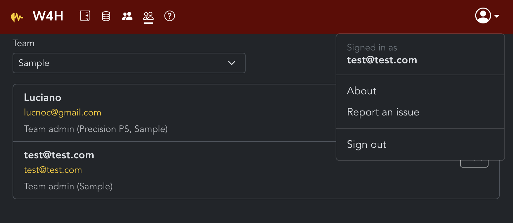

## Issues

### User form does not reset.

- Reproduce: As Super Admin: Users → Invite User → try to add self → A user with this email already exists error → Change email does not reset the form the error status. 
- Workaround: go back to users screen.
- Expected: form validation should reset when changing email
- Type: Bug

### Requests logs cannot be filtered

- Reproduce: Usage → Recent requests seems to show requests for more than a week at once. Seems to be from initial setup.
- Workaround: N/A
- Audit table seems not to include page access and go back to installation. 
- Type: Feature


### Wrong Audit logs details preview

- Reproduce: As admin: Audit → Events → Click Details on an event. The filters are not set; however the entries show correct user, action, resource type. Also IP is listed but the json does not seem to include it and format is weird (::1/128)

```json
{
  "page": 1,
  "limit": 50,
  "total": 28,
  "filters": {
    "q": null,
    "to": null,
    "days": 30,
    "from": null,
    "action": null,
    "user_id": null,
    "resource_type": null
  }
}
```
- Workaround: access audit logs in db: `SELECT * FROM w4h.audit_log`
- Expected: json should match database rows information, and the documentation should provide the needed details (eg HIPAA Compliance page does not list possible values for resource_type -- Type of resource affected). Also, should requests logs be included in the audit list?

### Send test email not showing failures

- Reproduce: Go offline and send a test email. Button resets after a while with no message.
- Workaround: N/A
- Expected: an error message should be provided. Also the button outline in dark mode looks like outline disabled. Same issue with Resend invite in Users → edit user.

### Invites without SMTP

- Reproduce: Turn off internet. As Super Admin: Users → Invite User → Invite test user:

```
Email: test@test.com
Role: team admin
Team: Sample
```

Click Send Invite, spinner appears and nothing else happens. Going back to Users, the user is created, but no invite is sent.
- Workaround: Edit user and set a password.
- Expected: an error message should be provided with the workaround and instructions to test SMTP.
Workaround: Edit the user and manually set a password


### Cannot turn off Super Admins

- Reproduce: As Super Admin: Users → Invite User → Add a new Super admin account → Users → Edit the newly created user → panel shows active pill with "Super admin accounts stay active.". Logs table does not seem to track user creation accounts.
- Workaround: direct db editing (not allowed)
- Expected: One should be able to have multiple Super Admins and revoke access with some limits (at least one active?)


### Revoke invite does not reset status

- Reproduce: As Super Admin: Users → Edit user with invited pill → Click Revoke invitation → pill stays active
- Workaround: direct db editing (not allowed)
- Expected: invited pill should reset


### Loading sample data workflow with API Token 

Not documented/discoverable.

- 
### Super Admin pages accessible to non Super Admins

Accessible with error message. Should be 404?


### Team admin can see other team admins not in the same team

See 


### After creating a project key dialog disappears

### Should the project key be per user?


## My Test Credentials

test@test.com
C5LzVegd_4dhrKs@

API Token: cA1AV7z856JEdTm_PjBrsBB1OGespMnO