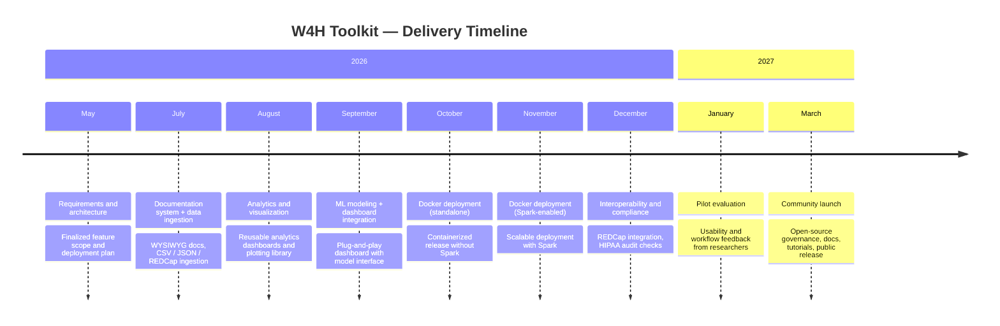

# W4H Toolkit — MVP Requirements

**Protocol Version:** 1
**Date Updated:** June 21, 2026
**Title:** W4H Toolkit — Validating and Promoting the W4H Toolkit
**Principal PI:** Cyrus Shahabi, PhD — shahabi@usc.edu
**Co-Investigator:** Luciano Nocera, PhD — nocera@usc.edu
**Funding:** SC CTSI Pilot Funding Program
**Document Status:** Draft v0.3

> **Changelog (v0.2 → v0.3):** Added user discontinue/resume lifecycle (replaces hard "remove"); added personal API key timeout and revocation-on-discontinuation; scoped audit log *viewing* access to Super-Admin / Group Admin; added grant-writing device & trial-design AI capabilities; moved basic email invitation (Google SMTP) into MVP scope and out of "Out of Scope."

---

## 1. Overview

The W4H Toolkit is a research-grade, open-source wearable health data platform for clinical research teams. It enables researchers to ingest, store, analyze, visualize, and model wearable data — standardized using the **GeoMTS (Geospatial Multivariate Time Series)** abstraction — within a secure, multi-tenant, HIPAA-compliant environment.

The MVP establishes the core platform architecture: multi-tenant team isolation, dataset sharing across teams, HIPAA-compliant data pipelines, REDCap data import, project-scoped analytics, AI-assisted research tools, and a comprehensive documentation system.

---

## 2. Roles & Access Model

### 2.1 Role Hierarchy

| Role | Scope | Permissions |
|------|-------|-------------|
| **Super-Admin** | Platform-wide | Manages all teams, users, datasets, projects globally. No team assignment. |
| **Group Admin** | Own team only | Full control within their research team: manage users, projects, datasets, shares. |
| **Researcher (Editor)** | Assigned projects | Access to datasets linked to their projects. Can run analytics and notebooks. |
| **Viewer** | Assigned projects | Read-only access to project data and dashboards. |

### 2.2 Key Rules

- A user **can belong to multiple teams** (e.g., a researcher collaborating with two research groups).
- A user's primary team determines their default data scope and admin privileges.
- **Group Admins** manage their team's users, projects, and datasets fully — including inviting, discontinuing, and resuming researchers.
- **All projects belong to a team.** There are no platform-level "super-admin" projects.
- New deployments **must** assign all users, projects, and datasets to a team at setup time. Unscoped records are not permitted.
- Users are **never hard-deleted** from the platform. A user account has a `status` of `active` or `discontinued`; discontinuing a user is reversible (see §4).

---

## 3. Multi-Tenancy (Research Teams)

### 3.1 Team Management

| # | Requirement | Who |
|---|-------------|-----|
| T-01 | Create a new research team (name, slug). | Super-Admin |
| T-02 | List all teams with member count and project count. | Super-Admin |
| T-03 | Edit any team's name and metadata. | Super-Admin |
| T-04 | Deactivate any team (soft-delete; preserves data). | Super-Admin |
| T-05 | View, edit, and manage their own team's details, metadata, and membership. | Group Admin (scoped to own team) |
| T-06 | Each team has a unique URL-friendly `slug`. | System |

### 3.2 User–Team Association

| # | Requirement | Who |
|---|-------------|-----|
| T-07 | Assign a user to one or more teams at creation. | Super-Admin / Group Admin (own team only) |
| T-08 | Remove a user from a team (membership link only — does **not** discontinue the user's account or their membership in other teams). | Super-Admin / Group Admin (own team only) |
| T-09 | Users with no team assignment are Super-Admins. | System |
| T-10 | Group Admin can view, invite, edit, discontinue, and resume all users in their team. | Group Admin |
| T-11 | Users can see teammates across all their teams; Super-Admin sees all users globally. | System |
| T-12 | Discontinuing a user does not remove their team or project memberships; resuming restores their prior access immediately. | System |

---

## 4. User Management

### 4.1 Core Lifecycle

| # | Requirement | Status |
|---|-------------|--------|
| U-01 | Create, edit, discontinue, and resume users. Users are never hard-deleted. | 🔲 New (was: "deactivate") |
| U-02 | Assign user roles: `admin`, `researcher`, `clinician`. | ✅ Exists |
| U-03 | Users have a `team_id` (multi-valued) linking them to their teams. | 🔲 New |
| U-04 | Group Admin can invite/add researchers to their team. | 🔲 New |
| U-05 | Group Admin can discontinue and resume researchers in their team. | 🔲 New (was: "remove") |
| U-06 | `team_id` (primary) embedded in JWT at login for request scoping. | 🔲 New |
| U-07 | User profile displays their team(s) and project memberships. | 🔲 New |
| U-08 | Users have a `status` field: `active` or `discontinued`. Use case: a student/trainee who steps away (e.g., for an internship) and later returns to the project. | 🔲 New |
| U-09 | Discontinuing a user preserves their full historical record (audit trail, prior contributions, team/project links) — only their ability to authenticate and access data is suspended. | 🔲 New |
| U-10 | Discontinuing a user immediately invalidates all of that user's active web-app sessions/JWTs and all of their personal API keys (see D-20). | 🔲 New |
| U-11 | Resuming a discontinued user restores web-app login ability; the user must issue new API key(s) post-resume (old keys remain revoked). | 🔲 New |
| U-12 | `/admin/users` list and `/admin/users/:id` detail show current status (`active` / `discontinued`) with a toggle action, scoped per role (Super-Admin: any user; Group Admin: users in their team). | 🔲 New |

### 4.2 Email Invitations

| # | Requirement | Status |
|---|-------------|--------|
| U-13 | Super-Admin / Group Admin can invite a new user by email; the system sends an invitation email via **Google SMTP** (relay through a Google Workspace / Gmail SMTP account configured in `.env`). | 🔲 New (MVP) |
| U-14 | Invitation email contains a time-limited signed link the invitee uses to set their password and activate their account. | 🔲 New (MVP) |
| U-15 | Expired or unused invitations can be revoked or resent by the inviting admin. | 🔲 New (MVP) |
| U-16 | Invite flow is intentionally basic for MVP: single SMTP provider (Google), plain-text/simple HTML template, no custom branding or multi-provider support (post-MVP hardening). | 🔲 New (MVP, scoped down) |

---

## 5. Project Management

| # | Requirement | Status |
|---|-------------|--------|
| P-01 | Create, list, view, edit, archive projects. | ✅ Exists |
| P-02 | Project member roles: `owner`, `editor`, `viewer`, `admin`. | ✅ Exists |
| P-03 | At least one `owner` enforced per project. | ✅ Exists |
| P-04 | Projects have a `team_id` (owning team). | 🔲 New |
| P-05 | Group Admin can create projects within their team. | 🔲 New (currently admin-only) |
| P-06 | Users see only projects in their team(s) or where explicitly added as members. | 🔲 New |
| P-07 | Super-Admin sees all projects across all teams. | 🔲 New |
| P-08 | Project list and detail views display the owning team name. | 🔲 New |
| P-09 | Project documentation stored in database (see §12). | 🔲 New |
| P-10 | IRB protocol metadata stored per project (protocol ID, expiry date). | ✅ Exists |

---

## 6. Dataset Management & GeoMTS Abstraction

All datasets in the W4H Toolkit are represented using the **GeoMTS (Geospatial Multivariate Time Series)** abstraction, which treats wearable data as geotagged, multi-sensor time series collections. This enables unified querying, analysis, and modeling across heterogeneous device types (Fitbit, Apple Watch, ActiGraph, etc.).

### 6.1 Dataset Core

| # | Requirement | Status |
|---|-------------|--------|
| D-01 | Datasets have a `team_id` (owning team). | 🔲 New |
| D-02 | Datasets have rich metadata: name, description, device type, sampling rate, subject count, date range, GeoMTS schema, IRB reference. | 🔲 New |
| D-03 | All datasets conform to the GeoMTS abstraction layer. | 🔲 New |
| D-04 | Original data is always preserved. Derived or modified data is stored separately (additive model). | 🔲 New |
| D-05 | Each dataset version (original, derived) is tracked with provenance metadata. | 🔲 New |
| D-06 | Datasets can be linked to one or more projects with per-link access type (`read` / `read_write`). | ✅ Exists |
| D-07 | Team can only see datasets they own, plus datasets explicitly shared with them. | 🔲 New |
| D-08 | Super-Admin sees all datasets across all teams. | 🔲 New |

### 6.2 Data Ingestion

| # | Requirement | Status |
|---|-------------|--------|
| D-09 | Import datasets via **CSV** (most wearable device export format). | 🔲 New |
| D-10 | Import datasets via **JSON**. | 🔲 New |
| D-11 | Import datasets via **REDCap** (see §9). | 🔲 New |
| D-12 | **Super-Admin / Group Admin** can ingest data directly to the database. | 🔲 New |
| D-13 | **Researchers** ingest data via **API key** only (no direct DB access). | 🔲 New |
| D-14 | Data ingestion notebooks available per dataset for script-based ETL pipelines. | 🔲 New |
| D-15 | Ingestion logs stored with timestamp, user, row count, and status. | 🔲 New |

### 6.3 API Key Data Access

| # | Requirement | Status |
|---|-------------|--------|
| D-16 | Researchers authenticate against the data API using a **personal**, individually-issued API key (not shared/team-level). | ✅ Partial (project DB tokens exist) |
| D-17 | API keys are scoped to a user's project memberships and their allowed datasets. | 🔲 New |
| D-18 | API key analytics: log every API access event (user, dataset, query type, timestamp, row count). | 🔲 New |
| D-19 | API usage dashboard visible to Group Admin and Super-Admin. | 🔲 New |
| D-20 | API keys have a configurable timeout/expiration (TTL). Expired keys stop working and must be reissued by the user (or re-granted by an admin). | 🔲 New |
| D-21 | When a user's status changes to `discontinued`, all of that user's personal API keys are immediately invalidated, in addition to their web-app session/JWT (see U-10). | 🔲 New |

---

## 7. Dataset Sharing (Cross-Team)

| # | Requirement | Who |
|---|-------------|-----|
| S-01 | Share a dataset owned by your team with one or more other teams. | Group Admin, Super-Admin |
| S-02 | Share can be team-wide (any project in target team can link it) or project-specific. | Group Admin |
| S-03 | Default share access type is `read`; `read_write` is explicitly granted. | Group Admin |
| S-04 | Revoke a dataset share at any time. | Group Admin, Super-Admin |
| S-05 | Shared datasets show owner team name in the UI: *"Shared by [Team Name]"*. | System |
| S-06 | Super-Admin can view all active share agreements across all teams. | Super-Admin |

---

## 8. HIPAA Compliance

The platform must comply with HIPAA Security Rule requirements for handling Protected Health Information (PHI).

| # | Requirement | Status |
|---|-------------|--------|
| H-01 | Append-only audit log for all PHI access and mutations (`w4h.audit_log`). | ✅ Exists (schema) |
| H-02 | Audit log records: timestamp, user, action, resource type, resource ID, IP address, user agent. | ✅ Exists (schema) |
| H-03 | Audit log records must be retained for a minimum of **6 years**. No deletions permitted. | 🔲 Enforce |
| H-04 | All PHI-modifying API endpoints must write to the audit log. | 🔲 New |
| H-05 | Data at rest encrypted (PostgreSQL-level or filesystem-level encryption). | 🔲 Infrastructure |
| H-06 | Data in transit encrypted via TLS/HTTPS. | 🔲 Infrastructure |
| H-07 | Role-based access enforcement on all data endpoints (least-privilege), including immediate revocation of access for `discontinued` users. | 🔲 New |
| H-08 | Automated HIPAA compliance checks as part of CI/CD pipeline. | 🔲 New |
| H-09 | Ability to generate an access audit report per dataset or project for IRB review. | 🔲 New |
| H-10 | Support de-identification pipelines before data is shared across teams. | 🔲 Post-MVP |
| H-11 | **Audit log viewing access** is role-scoped: Super-Admin can view audit log entries across all teams; Group Admin can view audit log entries for their own team only. Researcher and Viewer roles cannot browse the raw audit log. | 🔲 New |

---

## 9. REDCap Integration

REDCap is the most widely used data capture platform in academic clinical trials. W4H must interoperate with it.

| # | Requirement |
|---|-------------|
| R-01 | Connect to a REDCap instance via REDCap API (token-based). |
| R-02 | Import a REDCap project's records into a W4H dataset. |
| R-03 | Map REDCap field names to GeoMTS schema fields during import. |
| R-04 | Schedule recurring REDCap syncs (incremental import of new/updated records). |
| R-05 | Log REDCap import events in the audit log. |
| R-06 | Validate imported REDCap data against the dataset's GeoMTS schema. |
| R-07 | Surface import errors and validation warnings in the admin UI. |

---

## 10. Analytics Dashboards

Basic analytics dashboards allow researchers to understand the data available in their projects without writing code.

| # | Requirement |
|---|-------------|
| A-01 | Per-project summary dashboard: subject count, date range, device types, dataset sizes. |
| A-02 | Signal-level visualization: time series plots for individual subjects or group averages. |
| A-03 | Comparative analytics: compare selected subjects against a control group. |
| A-04 | Compliance and wear-time metrics per subject and per dataset. |
| A-05 | Outlier detection visualization for health metrics. |
| A-06 | Export dashboard views as PDF or PNG for reporting. |
| A-07 | Dashboard is accessible to all project members (Viewer and above). |

---

## 11. ML Model Capabilities

The W4H Toolkit supports applying, retraining, and extending pre-built ML models on a team's own data. Built-in models include GeoMTS-based frameworks (BysGNN, NeuroGNN, WaveGNN, Motif analysis).

| # | Capability | Requirement |
|---|-----------|-------------|
| M-01 | **Apply model** | Run a pre-trained model against a project's dataset and view predictions/outputs. |
| M-02 | **Apply model** | Model outputs stored as a derived dataset (additive; original preserved). |
| M-03 | **Retrain model** | Fine-tune an existing model with a team's own labeled data. |
| M-04 | **Retrain model** | Track retraining runs: parameters, dataset version, performance metrics. |
| M-05 | **Extend model** | Define a new model variant based on an existing architecture with custom hyperparameters. |
| M-06 | **Extend model** | Share a trained model with another team (with permission). |
| M-07 | **All** | Model execution runs in a notebook environment (Jupyter/VS Code). |
| M-08 | **All** | Model runs logged in the audit trail with user, model version, and dataset reference. |

---

## 12. Documentation System

### 12.1 Platform Documentation (External Repository)

| # | Requirement |
|---|-------------|
| Doc-01 | Documentation is maintained as Markdown files in an external git repository (`w4h-docs`). |
| Doc-02 | Admin UI provides a path to **pull and update docs** from the external repository. |
| Doc-03 | Admin UI provides a path to **export/publish docs** back to the repository (round-trip). |
| Doc-04 | Docs rendered in the app are fetched from the database (previously synced from the repo). |
| Doc-05 | WYSIWYG editor for editing documentation pages within the admin UI. |
| Doc-06 | Documentation supports embedded code examples, GeoMTS schema snippets, and mermaid diagrams. |

### 12.2 Per-Project Documentation (Database-Stored)

| # | Requirement | Priority |
|---|-------------|----------|
| Doc-06 | Platform Docs are stored in a git repository and can be synced to the database. | P1 |
| Doc-07 | Each project has a dedicated documentation section stored in the database. | P1 |
| Doc-08 | Project Docs can include protocol descriptions, data dictionaries, and analysis notes. | P1 |
| Doc-09 | Platform docs support linking to external repository paths for source-controlled doc management. | P2 |
| Doc-10 | Project Docs support linking to platform documentation. | P2 |

---

## 13. AI Assistant Features

### 13.1 Chat AI Helper

| # | Requirement |
|---|-------------|
| AI-01 | Embedded AI chat assistant accessible from any page in the platform. |
| AI-02 | Assistants is context-aware: understands the current project, dataset, and user role. |
| AI-03 | Can answer questions about platform features, data schemas, and analysis workflows. |
| AI-04 | Can generate notebook code snippets for common data tasks (filtering, plotting, aggregation). |

### 13.2 IRB Grant Assistant

| # | Requirement |
|---|-------------|
| AI-05 | AI assistant guides researchers through drafting IRB submission documents. |
| AI-06 | Provides templates and guidance for wearable-specific IRB sections (data privacy, HIPAA considerations, device descriptions). |
| AI-07 | Pre-populates IRB fields from project metadata (PI name, team, dataset types, IRB protocol ID). |
| AI-08 | Generates a draft Data Management Plan (DMP) based on the project's dataset configuration. |

### 13.3 Research AI Tools

| # | Requirement |
|---|-------------|
| AI-09 | **Sample size calculator**: helps researchers compute required sample sizes for wearable-based clinical studies based on expected effect sizes and device metrics. |
| AI-10 | **Study design advisor**: recommends appropriate statistical methods and study designs for a given wearable data type and clinical question, including guidance on how to design a trial/protocol around a specific device (sampling schedule, compliance monitoring, endpoint capture windows). |
| AI-11 | **Literature assistant**: surfaces relevant published research based on the study's clinical domain, device type, and target outcome. |
| AI-12 | **Endpoint-to-device advisor** (grant-writing support): given a target clinical end-point or outcome measure, recommends candidate wearable devices and the specific data streams/sensors needed to capture it — to inform device selection in grant proposals and protocols. |

---

## 14. Deployment

| # | Requirement |
|---|-------------|
| Dep-01 | **Standalone Docker** deployment: single-container or docker-compose deployment without Spark. |
| Dep-02 | **Spark-enabled Docker** deployment: scalable version with Apache Spark for large dataset processing. |
| Dep-03 | Environment configured via `.env` file (DB credentials, API keys, ports, Google SMTP credentials for invitation email). |
| Dep-04 | Docker images published to a public registry (Docker Hub or GitHub Container Registry). |
| Dep-05 | Setup documentation covers both deployment modes. |

---

## 15. Admin UI Pages

| Page | Status | Notes |
|------|--------|-------|
| `/admin/teams` | 🔲 New | List all teams (Super-Admin only) |
| `/admin/teams/add` | 🔲 New | Create a new team |
| `/admin/teams/:id/edit` | 🔲 New | Edit team, view/manage members |
| `/admin/datasets` | 🔲 Modify | Show owning team; metadata; share button |
| `/admin/datasets/shares` | 🔲 New | View and manage cross-team dataset shares |
| `/admin/datasets/:id/ingest` | 🔲 New | Ingestion UI (CSV, JSON, REDCap) |
| `/admin/projects` | ✅ Exists | Add owning team column |
| `/admin/projects/:id/edit` | ✅ Exists | Add project docs section |
| `/admin/users` | ✅ Exists | Add team column; filter by team; show status (active/discontinued) |
| `/admin/users/add` | ✅ Exists | Add team selector field; "Invite by email" action (Google SMTP) |
| `/admin/users/:id` | 🔲 New | User detail: discontinue/resume toggle, API key list, status history |
| `/admin/api-usage` | 🔲 New | API key analytics and usage logs |
| `/admin/audit-log` | 🔲 New | Audit log viewer — Super-Admin: all teams; Group Admin: own team only |

---

## 16. Out of Scope for MVP

| Feature | Rationale |
|---------|-----------|
| Row-Level Security (RLS) in PostgreSQL | Application-layer scoping sufficient for MVP; RLS is a post-MVP hardening step. |
| Cross-team project membership | MVP limits project members to users within the project's owning team. |
| De-identification pipelines | Planned for post-MVP; raw data sharing relies on IRB-approved agreements. |
| FHIR API endpoints | Interoperability with FHIR is planned post-MVP. |
| Mobile application | Web platform only for MVP. |
| Multi-provider / branded email invitations | MVP ships a basic Google-SMTP-only invite flow (see U-13–U-16); custom templating and alternate providers are post-MVP. |
| Hard user deletion / GDPR-style erasure | MVP only supports discontinue/resume; permanent erasure workflows are post-MVP. |

---

## 17. Delivery Timeline

| Period | Milestone | Deliverable |
|--------|-----------|-------------|
| By May 2026 | Requirements and architecture | Finalized feature scope and deployment plan |
| By July 2026 | Documentation system + data ingestion | WYSIWYG docs; CSV / JSON / REDCap ingestion |
| By August 2026 | Analytics and visualization | Reusable analytics dashboards and plotting library |
| By September 2026 | ML modeling + dashboard integration | Plug-and-play dashboard with model interface |
| By October 2026 | Docker deployment (standalone) | Containerized release without Spark |
| By November 2026 | Docker deployment (Spark-enabled) | Scalable deployment with Spark |
| By December 2026 | Interoperability and compliance | REDCap integration; HIPAA audit checks |
| By January 2027 | Pilot evaluation | Usability and workflow feedback from researchers |
| By March 2027 | Community launch | Open-source governance, docs, tutorials, public release |

//make a mairmaid timeline for the above 

