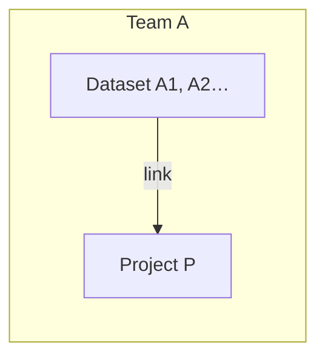
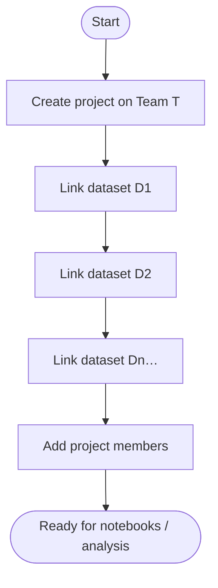
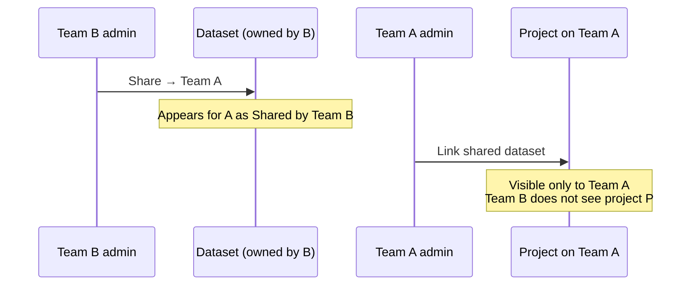
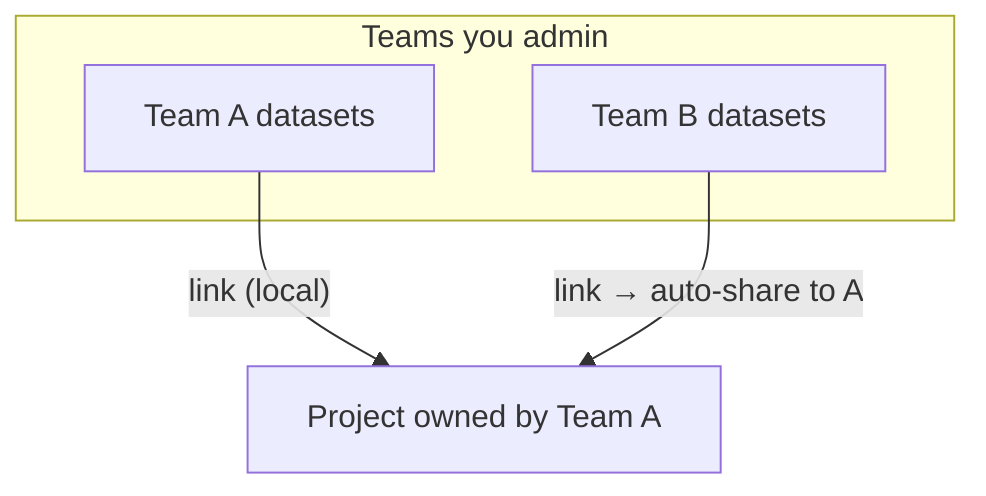
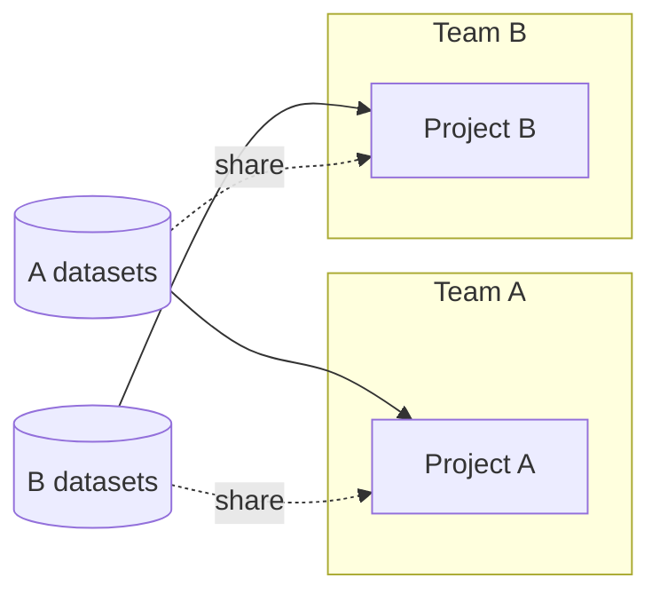
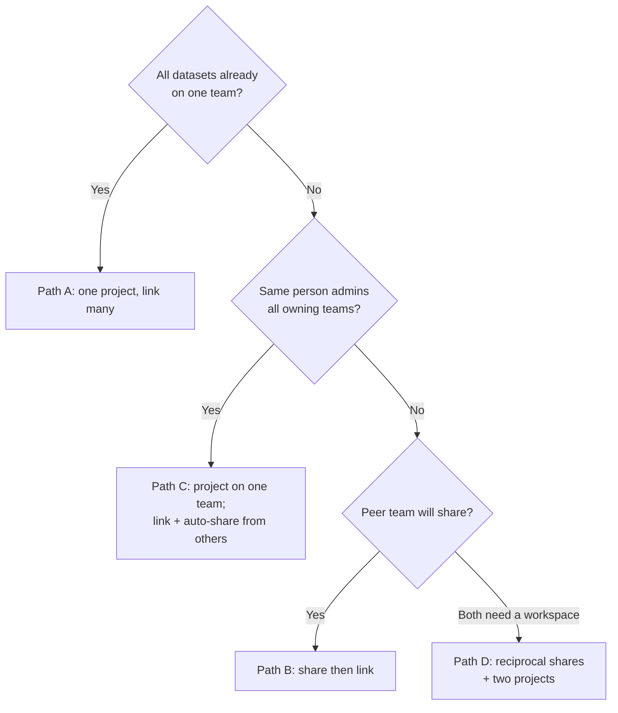

  A <strong>project</strong> is a workspace for analysis (members, linked datasets, notebooks).
  Datasets stay owned by a <strong>team</strong>; projects <em>link</em> them — they do not move ownership.

This guide is for **Team admins** (and Super admins reading for context). It covers single-team multi-dataset projects and cross-team setups via **shares**. Design details: [ADR-012]({{APP_URL}}/docs/ADR-012-project-dataset-linking).

**Shells:** Team admins work in the **app shell** (`W4H Toolkit`). Super admins stay in **Platform Admin** (`W4H Toolkit Admin`) for bootstrap only — they do not toggle into the app shell.

---

## Concepts at a glance

| Term | Meaning |
|---|---|
| **Team** | Tenancy boundary (members, IRB scope). Owns datasets. |
| **Project** | Analysis workspace with **one** owning team. |
| **Link** | Attach a dataset to a project (`project_datasets`). Done on the project page. |
| **Share** | Let **another team** use a dataset. Does **not** share the project. |
| **Discoverable** | Other teams can see name/description under **Others** — still need a share to link/query. |

---

## Who does what

| Goal | Who | Where |
|---|---|---|
| Request platform access (new PI) | Prospective PI | Access request form (Draft T-16) |
| Onboard PI | Super admin | Fulfill request → Team admin invite + **initial team** (Draft T-17) |
| Create further teams / trials | Team admin (PI) | **Teams → Add Team** after onboard (Draft T-15) — Super admin does **not** approve each trial |
| Create / own datasets | Team admin | **Datasets → Add Dataset** |
| Create a project | Team admin | **Projects → Add Project** |
| Link datasets | Team admin / project owner | Project **Linked datasets** |
| Share a dataset to another team | Owning Team admin | Dataset edit → **Shares** |

### Onboarding vs trial setup

Super admin only bootstraps **who** may run trials on the platform. They do not approve study design, datasets, or projects — that is entirely the Team admin (PI) role. See MVP §3.0.

---

## Path A — Same team, multiple datasets

Use this when all study datasets already belong to **one** team (the usual case).

### Steps

1. Open **Projects → Add Project** and set the **owning team** to that team.
2. Open the project → **Linked datasets**.
3. **Add** each dataset you need (any number).
4. Add **Members** (`owner` / `editor` / `viewer`) from that team.

**Picker contents for Team T:** datasets owned by T, plus inbound shares to T, plus datasets you **admin** on your other teams (see Path C).

---

## Path B — Peer team shares data into your project

Use this when Team B owns a dataset you need inside a Team A project.

### Steps

1. **Team B admin:** open the dataset → **Shares** → share with **Team A** (access usually `read`).
2. **Team A admin:** open (or create) a project owned by **Team A**.
3. In **Linked datasets**, add the row labeled **Shared by Team B**.
4. Optionally also link Team A’s own datasets on the same project.

**Important:** Sharing the dataset does **not** give Team B access to Team A’s project (or the reverse).

---

## Path C — You admin several teams (dual-hat)

You are Team admin on Team A and Team B, and want one modeling project that uses datasets from both.

You do **not** need a new team.

1. Create the project under **one** of your teams (e.g. Team A).
2. In **Linked datasets**, pick:
   - **This team** — Team A’s datasets  
   - **Shared by …** — inbound shares  
   - **Your team · Team B** — datasets you admin on B  
3. When you link a Team B dataset, the platform **auto-shares** it to Team A, then links it (audited).

---

## Path D — Reciprocal modeling (two workspaces)

Both teams need to analyze the union in **their own** UI.

MVP does **not** support a single jointly owned project. Pattern:

1. A shares datasets to B; B shares datasets to A (as needed).
2. **Each** team creates **its own** project and links owned + inbound-shared datasets.

---

## Choosing a path

---

## UI checklist

| Screen | What to do |
|---|---|
| **Datasets** | Filters **All / Mine / Others / Shared**. Create catalogs; set **Discoverable**; manage **Shares** on edit. |
| **Projects → Add** | Name, description, **owning team**. |
| **Project edit → Linked datasets** | Add/remove datasets; labels show This team / Shared by… / Your team · … |
| **Project edit → Members** | Only users on the owning team. |
| **Dataset edit → Shares** | Push share to another team; revoke. Overview: `/admin/datasets/shares`. |

---

## Common mistakes

| Mistake | Better approach |
|---|---|
| Create a **new team** just to “hold” a multi-study model | Create a **project** on an existing team and link datasets (Path A/C) |
| Expect the project picker to list every discoverable dataset | **Others** is metadata only; link requires ownership, share, or dual-hat admin |
| Assume share opens the other team’s project | Share ≠ project access ([ADR-012]({{APP_URL}}/docs/ADR-012-project-dataset-linking)) |
| Link from the dataset page | Links are managed on the **project** |

---

## Related docs

- [ADR-012 — Project–dataset linking]({{APP_URL}}/docs/ADR-012-project-dataset-linking)
- [ADR-002 — Cross-trial sharing]({{APP_URL}}/docs/ADR-002-cross-trial-sharing)
- [ADR-004 — Roles]({{APP_URL}}/docs/ADR-004-acl-roles)
- [Quick Start]({{APP_URL}}/docs/quick-start)
- MVP requirements: Projects (P-*), Datasets (D-*), Sharing (S-*) in `dev/mvp.md`
