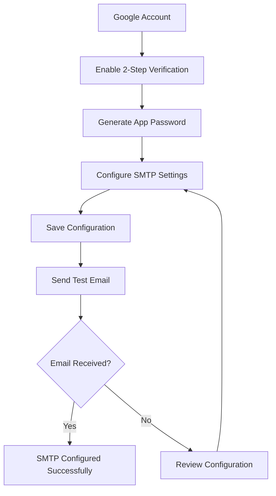

# Configuring Gmail SMTP for Testing

This guide explains how to configure a Gmail account as the SMTP server for sending emails from W4H. Gmail SMTP is recommended for **development and testing** purposes only. For **production** environments, use your institution’s email service or a dedicated SMTP provider (such as SendGrid, Amazon SES, or Mailgun) to ensure reliable email delivery and compliance with organizational policies.

---

## Prerequisites

Before configuring Gmail SMTP, ensure that:

- You have a Gmail account.
- **2-Step Verification** is enabled on your Google account.
- You have generated a **Google App Password**.

> **Note**
>
> Google no longer allows authentication using your regular Gmail password for SMTP. You must use an **App Password**.

---

## Step 1 – Enable 2-Step Verification

1. Sign in to your Google account.
2. Navigate to **Security**.
3. Under **Signing in to Google**, enable **2-Step Verification**.

You can also visit:

[https://myaccount.google.com/security](https://myaccount.google.com/security)

---

## Step 2 – Generate an App Password

1. Go to:

   https://myaccount.google.com/apppasswords

2. Select:

   - **App:** Mail
   - **Device:** Other (Custom Name)

3. Enter a name such as:

   ```
   W4H SMTP
   ```

4. Click **Generate**.

5. Copy the generated **16-character App Password**.

Example:

```
abcd efgh ijkl mnop
```

> **Important**
>
> This password is shown only once. Store it securely.

---

# SMTP Configuration

Open **Administration → Mail Server** and configure the following fields.

| Field | Value |
|--------|-------|
| SMTP Host | `smtp.gmail.com` |
| Port | `587` |
| Username | Your Gmail address |
| Password | Google App Password |
| From | `Your Name <your@gmail.com>` |
| Reply-To | Optional |
| Use SSL/TLS (SMTPS) | **Disabled** |

---

## Recommended Configuration (STARTTLS)

```text
SMTP Host : smtp.gmail.com
Port      : 587
Username  : your@gmail.com
Password  : <Google App Password>

SSL/TLS   : Disabled
STARTTLS  : Enabled automatically by SMTP client
```

Port **587** uses **STARTTLS**, which upgrades the connection to TLS after connecting.

---

## Alternative Configuration (SMTPS)

If your SMTP client supports implicit SSL:

| Field | Value |
|--------|-------|
| SMTP Host | `smtp.gmail.com` |
| Port | `465` |
| Use SSL/TLS (SMTPS) | Enabled |

Configuration:

```text
SMTP Host : smtp.gmail.com
Port      : 465
SSL/TLS   : Enabled
```

---

# Example Configuration

| Setting | Example |
|---------|---------|
| SMTP Host | smtp.gmail.com |
| Port | 587 |
| Username | john.doe@gmail.com |
| Password | Google App Password |
| From | John Doe \<john.doe@gmail.com\> |
| Reply-To | john.doe@gmail.com |

---

# Sending a Test Email

1. Save the SMTP configuration.
2. Enter a recipient email address in **Test Recipient**.
3. Click **Send Test Email**.
4. Verify that the email is received.

---

# Configuration Flow



---

# Troubleshooting

## Authentication Failed

**Error**

```
Username and Password not accepted
```

**Possible causes**

- Using your Gmail account password instead of an App Password.
- 2-Step Verification is not enabled.
- Incorrect App Password.
- Incorrect Gmail username.

---

## Unable to Connect

Possible causes:

- Firewall blocking outbound SMTP traffic.
- Port 587 or 465 is blocked.
- Network proxy restrictions.

Verify that your server can reach:

```
smtp.gmail.com
```

---

## TLS/SSL Errors

Ensure that:

- Port **587** is used with **STARTTLS**.
- Port **465** is used with **SSL/TLS**.

Do not enable SSL/TLS when using port **587** unless your SMTP client explicitly expects it.

---

## Test Email Not Received

Check:

- Spam or Junk folder.
- Recipient email address.
- SMTP logs.
- Google Account security notifications.

---

# Security Considerations

- Never use your personal Gmail password.
- Always use a Google App Password.
- Store SMTP credentials securely.
- Do not commit SMTP credentials to source control.

---

# Production Recommendation

While Gmail SMTP works well for development and testing, Google enforces sending limits and is not intended for production applications.

For production deployments, consider:

- SendGrid
- Amazon SES
- Mailgun
- Microsoft 365 SMTP
- Organization SMTP Server

These services provide higher sending limits, improved deliverability, monitoring, and support for production workloads.