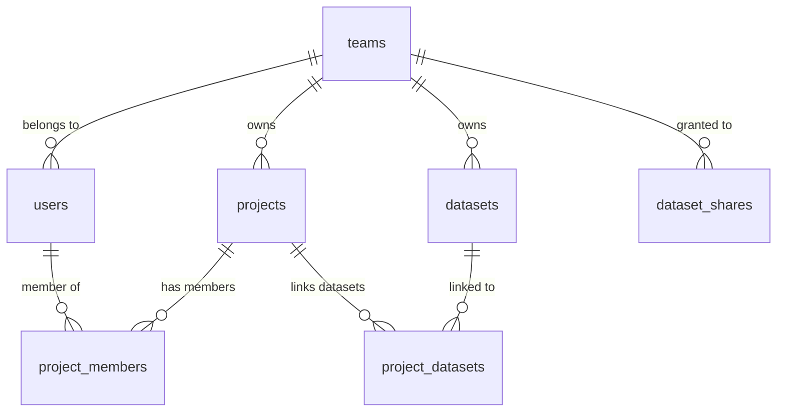

# Multi-Tenancy Architecture Plan for W4H Toolkit

To evolve the W4H platform into a secure, scalable multi-tenant system, we need to implement **Logical Data Isolation** using PostgreSQL **Row-Level Security (RLS)** or query-level scoping, and define a permission model for cross-team sharing.

Here is the proposed architectural plan across the database, backend, and frontend.

---

## 1. Database Schema Extensions

To introduce teams, scope existing tables, and support cross-team dataset sharing, we introduce a `teams` table and update the schema as follows:



### SQL Schema Migrations

```sql
BEGIN;

-- 1. Create the Teams table (The tenant unit)
CREATE TABLE IF NOT EXISTS w4h.teams (
  id uuid PRIMARY KEY DEFAULT gen_random_uuid(),
  slug text UNIQUE NOT NULL, -- e.g. 'cardio-researchers'
  name text NOT NULL,        -- e.g. 'Cardiology Research Group'
  created_at timestamp without time zone NOT NULL DEFAULT CURRENT_TIMESTAMP,
  updated_at timestamp without time zone NOT NULL DEFAULT CURRENT_TIMESTAMP
);

-- 2. Associate Users with a Team
-- Note: System/Super-admins can have team_id = NULL to act as cross-team global administrators
ALTER TABLE w4h.users 
  ADD COLUMN IF NOT EXISTS team_id uuid REFERENCES w4h.teams(id) ON DELETE RESTRICT;

-- 3. Scope Projects to a Team
ALTER TABLE w4h.projects 
  ADD COLUMN IF NOT EXISTS team_id uuid REFERENCES w4h.teams(id) ON DELETE CASCADE;

-- 4. Scope Datasets to an Owner Team
ALTER TABLE w4h.datasets 
  ADD COLUMN IF NOT EXISTS team_id uuid REFERENCES w4h.teams(id) ON DELETE CASCADE;

-- 5. Create Dataset Shares for Cross-Team Sharing
-- Allows team A to share dataset X with team B (or directly with specific projects)
CREATE TABLE IF NOT EXISTS w4h.dataset_shares (
  id uuid PRIMARY KEY DEFAULT gen_random_uuid(),
  dataset_id text NOT NULL REFERENCES w4h.datasets(id) ON DELETE CASCADE,
  
  -- Target scoping: share with a whole team, or restrict to a specific project
  target_team_id uuid NOT NULL REFERENCES w4h.teams(id) ON DELETE CASCADE,
  target_project_id uuid REFERENCES w4h.projects(id) ON DELETE CASCADE,
  
  access_type text NOT NULL DEFAULT 'read' CHECK (access_type IN ('read', 'read_write')),
  shared_by integer REFERENCES w4h.users(id) ON DELETE SET NULL,
  shared_at timestamp without time zone NOT NULL DEFAULT CURRENT_TIMESTAMP,
  
  CONSTRAINT unique_dataset_team_project_share UNIQUE (dataset_id, target_team_id, target_project_id)
);

CREATE INDEX IF NOT EXISTS idx_dataset_shares_lookup ON w4h.dataset_shares(dataset_id, target_team_id);

COMMIT;
```

---

## 2. Access Control & Visibility Model

To achieve data isolation, we enforce team-based scoping rules:

### A. Projects Visibility
* **Main Admin (Super-Admin):** Can view and manage projects across all teams.
* **Team Admin:** Can view, edit, and create projects scoped to their own `team_id`. They can add users from their own team as project members.
* **Regular Users:** Can only view or edit projects where they are explicitly added in `w4h.project_members`, and the project belongs to their team.

### B. Datasets Sharing & Linking
* **Primary Owner:** Datasets are owned by the team that uploaded/added them (`datasets.team_id`).
* **Intra-Team Linking:** Any project creator/editor within the owning team can link their team's datasets to their projects via `w4h.project_datasets`.
* **Cross-Team Linking (Sharing):**
  1. A team administrator creates an entry in `w4h.dataset_shares` mapping `dataset_id` to a target `target_team_id`.
  2. The target team's admin/project editors can now select and link that shared dataset to their local projects.

---

## 3. Backend Implementation (Express)

We need to capture the user's `team_id` from the JWT/session and inject it into database queries.

### A. Middleware: Extract Team Context
Update the token generation/JWT payload to include `team_id`. Then, standard authentication middleware sets it on the request:

```javascript
// middleware/auth.js
export function authenticateJwt(req, res, next) {
  // ... verify token ...
  req.user = {
    id: decoded.id,
    role: decoded.role,
    team_id: decoded.team_id // uuid or null for super-admins
  };
  next();
}
```

### B. Route Scoping Examples

#### 1. Fetching Projects (Scoped vs Global)
```javascript
// routes/projects.js
async function listProjects(req, res) {
  const { team_id, role } = req.user;

  let sql;
  let params;

  if (role === 'admin' && !team_id) {
    // Super-admin: global access
    sql = `SELECT * FROM w4h.projects ORDER BY name`;
    params = [];
  } else {
    // Team user: projects owned by team OR projects user is a member of
    sql = `
      SELECT DISTINCT p.* 
      FROM w4h.projects p
      LEFT JOIN w4h.project_members pm ON pm.project_id = p.id
      WHERE p.team_id = $1 OR pm.user_id = $2
      ORDER BY p.name
    `;
    params = [team_id, req.user.id];
  }

  const result = await query(sql, params);
  res.json(result.rows);
}
```

#### 2. Fetching Available Datasets (Including Shared ones)
```javascript
// routes/datasets.js
async function listDatasets(req, res) {
  const { team_id, role } = req.user;

  let sql;
  let params;

  if (role === 'admin' && !team_id) {
    sql = `SELECT * FROM w4h.datasets`;
    params = [];
  } else {
    // Return datasets owned by the team OR explicitly shared with the team
    sql = `
      SELECT DISTINCT d.* 
      FROM w4h.datasets d
      LEFT JOIN w4h.dataset_shares ds ON ds.dataset_id = d.id
      WHERE d.team_id = $1 OR ds.target_team_id = $1
    `;
    params = [team_id];
  }

  const result = await query(sql, params);
  res.json(result.rows);
}
```

---

## 4. PostgreSQL Row-Level Security (RLS) alternative
For bulletproof data isolation, PostgreSQL supports native Row-Level Security. This guarantees that developers cannot accidentally leak data across teams via a missing `WHERE team_id = $1` filter.

```sql
-- Enable RLS on core tables
ALTER TABLE w4h.projects ENABLE ROW LEVEL SECURITY;
ALTER TABLE w4h.datasets ENABLE ROW LEVEL SECURITY;

-- Create policy for Projects: 
-- Allow access if the user's session team_id matches the row's team_id, 
-- or if the user is a super-admin (indicated by an empty session variable)
CREATE POLICY project_team_isolation ON w4h.projects
  USING (
    team_id = NULLIF(current_setting('app.current_team_id', true), '')::uuid
    OR current_setting('app.is_super_admin', true) = 'true'
  );
```

On every database transaction/checkout from the pool, you set the context:
```javascript
await client.query("SET LOCAL app.current_tenant_id = $1", [req.user.team_id]);
```

---

## 5. Summary of Recommended Frontend Adjustments (Vue)
1. **User Store:** Update `src/stores/user.js` to parse and save `team_id` from the login payload.
2. **Dataset Selector:** In `ProjectsEdit.vue`, label datasets in the selection list to specify if they are **"Shared from [Team Name]"** or **"Local"** to improve clarity.
3. **Admin Dashboard:** Provide a team management view under `/admin/teams` where Super-Admins can create new teams and inspect cross-team dataset sharing agreements.
