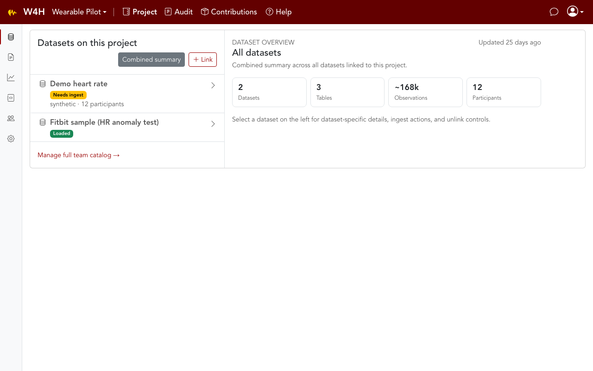

Archive page for **September 2026**. For the latest release, see [What's New](../whats-new.md).

  The <strong>September 2026</strong> update productized M3 analysis in the project workspace:
  in-app import runs, YAML-bound SQL jobs, contribution version pins, and cohort comparison on Analytics.

**Highlights**

- [Run import from the project](#run-import-from-the-project) — pick a runnable contribution and a dataset
- [Update vs full re-import](#update-vs-full-re-import) — append missing rows, or replace with confirmation
- [SQL analytics contributions](#sql-analytics-contributions) — vetted YAML + SQL, not free SQL
- [Contribution version pins](#contribution-version-pins) — Super admin pins a GitHub `v*` tag
- [Analytics cohort comparison](#analytics-cohort-comparison) — selected subjects vs a control group
- [Personal API keys](#personal-api-keys) — issued automatically at bootstrap and invite accept

> Tip: click any image to enlarge it in the docs browser.
>
> **Cursor preview:** use the built-in command **Markdown: Open Preview to the Side** (`Cmd+K` then `V`) — not “Markdown Editor”. Image files are in `../media/whats-new/`.

---

## Run import from the project

Empty (and later, already-loaded) datasets no longer need a laptop CLI for first-party sample importers.

On **Project → Datasets**, select a dataset you manage and click **Run import…**. The dialog lists Super-admin-curated `runnable` contributions and target datasets grouped as **already in this project** vs **from team catalog** (picking a catalog row links it as part of starting the run). The API clones the contribution repo (and its paired sample-data repo) on demand.

*Animation: opening **Run import…** from the project dataset overview.*

Authorization is the existing ingest ACL (team Admin or a project owner of *that team's* dataset). Prefer the contribution's own `run.sh` if you would rather run locally. [ADR-022](../dev/ADR-022-in-app-contribution-run-trigger.md) · [Welcome — Admin](../guide/welcome-admin.md).

---

## Update vs full re-import

**Run import…** is not only for first load.

| Mode | What it does |
|---|---|
| **Update** (default when tables already exist) | Adds missing rows/tables (`--mode append`) |
| **Full re-import** | Truncates and reloads (`--mode replace`) |

A full re-import against a non-empty dataset checks other linked projects and active shares. If either is non-empty, you confirm with a checkbox. Every start writes an audit row (`dataset.import.update` / `dataset.import.full_reimport`). Derived datasets and model runs are not in that dependents list yet.

---

## SQL analytics contributions

Platform METS (and later jobs) run as **YAML-bound SQL** executed by the API (`kind: sql`). You never POST arbitrary SQL.

The first listing is **`w4h-sql-compute-mets`**: bind identifiers from the dataset mapping (`w4h.tables`), then execute. The pandas **`w4h-compute-mets`** notebook stays a separate companion. In-app: **Run analysis…** on Analytics with `{ dataset_id }`. Notebooks: `POST /datasets/:id/contributions/:slug/sql`. [ADR-023](../dev/ADR-023-sql-analytics-contributions.md).

---

## Contribution version pins

Catalog rows store a **version pin** plus last-seen GitHub tag. Super admin **Check for updates** / **Update** on `/admin/contributions` inspects the tag, then pins `repo_ref`. In-app Run checks out that pin. Dirty sibling checkouts on a developer laptop are left as-is. W4H never auto-follows `main`. [ADR-018](../dev/ADR-018-contributions-catalog.md).

---

## Analytics cohort comparison

Filter-based comparison from the ICDE demo is on the project **Analytics** tab: pick subject IDs, a control group (entire dataset, everyone else, or specific IDs), a date range, and optional time-of-day windows.

Results show selected-vs-control KPI deltas, downsampled time series (heart rate includes a control ±2σ band), and comparison bars. This is **not** attribute-matched cohorts, maps, or live streaming. [ADR-021](../dev/ADR-021-cohort-control-group-comparison.md).

---

## Personal API keys

A personal API key is issued automatically when the Super admin account is bootstrapped and when someone accepts an invitation. You still rotate from Profile. Notebooks and CLIs use `W4H_API_KEY` in local `.env` only — never a shared team key.

---

## Also in this release

- **Fetch repo info** on Contributions admin: paste a git URL; the API fills README / `manifest.yaml` fields (errors and warnings, never a hard block on save).
- Dataset overview **stats tiles** (tables, observations, participants) from cached metadata — no live `COUNT(*)` from the browser.
- Wear-compliance and compute-METs notebooks remain first-party Contributions (CLI parity with the Fitbit importer). Cached Analytics cards for those summaries landed in October.
- Agentic tool-loop AI and non-Claude LLM providers are **post-MVP** ([ADR-025](../dev/ADR-025-phi-safe-agent-tools.md), [ADR-026](../dev/ADR-026-multi-provider-llm.md)).

### For developers
Architecture and requirements: [MVP](../dev/mvp.md) and the [ADR index](../dev/ADR-README.md).

---

[← What's New (latest)](../whats-new.md) · [October 2026 (current) →](../whats-new.md) · [← August 2026](2026-08.md)
