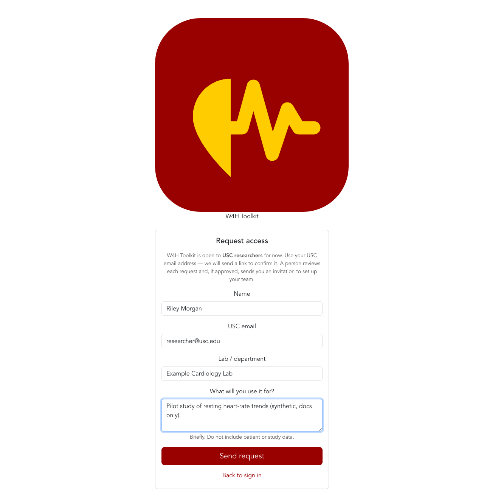
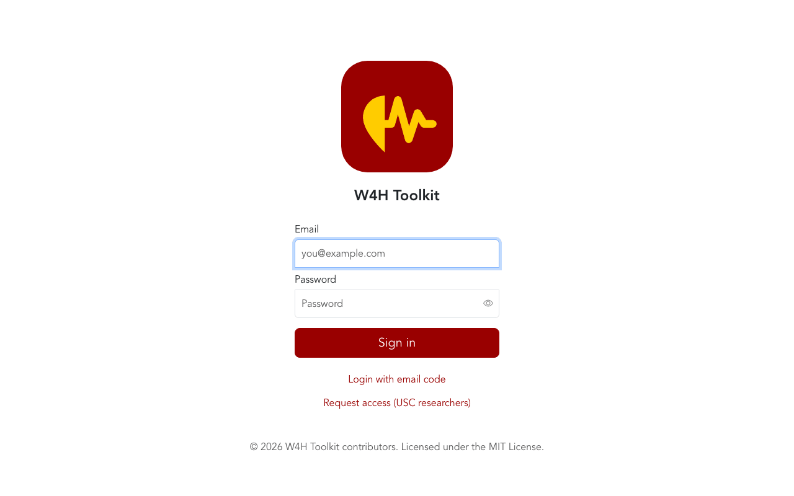
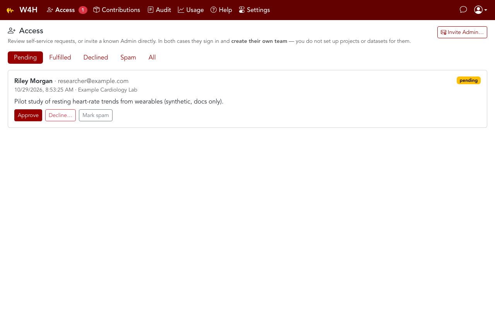
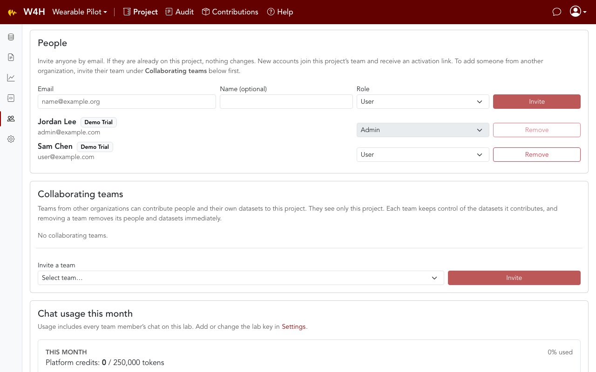
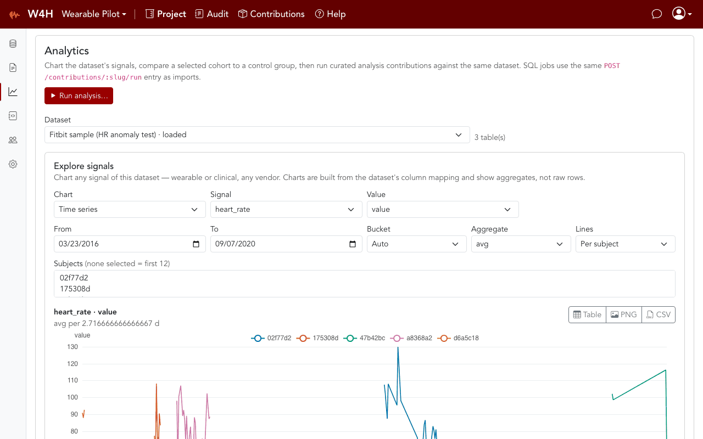
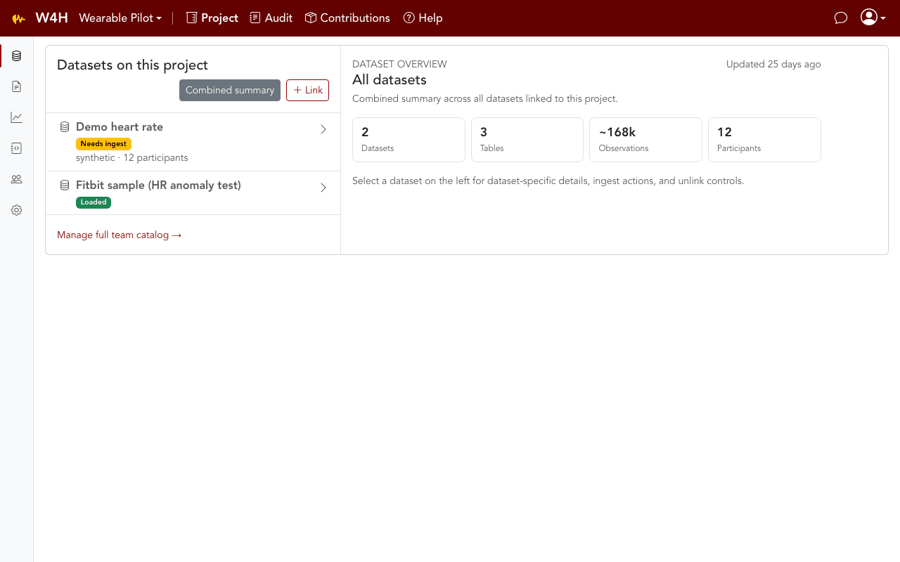
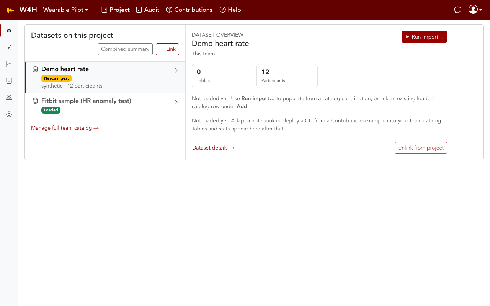
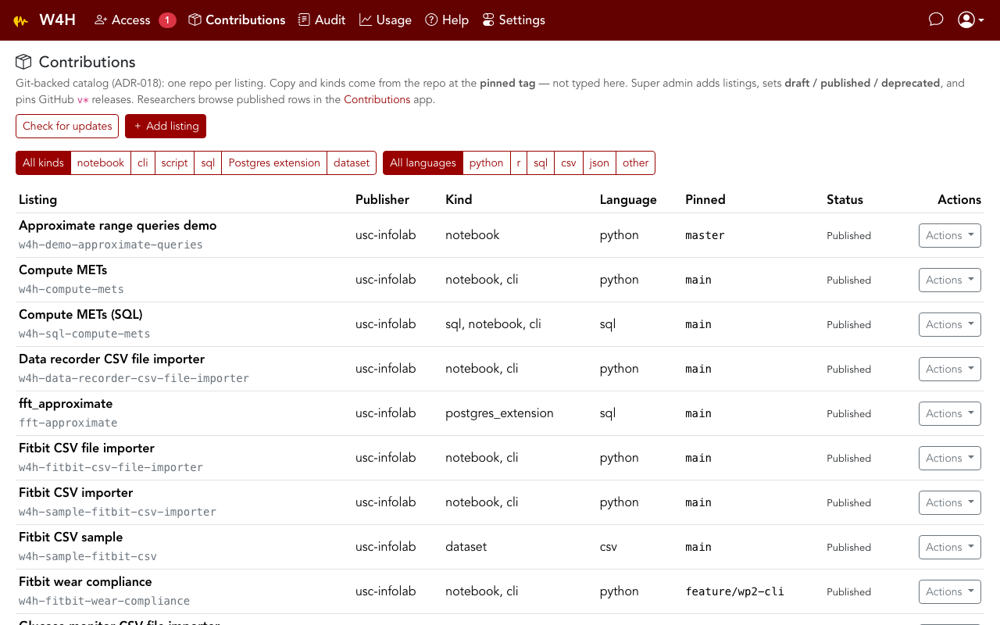

  Welcome to the <strong>October 2026</strong> update of the W4H Toolkit
  (<strong>🧗 Peña Roja 0.3.0</strong> line). App and API share this version.
  Below are the changes you will notice most this month.

**Highlights**

- [Request access](#request-access) — USC researchers apply from the login screen; Super admin only approves
- [Collaborating teams](#collaborating-teams) — one project, several organizations; data follows project membership
- [Charts and published reports](#charts-and-published-reports) — Explore signals on Analytics; sandboxed notebook reports
- [Analytics cohort cards](#analytics-cohort-cards) — wear compliance and METs with Refresh
- [Project workspace rail](#project-workspace-rail) — icon sidebar for Datasets, Documentation, Analytics, and the rest
- [New contributions](#new-contributions) — your-files CSV importers, SQL METs, wear compliance, resting-HR anomaly

> Tip: click any image to enlarge it in the docs browser.
>
> **Cursor preview:** use the built-in command **Markdown: Open Preview to the Side** (`Cmd+K` then `V`) — not “Markdown Editor”. Image files are in `media/whats-new/`.

---

## Request access

New PIs no longer wait for Super admin to invent a team for them.

1. On the login screen, **Request access (USC researchers)**.
2. Confirm the mailbox (allowlisted USC domain).
3. Super admin **Approves** from **Platform Admin → Access** — that sends an **Admin invitation** and creates **no team**.
4. After sign-in the Admin **creates their own team** (`/team/new`; later, account menu → **New team**).

*Animation: login screen, the public request form, then the Super admin **Access** queue with Approve.*

Super admin can also **Invite Admin…** on that page for someone they already know (same invitation, still no team chosen for them). They stay in Platform Admin and do not create projects or ingest study data. [Welcome — Super admin](guide/welcome-super-admin.md) · [ADR-028](dev/ADR-028-platform-access-requests.md).

---

## Collaborating teams

A project still has one **owning team**. It may also list **collaborating teams** from other organizations.

- The owner invites a team; that team's Admin accepts (per project — there is no standing org-to-org agreement).
- Collaborators join as **User** only. Project Admin stays with the owning team.
- Each team links and controls **its own** datasets. Removing a team removes its people and its datasets immediately.
- **Dataset data follows project membership.** Being on a team is not enough to read tables. A team member who is not on the project sees Datasets and People only.

On **Project → People**, home-team badges mark collaborators. Invite another organization under **Collaborating teams**. [ADR-027](dev/ADR-027-cross-org-project-collaboration.md).

---

## Charts and published reports

**Project → Analytics → Explore signals** charts any loaded dataset from its GeoMTS mapping — not from a vendor name. Time series, distribution, coverage heatmap, scatter, and events. PNG and CSV export sit on each chart. Times stay wall-clock as stored.

For edge cases the component cannot draw, an Admin **Publish a report…** (HTML from a notebook, only datasets their own team owns). Reports render in a sandboxed iframe. [Charts and Reports](guide/charts-and-reports.md) · [ADR-029](dev/ADR-029-visualization-component-and-reports.md).

*Animation: opening Analytics and the signal explorer on a project dataset.*

---

## Analytics cohort cards

Wear-compliance and METs summaries are cached on the dataset and shown as cohort cards. Admins **Refresh** (optional wear protocol); a successful in-app contribution run refreshes them too. Filter by subject when you need a subset. These numbers are not live full-table scans.

---

## Project workspace rail

The project page uses a compact **activity rail** (like the VS Code sidebar): Datasets, Documentation, Analytics, Jupyter, People, and Settings. Hover an icon for its name. On small screens, **Menu** opens the same list.

*Animation: the project rail switching sections so the content pane stays wide.*

---

## New contributions

Browse **Contributions** in the app (`/contributions`). Super admin curates the listing and pins a GitHub tag. First-party tools added or published this month:

### Import your own CSV files

These are **not** the bundled sample-data pairs. You bring the export; tables go into **your** team's dataset (`table_prefix` keeps vendors from colliding). Notebooks have a file chooser. In-app **Run import…** is enabled when the row is `runnable`.

| Listing | What it imports | In-app Run |
|---|---|---|
| **Fitbit CSV file importer** (`w4h-fitbit-csv-file-importer`) | User-supplied Fitbit account CSVs | **Run import…** |
| **Glucose monitor CSV file importer** (`w4h-glucose-monitor-csv-file-importer`) | Dexcom Clarity and FreeStyle LibreLink headers | **Run import…** |
| **Data recorder CSV file importer** (`w4h-data-recorder-csv-file-importer`) | Empatica E4 Connect (raw, no header) plus headered research CSVs (nurse-stress, GalaxyPPG, pain-prediction merge) | **Run import…** |

Glucose and recorder tests use **synthetic fixtures** that follow public Kaggle column layouts — those downloads are not in git. [Contributions](guide/sample-packages.md).

*Animation: **Run import…** on a project dataset (same dialog for sample importers and file importers).*

### Analysis and models

| Listing | What it does | How you run it |
|---|---|---|
| **Compute METs (SQL)** (`w4h-sql-compute-mets`) | YAML-bound SQL: `mets_computed` from mapped calories + weight | Analytics → **Run analysis…** |
| **Compute METs** (`w4h-compute-mets`) | Pandas companion (same formula family) | Notebook / CLI |
| **Fitbit wear compliance** (`w4h-fitbit-wear-compliance`) | Per-subject wear-time protocol (HR as wear proxy) | Notebook / CLI; Analytics cohort tile uses the same protocol |
| **Approximate range queries demo** (`w4h-demo-approximate-queries`) | Notebook demo of `fft_approximate` | Notebook (install the extension on your database first) |
| **Resting heart-rate anomaly detector** (`w4h-hr-anomaly`) | MVP example model: per-subject resting HR, robust z-score + Isolation Forest; writes `hr_anomaly` | Notebook / CLI (not an in-app importer). Research/demo only, not a diagnostic |

Some repos are still private; README and tag check can fail until they are public or the API has a token. Super admin **Check for updates** pins a `v*` release when one exists.

---

## Also in this release

- Global **`users.role = team_admin`** is gone. Team admin is membership-only (`team_members.role`).
- Docker: **Request access** needs SMTP and `APP_URL` in the API container.

### Docs & Help
- [Welcome — Super admin](guide/welcome-super-admin.md) (approve requests; do not create teams)
- [Welcome — Admin](guide/welcome-admin.md) (create your team, then project → ingest → invite)
- [Charts and Reports](guide/charts-and-reports.md)
- [Contributions](guide/sample-packages.md) (file importers, SQL METs, catalog browse)
- Monthly archive: [September 2026](releases/2026-09.md) · [August 2026](releases/2026-08.md)

### For developers
Architecture and requirements: [MVP](dev/mvp.md) (v0.36) and the [ADR index](dev/ADR-README.md). After deploy, **refresh Help** from Platform Admin so this page is imported.

---

## Previous releases

Older months are archived (same idea as VS Code’s versioned Updates pages) so this page stays focused on the **current** month:

| Release | Notes |
|---|---|
| **October 2026** | This page (access requests, collaborating teams, charts, new contributions) |
| [September 2026](releases/2026-09.md) | Run import, SQL METS jobs, version pins, cohort Analytics |
| [August 2026 — 🧗 Peña Roja 0.3.0](releases/2026-08.md) | PHI-safe chat, Contributions catalog, sample CSV pairs, Docker wizard |
| [July 2026](releases/2026-07.md) | Email code login, Platform Admin setup, discoverable datasets, Usage, audit log |
| [June 2026](releases/2026-06.md) | Projects rename, ACL, notebook keys, email login codes |
| [Earlier 2026](releases/earlier-2026.md) | May Projects hub, March–April auth, initial platform |

Full index: [Release notes archive](releases/archive.md) (under **releases** in the sidebar).
